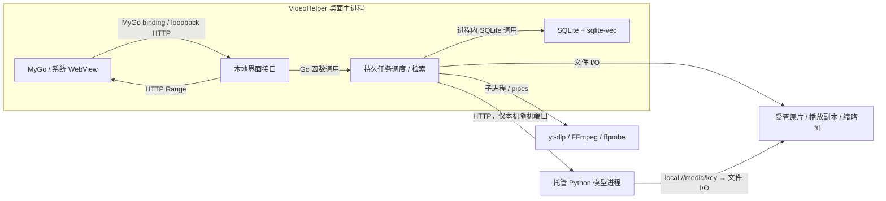

# VideoHelper 桌面版设计

VideoHelper 是个人使用的跨平台视频检索 App，优先交付 macOS。用户导入本地视频或视频链接，用文字搜索画面、转录和声音，点击结果定位播放。`main` 维护桌面应用；此前公开工作台的服务端版本保留在 `cloud` 分支与 Git 历史中。

## 产品边界

- 一个可分发的主二进制。界面与应用代码内置；允许首次运行下载工具、Python 运行环境和模型，释放到私有应用目录。
- 打开即用，没有用户、租户、登录、JWT、后台管理、套餐、计费或按用户限流。
- 项目只是本地视频分组和搜索范围，不是访问权限边界。
- SQLite 是业务状态的唯一来源，sqlite-vec 保存与检索向量，媒体保存在应用管理的本地文件目录。无需 PostgreSQL、Redis、S3 或 Docker。
- 只读输入视频，导入时复制原片。删除应用中的视频不能删除用户原文件。
- 保留已有模型插件与时间轴规则；LLM、Agent、OCR、问答不在此次范围内。

## 桌面体验

MyGo 承载 React / TypeScript / Tailwind 界面，主题集中在 `web/src/index.css`。主窗口直接进入搜索或资料库，不展示营销页和登录页。

品牌资产以 `Design/Icon/` 与 `Design/Kite/` 为准：墨黑 `#0f0e15`、米纸色 `#f3ede2`、播放头红 `#f43d3f`。应用图标使用原始 PNG，界面标志与字标直接使用反白 SVG，不重绘轨道或用实时文字替代字标。正文与标题使用随应用携带的 Instrument Sans，中文回退系统黑体；胶囊按钮、圆角轨道与面板呼应图标。功能图标保留搜索、资料库、导入等语义，统一圆头描边；错误与成功保留可辨认的语义色。运行环境状态、错误与重试在窄窗口下仍可见。

macOS 单文件先在应用数据目录恢复 `.app` 包装，再由 LaunchServices 启动同一主程序，让 Dock、窗口和系统选择器具有完整应用身份。它属于允许释放的组件，不增加分发文件；已经从 `.app` 启动时不重复包装。

窗口先显示，再后台准备运行环境与模型。安装、下载和处理显示真实阶段、设备、错误与重试入口；不能在 UI 线程等待推理。已有资料库在模型准备期间仍可浏览和播放。文件选择使用系统对话框，链接导入使用 yt-dlp。

资料库筛选只更新列表，保留窗口内容和当前导入状态，避免整页重新加载造成黑屏。URL 记录状态与项目，支持返回/前进；读取期间在列表内显示加载状态，不清空整个界面。

全局搜索保留当前项目范围；切换命中更新当前历史条目，刷新恢复选中片段，返回仍回到图库。模型选择至少保留一个有效通道，历史无效配置恢复默认。完成的视频默认收起处理阶段；可搜索能力由已完成的编码与实际音轨决定。取消与失败分开显示，错误先提供可操作的说明，再按需展开原始技术详情。窄窗口收起侧栏并按内容宽度排列播放器与搜索，导航支持 Escape 关闭和焦点归还。

搜索与索引共用本机资源。执行并发服务于内存、显存和交互响应，不模拟服务器的用户配额。模型与工具保持可复用的私有缓存，正常重启不重复下载。

## 进程与存储边界

Python 插件仍在各自模型进程内部通过函数调用执行，不是每个插件增加一个服务。桌面程序负责子进程启动、就绪检测与退出；用户不手工维护模型服务。

同一数据目录只允许一个调度实例。SQLite 中的任务状态持久化，内存通知只用于唤醒。应用退出后重新启动可以恢复未完成工作；取消的任务不能被恢复逻辑重新启动。旧 attempt 的推理结果不能覆盖新任务。

本地接口只绑定 loopback，内部连接凭据由进程自动生成，不形成用户账号体系。媒体接口只访问受管文件，并支持 Range 定位播放；不能接受任意磁盘路径。模型读取 `local://media/<key>` 时检查目录边界和符号链接。

## 模型模块与设备选择

模型通过现有 Python entry point 加载，继续使用 ML 契约中的能力声明、维度、距离类型、批量上限与 fingerprint。Go 编排不绑定模型内部实现。

自动选择顺序是可用的 Apple MPS → 可用的 CUDA → CPU。操作系统和驱动信息只帮助选择待安装环境；最终选择必须在私有 Python 环境执行真实张量运算确认，不能把“发现 GPU 名称”当作推理可用。

不同平台、精度或预处理产生的空间身份不可混用。设备切换后按实际空间和 fingerprint 查询；不兼容的旧索引保留，以便重新索引或切回，不能冒充当前设备的有效索引。UI 显示实际设备与回退原因。

跨平台源代码、依赖可解析、目标机可运行和真实模型验收是不同结论。macOS Apple Silicon 是首要验证目标；其他系统与架构按实际构建和运行证据记录，不以自动选择代码代替验收。

## 视频到检索的流程

1. 本地文件复制到受管目录；链接通过 yt-dlp 下载。临时产物完成并校验后才发布，取消和错误不留下可被处理的半文件。
2. ffprobe 获取时长与流信息；生成适合系统 WebView 播放的副本与缩略图。原片持续保留，ASR 与 CLAP 从原始媒体读取音频。
3. 画面通过 WeMM 编码；ASR 生成带时间戳转录，转录文本通过 WeMM 编码；声音通过 CLAP 编码。
4. 批次输出与进度在同一 SQLite 事务提交。数据库事务不跨越下载、转码或推理调用。
5. 文字查询原样进入模型。sqlite-vec 在视频、项目、时间范围、删除状态与模型身份约束下召回，再沿用时间格子融合和跳转点规则。
6. 返回时间片段、通道证据、转录摘要与缩略图；点击使用 HTTP Range 播放并定位。

时间区间使用左闭右开的整数毫秒。沿用既有默认参数 `k=5`、`rrf_k=60`、`merge_gap_cells=1`、查询权重 `visual:speech:audio=1:1:0`；声音索引保留，显式启用声音召回。不自动翻译查询。旧参数证据见 [Evaluation.md](Evaluation.md)，它不能证明新 SQLite 后端的性能或质量。

## 发布与验证

依赖与工具固定版本并校验内容。主二进制不依赖用户的 shell、系统 Python、全局 FFmpeg 或手工启动的服务；模型权重可在首次使用时下载。解包路径、平台架构和依赖许可随发布包核对。

每个单元验证真正的边界：本地路径与原片保护、SQLite 事务与恢复、向量过滤和模型身份、下载取消、子进程退出、媒体 Range。最终 macOS 验证覆盖启动、导入、真实模型索引、搜索、跳转播放和重启后数据保留。构建通过、假模型测试、一个短视频闭环与检索质量评估分别报告。
