# VideoHelper 设计文档（首版）

> 状态：草案，待评审　｜　更新：2026-10-27
> 配套文档：[实现文档 spec.md](spec.md) · [设计画布](https://claude.ai/artifact/38jtvjPEShFP1fSfD1CKXb)

这份文档回答三个问题：**产品要做什么、要达到什么效果、整体怎么设计**。目录结构、文件职责、表字段、接口字段等细节写在 [spec.md](spec.md)，这里不重复。

标注约定：

- **已定**：用户在讨论中明确拍板。
- **提议**：讨论中提出、用户没有反对，但还没有正式确认。
- **当前 / 已实现**：与本地代码一致；「已定」表示设计决策，不等于已完成。未来流程与部署均单独标注。
- 拿不准的地方统一列在文末「[待确认问题](#12-待确认问题)」，正文不自行敲定。

---

## 当前实施范围（2026-10-27）

本地处理链路为「视频 → 标准化视频 → WeMM 画面编码 / CLAP 声音编码 / ASR → WeMM 转录文本编码 → 文字检索 → 时间片段与证据」。WeMM-Embedding-2B 统一支持视频、文字、图片编码；图片是编码输入，本轮搜索入口只接受文字。保留 `visual`、`speech` 与 `audio` 索引及供 ASR、CLAP 使用的音轨；当前默认查询权重为 `1:1:0`，每路召回 K=5，RRF=60、gap=1，实验依据与回退见 [Evaluation.md](Evaluation.md)。声音通道采用 edit-mind 同款 CLAP HTSAT unfused；查询文字原样传入，英文转换后续再做。LLM/Agent 暂缓；AWS 单用户 CPU Demo 已通过短样本的真实云端验证，自动发布仍等待 CodeBuild 配额，详见 10.2 / 10.3；前端（`web/`）已实现；导入和 Agent 等规划章节仍为后续设计。真实模型验证与显式 fake 的协议/流程测试分开。

本轮提供本地上传、阶段状态/重试、软删除/上传视频恢复、项目范围和文字搜索。进度由 Web 轮询视频详情读取。已就绪视频可自动补建新通道/空间缺失的编码阶段；URL 导入、上传分片续签、SSE 事件、到期 purge、配额计费仍是后续设计；软删除保留原片和处理文件。当前只记录索引时长。操作入口见 [README](../README.md)。

离线评估工具集中在 [Eval](../Eval/README.md)：完整上传/索引验收与固定索引检索回归分开运行，保存数据库和对象快照、逐题结果及对比报告。当前小型合成集的标签尚未独立人工复核；语料校验、真实模型召回质量和系统稳定性验收是不同结论，详见 [基线流程](../Eval/RUNBOOK.md)。

## 目录

1. [产品定位](#1-产品定位)
2. [需求](#2-需求)
3. [设计原则](#3-设计原则)
4. [核心概念](#4-核心概念)
5. [总体架构](#5-总体架构)
6. [核心流程](#6-核心流程)
7. [数据设计概览](#7-数据设计概览)
8. [关键设计决策](#8-关键设计决策)
9. [质量属性](#9-质量属性)
10. [部署视图](#10-部署视图)
11. [风险与验证计划](#11-风险与验证计划)
12. [待确认问题](#12-待确认问题)

---

## 1. 产品定位

**一句话**：把视频交给 VideoHelper，用自然语言描述想找的画面，它返回视频里对应的时间段，点一下就能跳过去看。

| 项目 | 内容 | 状态 |
|---|---|---|
| 首版重点 | 根据描述找到对应画面 | 已定 |
| 产品形态 | SaaS，按工作区隔离数据 | 已定 |
| 交互方式 | 文字搜索（不经过 LLM）；Agent 对话暂缓 | 已定 |
| 视频来源 | 上传文件；导入 YouTube、哔哩哔哩链接（用开源工具 yt-dlp 下载） | 已定 |
| 召回通道 | 画面 `visual`、转录 `speech`、声音 `audio` | 已定 |
| 以后再做 | 章节摘要、OCR | 已定 |
| 以后再做 | 笔记、问答、人物与物体识别（Detection）、跨视频分析 | 提议 |

### 1.1 用户能做什么（首版）

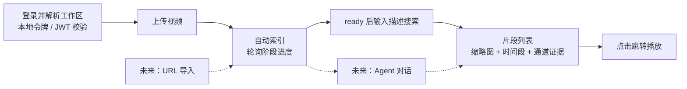

几个典型的查询：

- 「海边有人弹吉他的画面」：主要靠画面通道。
- 「他讲到滚动更新的地方」：主要靠转录通道。
- 「有掌声的片段」：显式启用 audio 查询权重后走 CLAP 声音召回；当前默认 audio=0，不翻译查询，可先使用英文描述验证，中文查询质量另行评估。
- 后续 Agent 场景「张老师在白板前讲 maxSurge」：由 Agent 拆开，「张老师在白板前」交给画面通道，「maxSurge」交给转录通道。

---

## 2. 需求

### 2.1 首版功能需求

下表保留产品目标；「已定」表示需求已确认，具体已实现范围见文首。URL 导入与 Agent 仍暂缓，进度当前使用轮询。

| 编号 | 需求 | 说明 | 状态 |
|---|---|---|---|
| FR-1 | 上传视频文件 | 浏览器分片直传 S3，大文件不经过服务器 | 已定 |
| FR-2 | 导入视频链接 | 首版支持 YouTube、哔哩哔哩链接，用开源工具 yt-dlp 下载；是否同时支持直接的视频文件链接，见[问题 5](#12-待确认问题) | 已定 |
| FR-3 | 自动索引 | 上传后自动生成画面、转录、音频向量和转录文本；前端实时显示进度 | 已定 |
| FR-4 | 搜索框检索 | 输入描述，返回按相关度排序的片段：时间段、跳转点、缩略图、命中了哪几路 | 已定 |
| FR-5 | Agent 对话 | 多轮细化搜索：拆解描述、调整通道权重、必要时看图复核；回答引用具体片段 | 已定 |
| FR-6 | 项目 | 用项目把视频分组；项目是搜索和对话的范围 | 已定 |
| FR-7 | 播放跳转 | 点击片段，播放器跳到对应时间 | 已定 |
| FR-8 | 工作区隔离 | 注册即有个人工作区；工作区之间数据完全隔离 | 已定 |
| FR-9 | 删除视频 | 提供删除接口，采用软删除：视频立刻从列表和搜索里消失，保留期满后再彻底清除文件和数据 | 已定 |
| FR-10 | 失败可见、可重试 | 哪个处理阶段失败、为什么失败都能看到，可以手动重试 | 已定 |

### 2.2 非功能需求

| 编号 | 需求 | 设计上的保证 |
|---|---|---|
| NFR-1 隔离 | 工作区 A 永远看不到工作区 B 的任何数据 | 所有表带 `workspace_id`；所有查询必带；Agent 工具从会话上下文取工作区，不信任模型传入的 id；S3 路径按工作区分前缀 |
| NFR-2 可替换 | 换 embedding 模型、换 LLM 不改 Go 代码 | Go 只认 space 契约；LLM 只认 OpenAI 兼容接口 + 配置 |
| NFR-3 可靠 | 任何一步失败都能重试，重试不产生脏数据 | 阶段状态存在 Postgres；所有写入按主键覆盖；任务 id 去重 |
| NFR-4 公平 | 一个工作区的大批量上传不能堵住其他工作区 | GPU 任务按工作区限并发 |
| NFR-5 成本可控 | GPU、LLM 用量可计量、可限额 | `usage_event` 计量；按套餐配额（额度待定） |
| NFR-6 可观测 | 能看到每个视频处理到哪一步、哪里慢、哪里错 | 阶段状态 + 进度事件 + 结构化日志 |
| NFR-7 性能 | 搜索、索引的速度目标 | 目标值待定，见[问题 2](#12-待确认问题) |

### 2.3 首版不做

| 不做的事 | 原因 | 以后怎么加 |
|---|---|---|
| OCR | 已定首版不跑 | `text_span` 预留 `kind=ocr`，加一个阶段即可 |
| 章节摘要 | 已定以后再做 | 加一个 LLM 阶段和 `chapter` 表 |
| 笔记、问答、跨视频分析 | 首版聚焦找画面 | Agent 加工具；加 `note` 表 |
| 人物 / 物体识别（Detection） | 需要标注界面，涉及人脸隐私合规 | 加 `detection` 表和过滤参数 |
| 以图搜片段 | 首版没有这个需求 | 查询改用图片编码，检索内核不变 |
| 关键词检索 | 已定不做；转录内容靠 speech 通道的语义检索 | 加一个 keyword 通道：`text_span` 上建全文索引，search 多一路召回，融合逻辑不变 |

---

## 3. 设计原则

整个设计从第一性原理出发，用奥卡姆剃刀控制复杂度：每个组件都必须回答「没有它会怎样」，答不上来就不引入。

### 3.1 六条原则

1. **一个事实只存一处。** Postgres 是唯一的真实数据来源。向量、缩略图都是派生数据，丢了可以重建。
2. **Go 编排，Python 计算。** Python 只负责「读媒体 → 跑模型 → 返回结果」，不连数据库、不碰队列、不存业务数据。
3. **只认契约，不认模型。** Go 只知道向量空间（space）的 id、维度和距离算法，代码里不出现任何模型名。
4. **检索内核不依赖 LLM。** 搜索框和 Agent 共用同一个确定性的检索内核，内核可以单独测试、单独调参。
5. **一切以时间为锚。** 所有检索结果、引用、跳转都用（视频, 起点, 终点）表示，和模型、切片方式无关。
6. **先少后多。** 一个 Go 二进制分别启动 api、worker；Python 公共服务按 profile 独立安装依赖并启动进程，共用 ML 契约。当前有 WeMM MPS / CPU、ASR/CLAP CPU 与候选 WeMM CUDA 配置；业务数据仍集中在一个 Postgres、一个 Redis、一个对象存储。

### 3.2 用「变化场景」检验高内聚、低耦合

好的边界意味着：一种变化只落在一个地方。

| 变化 | 需要改的地方 | 不需要改的地方 |
|---|---|---|
| 换或新增 embedding 模型 | 安装实现现有契约的插件包，选择独立运行配置；执行 `videohelper space add` 建索引；`channels.yaml` 加候选 | Go 业务代码、表结构、对外 API |
| 换 LLM，或接入 LLM gateway | 配置里的 `base_url` / 模型名 | 工具、检索、业务代码 |
| 换向量库（pgvector → Qdrant） | Go 的 `index` 包 | 检索算法、流水线编排、API |
| 加新通道（比如 OCR） | 新增产出阶段与证据契约；`channels.yaml` 加一路；模型通过插件提供 | 已有通道的处理阶段 |
| 改切片规则 | Go 的 `timeline` 包 + 切片版本号 + 回填（存量视频重跑的入口首版不做，见问题 25） | 引用、跳转（按时间锚定） |
| 换 ASR 模型 | 安装插件并显式选择转录模型；旧任务仍按冻结的模型 ID 与指纹执行；存量重跑入口另行实现（问题 25） | 已有转录契约、业务代码 |
| 扩容 | 部署配置：按 Go 角色、Python profile 增加副本；控制共享 GPU 资源 | 业务代码 |

---

## 4. 核心概念

| 概念 | 含义 |
|---|---|
| 工作区（Workspace） | 业务数据的归属与访问隔离边界。项目、视频等业务数据都属于一个工作区。首版用户注册即自动创建个人工作区 |
| 项目（project） | 一组视频，是搜索和 Agent 对话的范围（scope） |
| 原片 / 标准化视频（normalized_video） | 原片是用户上传或导入的原始文件；标准化视频由原片转码生成，采用 H.264/AAC、最高 720p、每秒一个关键帧，作为播放和后续音视频处理的统一输入 |
| 媒体预处理（prepare_media） | 生成标准化视频和缩略图的处理阶段：转码、生成缩略图雪碧图，再上传处理结果 |
| 格子（cell） | 画面、音频的切片单位：视频不短于 90 秒时每 2.5 秒一格，短于 90 秒时每 1 秒一格。边界由时长算出，不存储 |
| 句子（sentence） | 转录的切片单位：ASR 输出的一句话，过短的与相邻句合并 |
| 通道（channel） | 一路向量召回：visual（画面）、speech（ASR 转录语义）、audio（环境声音与音乐） |
| 向量空间（space） | 一个模型的一个版本产生的向量空间，如 `wemm-2b@r1`。只有同一空间的向量才能互相比较 |
| active / shadow | 某通道默认查询空间是 active；回填、等待评估的候选空间是 shadow，索引就绪后可被单次请求显式选择 |
| 切片版本（seg） | 切片规则的版本号，如 `grid@v1`、`sentence@v1`。规则一变，版本号就变 |
| 片段（moment） | 返回给用户的结果：同一视频里相邻命中合并后的时间段，带跳转点和证据。查询时计算，不入库 |
| 阶段（stage） | 一个视频要经过的处理步骤，如 probe、prepare_media、asr、`embed:visual:wemm-2b@r1` |

---

## 5. 总体架构

### 5.1 系统上下文（当前）

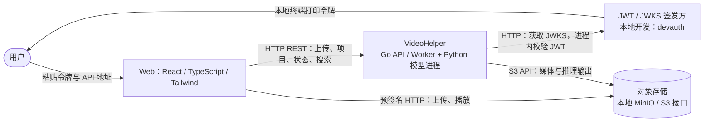

当前 Web 没有获取令牌接口；用户粘贴签发方提供的令牌，本地 `devauth` 只打印令牌并提供 `/jwks`。托管认证供应商仍待定；LLM/Agent、URL 导入和 SSE 不在当前运行链路中，未来流程见第 6 章。

### 5.2 模块与连接（当前）

图中的框明确进程边界：Go 的模型注册表和 `mlclient` 在 api、worker 各自进程内；每个 Python 环境运行一份公共服务，插件在该进程内执行。

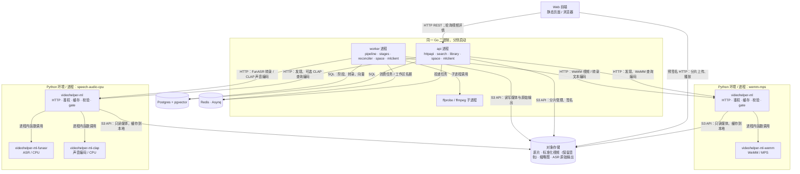

这是按现有 profile 拆分的组合，启动时须把对应地址加入 `ml.endpoints`；兼容依赖也可使用现有组合清单共用环境。候选 `wemm-cuda` 使用独立进程与空间，部署边界见第 10 章。插件加载不增加一跳 HTTP。

### 5.3 模块职责

| 模块 | 当前负责 | 边界 / 后续设计 |
|---|---|---|
| Web 前端 | 登录、上传、项目、阶段轮询、重试、搜索、播放界面 | Agent 对话暂缓；业务校验由 Go 执行 |
| api 进程 | REST、鉴权与工作区识别、项目和媒体管理、搜索、投递初始任务 | 不执行长时媒体处理；SSE、Agent、URL 导入暂缓 |
| worker 进程 | Asynq 消费、阶段依赖、断点重试、补投与 embedding 回填；调用 ffmpeg 和 ML | 不提供对外业务接口；yt-dlp 导入暂缓 |
| search（api 内） | 按范围列出模型与索引状态；校验每路选择 → 查询编码 → 多路召回 → 融合与证据 | 不调用 LLM；不安装插件或自动回填 |
| space / mlclient（各 Go 进程内） | 多端点发现、身份校验、模型 ID 路由、HTTP 契约 | 不加载模型；不提供负载均衡或任意故障转移 |
| 公共 ML 服务 `videohelper-ml` | HTTP、内部鉴权、媒体缓存、输入输出校验、模型注册与并发限制、runtime 诊断 | 不连业务数据库、队列或向量索引 |
| 模型插件安装包 | 权重准备、模型加载、采样与预处理、embed / transcribe | 同 Python 进程内执行，不另设插件 HTTP 服务 |
| Postgres | 业务数据、阶段计划与状态、转录、向量、索引时长计量 | Agent 会话表暂缓 |
| Redis | 队列通知、工作区 ML 任务名额 | 持久阶段状态以 Postgres 为准；进度事件暂缓 |
| 对象存储 | 原片、标准化视频、缩略图、ASR 原始输出与断点文件 | 模型权重当前放 Hugging Face 缓存，未实现 S3 权重发布 |

### 5.4 Go 内部调用边界（当前）

下图是主要调用关系，不是严格的层次依赖图；模块都是进程内 Go 包。api 与 worker 由 `cmd/videohelper` 装配相应服务，文件与接口见 [spec.md 第 2 章](spec.md#2-go-后端)。

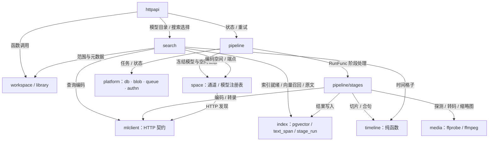

pgvector 查询集中在 `index`，Python HTTP 契约集中在 `mlclient`，切片与合句集中在 `timeline`。`agent`、ADK、`events`、`safehttp` 等属于后续设计，不作为已实现模块绘入。

### 5.5 接口与调用形式

| 接口 | 两端 | 当前形式 | 设计要点 |
|---|---|---|---|
| 对外 API | 浏览器 ↔ httpapi | HTTP REST / JSON；状态轮询 | JWT → workspace_id；大文件走预签名 URL；SSE 暂缓 |
| ML 契约 v1 | Go ↔ 各 Python 服务进程 | HTTP/JSON，推理与发现 | 模型 ID / fingerprint；媒体传 S3 引用和时间段，文字直接传文本 |
| 插件接口 | 公共 ML 服务 ↔ 已安装适配器 | 同进程 Python 函数调用 | entry point + 清单启用；共享输入与结果类型 |
| Agent 工具（未来） | ADK ↔ Go 函数 | 设计为进程内调用 | 范围取自会话；不信任模型传入的 id |

ML 的推理与发现使用三个接口：

| 接口 | 作用 |
|---|---|
| `GET /v1/spaces` | Python 报告加载的向量空间及转录模型（ID、能力、fingerprint；空间另含维度和距离算法） |
| `POST /v1/embed` | 统一的编码接口：`role=query` 编码查询文字，`role=document` 编码视频片段、音频片段或句子 |
| `POST /v1/transcribe` | ASR：返回按句子切好的文本和词级时间戳 |

独立的 `GET /v1/runtime` 报告服务、插件和依赖版本、设备与加载配置，使用同一内部鉴权；不改变上述接口响应。它用于部署检查与人工诊断，Go 的模型发现仍使用 `/v1/spaces`。

ASR 的词和句子保留识别顺序，按起点非递减排列，允许时间范围部分重叠或包含；结束时间不必递增。每个区间仍须有正时长，位于请求音频内，词须落在所属句子内。句子及合并片段取所含内容的最早起点、最晚终点。例如「今天」`[1000,1500)` 与「下雨」`[1450,1900)` 可组成「今天下雨」`[1000,1900)`；不为消除重叠裁词、移时间或丢文字。内部音频切段与最终句子边界分开处理。

字段级定义见 [spec.md 第 4、5、9 章](spec.md#4-对外-api)。

### 5.6 模型插件与运行版本

模型以独立 Python 安装包交付，通用 ML 服务通过 `videohelper.ml.adapters.v1` entry points 加载清单明确启用的适配器。公共服务保留 HTTP、鉴权、媒体缓存、结果校验和并发限制；插件负责权重准备、模型加载、预处理和推理。两者在同一 Python 进程内以函数调用连接，Go 仍直接通过 HTTP 调用该进程。插件不访问业务数据库或任务队列。

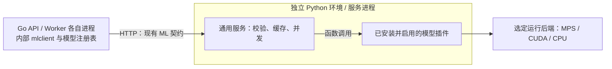

公共服务与三个插件分别由 `ml/pyproject.toml` 和 `ml/plugins/{wemm,funasr,clap}/pyproject.toml` 定义；插件的 `inference` extra 引入模型依赖。每个 profile 自带 `pyproject.toml`、`uv.lock`、`models.yaml`：

| Profile | 模型 / 设备 | 身份与用途 |
|---|---|---|
| `wemm-mps` | WeMM / MPS | `wemm-2b@r1`；video、text、image 文档与 text 查询 |
| `wemm-cpu` | WeMM / CPU float32 | `wemm-2b-cpu@r1`；相同输入能力，独立空间，性能待验收 |
| `speech-audio-cpu` | FunASR + CLAP / CPU | `paraformer-zh@r1` 转录；`clap-htsat-unfused@r1` 声音编码 |
| `wemm-cuda` | WeMM / CUDA | `wemm-2b-cuda-experimental@r1`；独立候选，目标 GPU 验收暂缺 |

架构图中的 WeMM 进程也可选择 `wemm-cpu`，运行于 Mac arm64 或 Linux amd64；仍调用同一个插件。CPU float32 与 MPS float16 的 fingerprint 不同，切换时按新空间回填和验证，不改变其他进程边界。

同一模型的核心代码共用；硬件版本通过独立依赖锁文件、设备与执行配置交付。Mac MPS 原生运行，Linux CUDA 可用容器部署；CUDA 必须经过目标硬件验证。依赖兼容的插件可以共用进程，拆分进程不能替代共享 GPU 的资源限制。WeMM 查询与文档编码继续共用串行闸门；请求超时后，尚未退出的推理仍占用名额。

编码空间身份与运行版本分开：包装代码、安装路径或运行信息的变化不自动改变既有 fingerprint；权重、预处理、精度或输出定义改变时按新空间管理。跨 MPS/CUDA 的索引兼容性须独立验证，未经验证的 CUDA 配置使用独立空间。运行信息通过独立诊断接口提供，不向现有严格校验的编码响应随意增加字段。

内部 ML 契约仅接受 `local://media/<key>` 读取私有媒体根目录，必须显式设置绝对路径 `ML_LOCAL_MEDIA_ROOT`。key 为受限相对路径，拒绝越界、编码路径与符号链接。桌面在托管推理彻底退出前保留输入文件；Python 不复制或驱逐受管媒体，不再支持 S3 下载。

Go 的 `ml.transcriber` 显式选择新任务的 ASR 模型；执行旧任务时按计划中冻结的 ID 与 fingerprint 查找，不能改用新默认模型。多个服务提供相同 ID 时须通过 `ml.model_endpoints` 显式绑定到 `ml.endpoints` 中的服务地址，身份冲突仍拒绝使用；这不提供负载均衡或任意故障转移。

安装依赖、准备权重、启动服务、切换 active、停止服务分别执行。只有验证覆盖率和检索效果后才切换；确认旧任务和回滚窗口结束后才能移除旧服务。停止或卸载插件不删除业务数据与权重缓存。新增 OCR、物体检测或联合音视频输入仍需相应契约、存储和处理阶段，插件化不改变当前三路证据及检索规则。

---

## 6. 核心流程

### 6.1 从上传到可以搜索

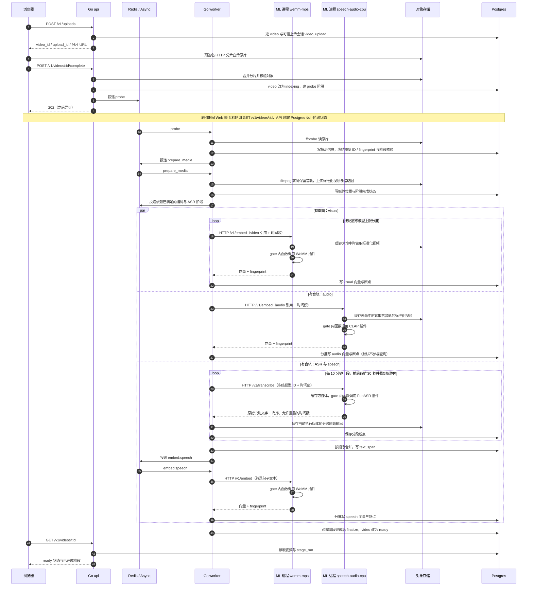

要点：

- 异步边界是上传完成接口返回 202；Web 轮询阶段状态，当前没有 SSE。
- 三路是任务依赖上的独立分支，实际运行受 Go 队列、工作区名额与各模型 gate 限制。图中两种 profile 须分别启动并配置端点。
- 搜索只返回 `ready` 视频；画面编码完成但其他必需阶段未完成时仍不能搜索。`audio=0` 只跳过查询，音轨、ASR 及 audio 索引仍保留。
- URL 导入尚未接入当前流水线，下面是未来设计。

#### 导入 YouTube、哔哩哔哩的视频（未来设计）

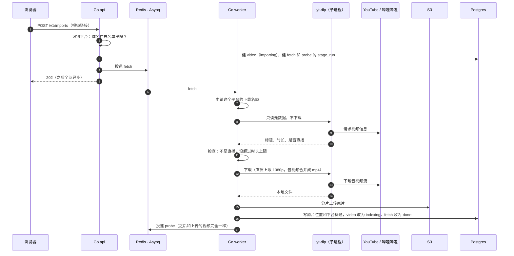

- yt-dlp 是成熟的开源下载工具，和 ffmpeg 一样作为外部命令由 Go worker 调用。它不放进 Python 模型服务，因为 Python 只负责模型推理。
- 下载前先读元数据：直播、超过时长上限、私密、地区限制、需要登录的视频，都在下载前就失败，并把原因告诉用户。
- 每个平台限制同时下载的数量，避免被平台限流或封禁出口 IP。

### 6.2 处理阶段的依赖关系

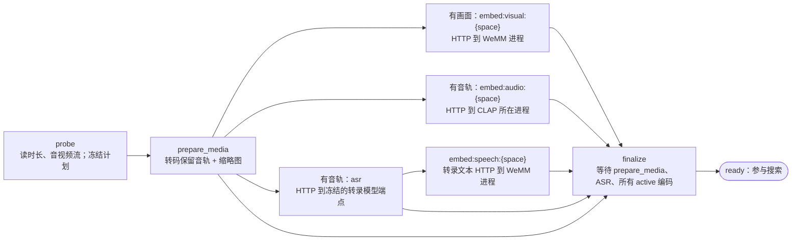

- 上传初始只建 probe。probe 完成时按音视频流与 channels 配置生成后续阶段：无音轨不建 ASR、speech、audio，无画面不建 visual。
- 每个 active / shadow 空间各有 embed 阶段；图中嵌入分支只有 active 是必需依赖，shadow 不阻塞 finalize。计划冻结空间元数据、ASR 模型 ID / fingerprint 与 required 标记，之后改默认配置不改写旧计划。
- `cpu` 队列跑 probe、prepare_media、finalize；`gpu` / `gpu_low` 队列跑模型阶段。队列名表示调度分类，ASR、CLAP 在当前 profile 中实际用 CPU。

### 6.3 一个任务是怎么被消费的

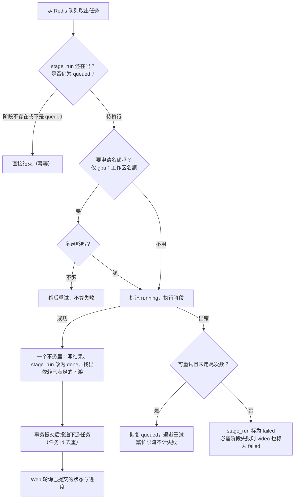

`gpu_low` 回填不申请工作区名额；它与 `gpu` 共用 worker 的模型任务并发，并受对应 Python 模型 gate 限制。

另外有一个每 5 分钟跑一次的 **reconciler**，负责四件事：

1. 补投「状态是待执行、但队列里没有对应任务」的阶段，比如投递失败或 Redis 丢了数据。
2. 收回「执行中，但 worker 已经崩溃」的阶段。
3. 修复原片已存在但还未启动 probe 的上传或恢复任务。
4. 发现 channels 配置新增了通道或 active/shadow 空间时，为已就绪且前置阶段完成的视频补建缺失的 embed 阶段。回填走 gpu_low、required=false，保留既有索引和 ready 状态。

Redis 里只放丢了也能重建的东西：任务通知、并发名额。阶段能不能执行、执行完没有，一律以 `stage_run` 为准，Redis 只负责通知，不做判断；以后加缓存、限流也照这个规则。所以 Redis 的数据就算全丢，reconciler 也能把任务补回来。

### 6.4 状态机

视频状态（当前；`deleted` 表示 `deleted_at`，恢复后重走上传或索引路径；到期 purge 暂缓）：

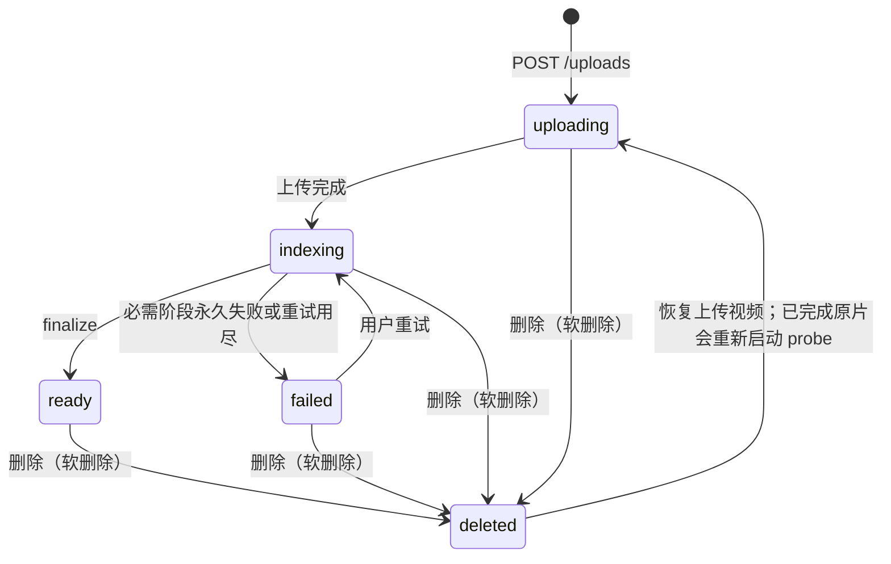

阶段状态（`stage_run.status`）：

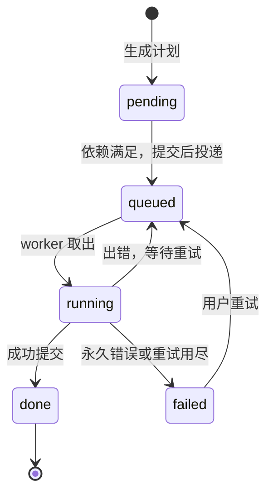

### 6.5 搜索

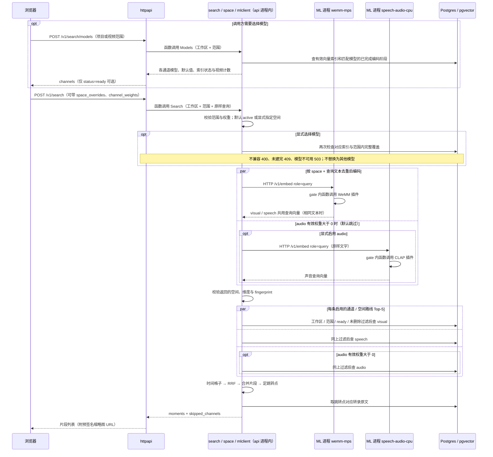

检索算法：

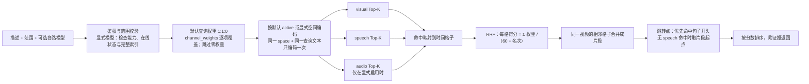

- 画面的命中本身就是格子；转录的命中是句子，**一句话覆盖到的每个格子都记上这句话的名次**。
- RRF 只看名次、不看分值，不同空间的分数不需要互相校准。
- 某一路编码或召回失败时，跳过这一路继续，结果里标明缺了哪一路；全部可用路线失败才报错；这是当前实现。
- 当前真实 WeMM 查询和文档编码共用串行闸门，查询可能等待索引；CLAP 可单独配置查询闸门。排队超时不开始推理；已开始的模型线程在 HTTP 超时后仍占名额直至结束，不能宣称查询与索引已完全隔离。
- 每路取多少名、RRF 常数、权重、合并间隔都是参数，版本与实验记录保存在 [Evaluation.md](Evaluation.md)。`search.channel_weights` 是默认查询乘数，`Query.ChannelWeights` 同名值替换它，再乘 `channels.yaml` 基础权重；省略值按 1 处理。改变查询默认值不重建索引或修改模型。

**按通道选模型的边界**：`POST /v1/search/models` 按当前工作区及请求范围返回可选项；`POST /v1/search` 的 `space_overrides` 为每路指定一个空间，未指定的沿用 active。选项要求支持文字查询，并分别支持 video（visual）、text（speech）、audio（audio）文档输入；视频、声音模型还须能处理 2.5 秒格子。同一个多模态空间可以出现在多路中；ASR 转录模型不在此列表。当前 WeMM 支持视频、文字、图片，不支持声音编码。

安装插件、加载模型和完成索引是三件事。新空间先在 ML 服务加载并被发现，执行 `space add` 建索引，再加入对应通道的 shadow 并重启 worker 回填。目录依据该范围内 ready、未删除且具有对应媒体的视频，检查冻结空间 ID、fingerprint、切片版本匹配的编码阶段是否全部 done；写了一部分向量不算完成，静音 speech 正常完成但没有句子仍算完成。检查以整段视频为单位，不按 `time_range` 放宽；没有适用视频时计数为 0/0，不代表有检索结果。

显式模型未就绪会在编码前拒绝请求，不会自动回退或触发回填；运行中发生故障仍按 `skipped_channels` 报告。选择模型不会开启权重为 0 的声音通道，须同时传 `channel_weights.audio=1`。选择仅对本次请求有效，不改 active、后台索引计划或部署结构。Web 搜索页的「模型」对话框按同一目录逐路选择模型和是否参与搜索；选择保存在当前浏览器，随之后的每次搜索发送，直到恢复默认。

### 6.6 Agent 对话（未来设计，暂缓）

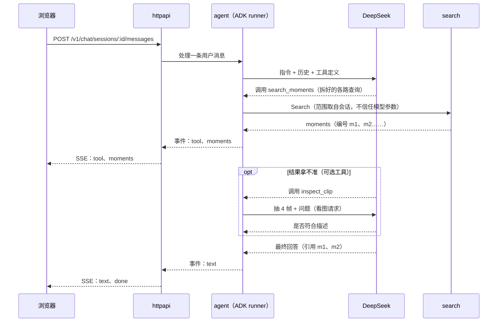

Agent 的价值是**把用户的描述变成更好的检索**：

- 把一句话拆成画面描述、讲到的内容、声音描述，分别填进不同通道。CLAP 的声音描述优先使用英文；这是后续 Agent 的职责，当前普通搜索不翻译查询。
- 根据问题调整通道权重，比如问声音时调高音频权重。
- 多轮细化，比如「只要室外的」「再找几个类似的」。
- 可选：把排名靠前的候选各抽几帧交给 deepseek-flash 看图复核，再重新排序。

### 6.7 换一个 embedding 模型

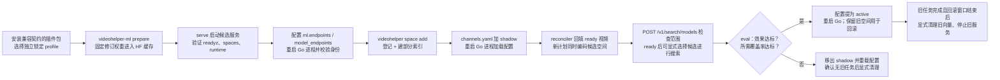

替换现有 embedder 契约不需要改 Go 业务代码；配置由进程启动加载，当前没有热安装、热卸载或配置文件热重载。评估可使用候选空间覆盖；覆盖率和检索效果是不同检查。保留旧索引与服务时，回滚是恢复旧配置并重启。

ASR 不走 embedding 的 active/shadow 切换：`ml.transcriber` 只选择新计划；旧任务按冻结 ID / fingerprint 执行，旧模型不可用时失败而不静默替换。存量转录的批量重跑仍暂缓（问题 25）。新证据类型仍要扩展契约与业务处理。

### 6.8 删除视频（软删除）

1. 用户调用删除接口。一个事务里给视频打上删除时间 `deleted_at`，同时删掉它的向量、转录句子和阶段记录。这些都是派生数据，恢复时可以重建。视频立刻从列表、搜索和 Agent 的范围里消失。
2. 原片、标准化视频和项目关联先保留，所以视频还能恢复。上传视频恢复接口已实现：有完整原片时从 probe 重建索引，未完成上传则回到 uploading。
3. 队列里还没执行完的该视频的任务，执行时找不到阶段记录，直接结束。
4. 未来到期 purge（尚未实现，期限待定）：后台任务先删 S3 上 `workspaces/{工作区}/videos/{视频}/` 下的文件，再删视频记录。

状态图里的 deleted 只是示意。实际上它用 `deleted_at` 字段表示，不是 `status` 的一个取值。

---

## 7. 数据设计概览

### 7.1 数据放在哪

| 数据 | 存放位置 | 能否重建 |
|---|---|---|
| 工作区、用户、项目、视频元数据 | Postgres | 不能（真实数据） |
| 阶段状态 | Postgres `stage_run` | 不能（但可以重跑） |
| 转录句子、词级时间戳 | Postgres `text_span`；原始 ASR 输出另存 S3 | 能（重跑 ASR） |
| 向量 | Postgres `embedding`（pgvector） | 能（重新编码） |
| 原片 | S3 | 不能 |
| 标准化视频、缩略图 | S3 | 能（重新转码） |
| Agent 会话（未来） | 设计为 Postgres（ADK 会话表，未实现） | 不能 |
| 任务队列、工作区并发计数 | Redis | 能（从 `stage_run` 补投） |

### 7.2 实体关系

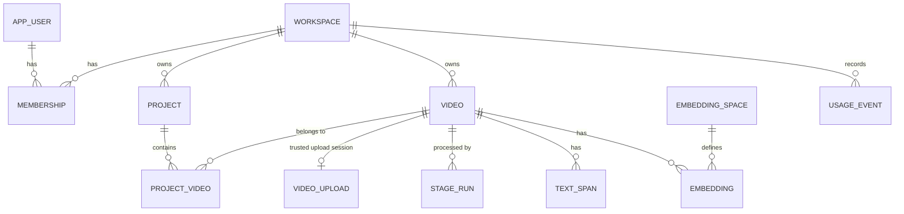

初始迁移 11 张业务表：`workspace`、`app_user`、`membership`、`project`、`project_video`、`video`、`stage_run`、`text_span`、`embedding_space`、`embedding`、`usage_event`；迁移 `0002` 增加可信分片上传会话表 `video_upload`。ADK 会话表暂缓。完整 DDL 见 [spec.md 第 3 章](spec.md#3-数据库)。

刻意不建的表：

| 不建 | 原因 |
|---|---|
| `segment` | 格子边界由视频时长和切片规则算出，存了也是冗余 |
| 切点表 | 固定时长切片用不到；以后改成按镜头切时再加 |
| `chat` | 未来使用 ADK 会话表；当前未实现对话 |
| `chapter`、`note`、`detection` | 对应功能首版不做 |

### 7.3 向量行上只放不变的字段

`embedding` 的一行只放永远不变的定位字段：视频、工作区、通道、空间、切片版本、起止时间。项目归属、标题、人名这类会变的属性放在各自的表里，查询时先筛出 video_id 列表，再进向量查询。原因是：

- 每个视频的向量是「3 个通道 × 每个空间」各一份，属性挂在向量上，改一次就要改很多行。
- edit-mind 正是因为把属性挂在向量上，才不得不专门写 `updateVideoMetadata`、`faceRenaming` 这类任务。

---

## 8. 关键设计决策

| # | 决策 | 状态 | 理由 | 放弃的方案 |
|---|---|---|---|---|
| D1 | Go 做后端与编排，Python 只做推理 | 已定 | 语言各取所长；Python 无状态，容易扩容 | 全 Python；全 TypeScript（edit-mind 的做法） |
| D2 | Agent SDK 用 ADK Go v2（`google.golang.org/adk/v2`） | 已定 | 用户指定；自带会话存储、工具、流式 | 自写 Agent 循环 |
| D3 | LLM 暂定 DeepSeek，走 OpenAI 兼容接口，以后接 gateway | 已定 | 中文好、便宜；deepseek-flash 支持看图；换供应商只改配置 | Gemini（ADK 原生支持最好，但数据出境、可用性另需考虑） |
| D4 | Go 只认 space 契约，模型可随时替换 | 已定 | 用户明确要求解耦；按评估结果换模型 | 按模型写死接口 |
| D5 | 向量库首版用 pgvector，以后视规模再换 | 已定 | 少一个有状态服务；元数据和向量能在一个事务里 | 一开始就上 Qdrant |
| D6 | 画面、音频每 2.5 秒一格（短于 90 秒每 1 秒），转录按句子 | 已定 | 定位精细；句子才有完整语义；边界可计算 | 固定 10 秒；按镜头切 |
| D7 | SaaS，按工作区隔离数据 | 已定 | 产品形态 | 单用户自托管 |
| D8 | 检索内核不调用 LLM，搜索框和 Agent 共用 | 提议 | 快、便宜、可测试；LLM 只负责拆解问题 | 每次搜索都先让 LLM 解析 |
| D9 | 阶段状态存 Postgres，Asynq 只负责投递和重试 | 提议 | Redis 数据丢了也能恢复；状态可查；重试、退避、超时、收回崩溃 worker 的任务、多副本只跑一份的定时任务都是 Asynq 现成的 | 只靠队列；引入 Temporal 等工作流引擎；直接用 `stage_run` 当队列（见问题 24） |
| D10 | 按资源分队列：cpu、gpu，另有放维护任务的 maint、放回填的 gpu_low；GPU 按工作区限并发 | 提议 | 转码不挤占编码；回填不堵新上传；工作区之间公平 | 一个队列 |
| D11 | 不建 segment 表，向量行自带时间段 | 提议 | 召回一张表完成；边界可计算 | 单独的 segment 表 |
| D12 | 转录与 OCR 共用 `text_span` 表（首版只有 speech） | 已定 | 按时间段取原话的查询只写一套；以后加 OCR 零迁移 | 每种文本一张表 |
| D13 | 多种信号不拼进同一个向量 | 提议 | 不互相稀释；换一个模型只重算一路 | edit-mind 的英文模板拼接 |
| D14 | 大文件经预签名 URL 直传 S3 | 提议 | 不占用服务器带宽和内存 | 经 Go 中转 |
| D15 | 首版不做 OCR、章节摘要 | 已定 | 聚焦找画面 | — |
| D16 | 用开源工具 yt-dlp 导入视频，首版支持 YouTube、哔哩哔哩 | 已定 | 成熟、维护活跃，平台改版后跟进快 | 自己写各平台的下载器；付费的第三方下载接口 |
| D17 | yt-dlp 在 Go worker 里作为子进程运行，和 ffmpeg 一样 | 提议 | 下载属于媒体处理，不属于模型推理；Python 服务保持只做推理 | 放进 Python 模型服务；单独做一个下载服务 |
| D18 | ASR 用阿里 FunASR，Go 按 10 分钟分段调用 | 已定 | 中文识别效果好；分段后每次请求时长有上限，失败只重跑一段 | Whisper；整段一次调用 |
| D19 | 删除视频采用软删除 | 已定 | 误删可以恢复；派生数据立即删除，搜索马上看不到 | 立即物理删除 |
| D20 | Demo 前端与 API 同源，经 SSM 访问 | 已定 | 单用户测试不需要公网入口；规模化再拆分 | 独立站点 + ALB |
| D21 | Go 调用 Python 时带服务间共享令牌 | 已定 | 内网隔离之外再加一道防线 | 只靠内网隔离 |
| D22 | Demo 在同一 EC2 运行 Postgres / pgvector | 已定 | 随主机启停；加密磁盘持久化并备份至 S3，后续按可用性需求迁移 RDS | 第一阶段常驻 RDS |
| D23 | 私有 GitHub + CodeConnections + CodeBuild | 已定 | 当前 AWS 项目的 SCP 禁止 IAM OIDC Provider；GitHub Actions 只验证，AWS 构建与发布使用服务角色 | 升级高级功能后重新评估 OIDC |

---

## 9. 质量属性

### 9.1 工作区隔离（三道防线）

1. **数据库**：所有业务表带 `workspace_id`；所有查询函数必须传入工作区，没有「不带工作区的查询」。不开 Postgres 行级安全（已定），靠评审时逐条检查。
2. **Agent**：工具从会话上下文取工作区和范围，模型传入的 video_id 必须在范围内，否则拒绝。
3. **文件**：S3 路径按工作区分前缀；浏览器只拿到短时效的预签名 URL；Python 只有只读权限。

### 9.2 可靠性

- 每个阶段的写入都按主键覆盖，重跑不会产生重复数据。
- 任务 id 由「视频:阶段:版本」生成，重复投递会被去重。
- 编码阶段每写完一批就记录进度，失败后从断点继续，不用从头再跑。
- reconciler 兜底：补投漏掉的任务，收回崩溃 worker 手里的阶段。

### 9.3 公平与成本

- `gpu` 队列任务按工作区限制并发数，超出的任务稍后执行，不算失败。每个工作区的名额须小于 worker 的模型任务总并发；`gpu_low` 不申请该名额。
- 换模型时的成批回填已走 `gpu_low` 队列，调度优先级低于新视频的 `gpu` 任务；两者仍共享模型资源。
- 当前只把索引时长记入 `usage_event`；GPU 时间、LLM token、配额检查与计费属于后续设计。具体额度待定。

### 9.4 安全

- 未来导入链接须防 SSRF（当前未实现导入）：
  - 平台链接只接受白名单里的域名；yt-dlp 只启用 YouTube 和哔哩哔哩的提取器，不启用会访问任意地址的通用提取器。
  - yt-dlp 自己发起网络请求，Go 的防护管不到它，所以 worker 所在网络还要在出口禁止访问内网和云服务器元数据地址（169.254.169.254），作为兜底。
  - 如果支持直链：只允许 http/https；拒绝内网、回环、链路本地地址；跟随重定向时每一跳都重新检查；限制大小和时长。
- Python 服务只在内网可达，不暴露公网；Go 调用它时还要带服务间共享令牌（已定）。
- Demo 通过同一 Nginx 入口访问前端和 API；其他部署可配置允许的前端来源。令牌放在 Authorization 头里，不用 cookie。
- 密钥只放环境变量，不进配置文件和代码仓库。

### 9.5 可观测性

- 用户看得到：视频的阶段状态、进度与失败原因，Web 每 3 秒轮询处理中的视频；SSE 推送暂缓。
- 开发看得到：结构化日志统一带 request_id、workspace_id、video_id、stage、task_id；请求 id 透传到 Python。

---

## 10. 部署视图

### 10.1 本地部署（当前支持的组合）

Docker Compose 启动 Postgres、Redis、MinIO；Go api/worker、Web 开发服务器与 MPS 模型在宿主机运行。各 profile 先安装锁定依赖，再 `prepare` 准备固定修订权重，最后 `serve`；权重缓存与服务媒体缓存分开。下图是按 profile 拆开的配置方式，须显式启动两个服务并填写 `ml.endpoints`，不是自动启动或自动安装。

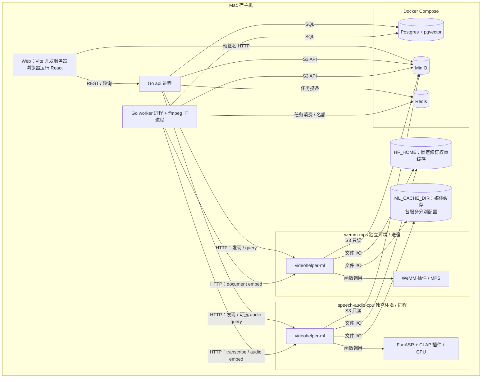

`models.local.yaml` 仍支持兼容插件共用环境的组合；显式 `ML_FAKE=1` 只用于协议和流程测试。`wemm-cuda` 提供 Linux amd64 的锁定配置与 Docker 构建入口，但未经过真实 CUDA 硬件验收，不能据此宣称与 MPS 索引兼容。

### 10.2 AWS 单用户 Demo

部署代码在 `deploy/aws/`；逐步操作、计费与恢复说明见 [部署手册](../deploy/aws/README.md)。已在 Ohio 的 16 GiB CPU 主机上通过六秒样本的真实上传、索引、三通道搜索和分段播放；这是部署链路验证，不代表长视频性能或检索质量验收。CodeBuild 并发配额当前为零，自动发布尚未完成运行验收。

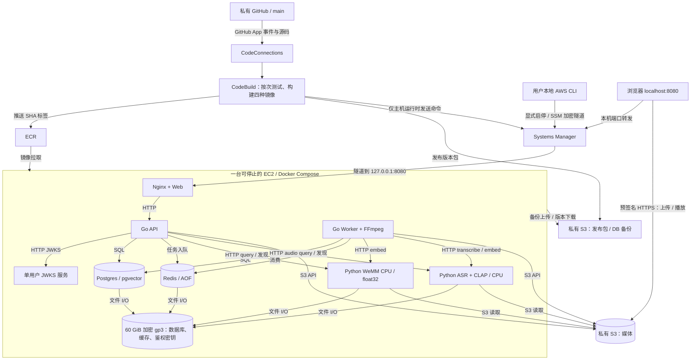

网络无入站规则；动态公网 IPv4 仅供主机主动访问 SSM、镜像和模型源。无需 ALB、NAT Gateway、ECS 集群、RDS 或 ElastiCache。EC2 默认 `r6a.large`（2 vCPU / 16 GiB），不是 GPU；首次并行加载真实模型触发 OOM，因此依次启动 ASR/CLAP、WeMM，并在原有 EBS 内保留 4 GiB 交换空间。交换只缓冲单用户峰值，CPU 推理延迟仍须实测，不足时再评估更大内存或 GPU。AWS 新体验项目目前限定 `us-east-2`，不能直接跨区域创建资源。

### 10.3 发布、停机与数据边界

1. `main` 代码变化触发 CodeBuild；GitHub Actions 只执行检查，不保存 AWS 长期密钥。
2. 构建 Go、Web、WeMM CPU、ASR/CLAP CPU 四个镜像；固定 commit SHA，四个镜像齐全后才更新 S3 的期望版本。
3. 主机停止时只发布；显式 `demo.py start` 才开机并应用期望版本。运行时通过 SSM 发布，不开放 SSH。构建角色没有 EC2 开机权限。
4. 主机先拉镜像，再停止写入、备份数据库、保存旧配置；执行固定权重 `prepare`，随后 `HF_HUB_OFFLINE=1` 启动。迁移与 `space add` 完成后启动 API / Worker / Web。
5. 每次开机两小时后自动停止；显式 Stop 尝试备份与优雅退出，即使备份失败也停止实例控制费用。备份失败必须处理，不能等同于备份成功。

数据库、Redis、鉴权密钥和权重缓存保存在加密 EBS；媒体在私有 S3。停止不删除数据，也不停止存储计费。S3 保留版本，数据库备份保留 30 天（旧版本另受 7 天规则约束）；本地备份需检查磁盘占用。ECR 每类仅保留最近三个推送版本；旧代码回滚需要镜像仍在或重新构建，数据库迁移不自动逆转。2026-10-27 已验证一次停机 / 开机后继续搜索与播放、鉴权公钥不变，并把 S3 备份恢复到隔离数据库核对一条视频与七个阶段；不代表整机丢失后的完整灾难恢复演练。

---

## 11. 风险与验证计划

后续质量与云端验收继续验证以下风险；现有离线评估结果及其局限见文首链接。

| 风险 | 怎么验证 | 不行怎么办 |
|---|---|---|
| WeMM 画面检索效果（1~2.5 秒短片段、中文描述、显存与速度） | 3~5 个真实视频，30~50 条「描述 → 期望时间段」，算 recall@10 | 换模型（契约不变），或调整格子时长 |
| CLAP 音频检索（2.5 秒片段、中文查询） | 同一批视频，用中文和英文的声音描述各查一遍 | 后续在查询编排中处理英文转换；或根据实测调整片段时长 |
| FunASR 的分句与时间戳（ASR 已定用阿里 FunASR） | 抽查句子边界和时间戳准确度 | 调整语音活动检测和标点模型；或换模型，契约不变 |
| DeepSeek + ADK `openaimodel` | 跑通工具调用、流式输出、非思考模式、图片输入 | 图片不行就让 inspect_clip 绕开 ADK 直接调用；工具调用不稳就自己实现 `model.LLM` |
| 按工作区过滤的 HNSW 查询 | 压测：小工作区、大工作区、大量 video_id 过滤 | 小范围直接精确扫描；开 iterative scan；规模大了换 Qdrant |
| 每小时约 3.5k 条向量的存储与编码成本 | 按预期规模估算存储、GPU 时间 | 调整格子时长，或用 halfvec 之外的压缩 |
| YouTube 限制云服务器 IP 下载（要求登录、验证不是机器人） | 在目标部署环境实测一批链接的导入成功率 | 配置平台账号的登录态（cookies）；或换下载出口（需评估合规） |
| 平台改版导致 yt-dlp 暂时失效 | 监控导入成功率 | 固定版本、定期升级；失败时给用户清楚的原因 |
| 哔哩哔哩不登录拿不到高画质 | 实测不登录能拿到的画质 | 首版接受较低画质（反正都会转成标准化视频），或配置账号 |
| 版权与平台服务条款 | 法务评估 | 用户协议写明导入内容的权利由用户负责；导入时让用户确认（见问题 17） |

验证用的「描述 → 期望时间段」标注数据，同时就是评估集的第一版。之后换模型、调参数都靠它。

---

## 12. 待确认问题

请逐条回答，正文会据此更新。编号保持不变，方便对照。

### 12.1 已确认（2026-10-25）

| # | 问题 | 结论 |
|---|---|---|
| 2（部分） | 单个文件的大小上限 | 上传与存储都不设上限 |
| 8（部分） | 删除视频后怎么处理 | 软删除：先从列表和搜索里消失，保留期满后再彻底清除 |
| 11（部分） | 前后端是否同域部署 | 不同域部署 |
| 12 | ASR 模型 | 阿里 FunASR |
| 15 | 平台登录态 | 暂时不带登录态 |
| 21 | pg_search 的许可（AGPL） | 不再适用：不做关键词检索，Postgres 用 RDS，不用 pg_search |

### 12.2 仍待确认

- **1. 目标用户与主要视频类型**：教程、录屏、讲座、生活视频、影视素材，各占多少？这会影响模型选型和格子时长。
- **2. 性能目标**：搜索的 P95 延迟要多少？一小时视频期望多久索引完？预期的工作区数和视频总时长？
- **3. 认证方案**：用哪家托管认证服务？部署在 AWS 上可以用 Cognito。
- **4. 团队功能**：首版要不要支持一个工作区有多个成员？表结构已经支持，问的只是功能做不做。
- **5. 直链**：除了 YouTube 和哔哩哔哩，首版还要不要支持直接指向视频文件的链接（比如 `https://…/talk.mp4`）？
- **6. 配额与套餐**：免费额度多少（每月可索引多少小时、每天多少 LLM token）？超额时怎么处理？
- **7. 数据合规**：工作区的转录和画面帧会发给 DeepSeek，需要怎样的告知和同意？AWS 部署在哪个区域？是否涉及数据出境？
- **8. 数据保留**：软删除的视频保留多久再彻底清除？用户能不能在回收站里自己恢复？没被删除的视频，原片、标准化视频、缩略图、推理原始输出是否也有保留期限？
- **9. inspect_clip（看图复核）**：首版是否启用？它每次调用都有 token 成本。如果启用，帧从哪来：从标准化视频现抽 720p 的帧（看得清，但 api 进程要跑 ffmpeg），还是直接用已有的雪碧图（api 不做任何媒体处理，但只有 320 宽，白板上的字这类细节可能看不清）？
- **10. 评估集**：由谁标注？首批多少条？
- **11. 前端技术栈**：已定（2026-10-26）：React + TypeScript + Tailwind，Vite 构建为静态文件，见 spec 第 16 章。
- **13. 视频语言**：以中文为主吗？需要支持多语言吗？ASR 已定为 FunASR，它以中文为主，如果有英文视频，需要再加一个英文模型。这也影响 CLAP 是否需要翻译。
- **14. 部署预算**：GPU 实例类型和数量、目标月成本。
- **16. 下载上限**：导入视频的画质上限（建议 1080p，反正都会转成标准化视频）、单个视频的时长上限。上传已定不设上限，导入是否也不设？
- **17. 版权与条款**：导入时是否要求用户确认自己拥有内容的使用权？用户协议怎么写？
- **18. 播放列表与分 P**：首版只导入链接指向的单个视频，还是也支持整个播放列表、合集，以及哔哩哔哩的多 P 视频？
- **19. 平台字幕**：YouTube、哔哩哔哩自带的字幕，要不要用来代替或校正 ASR？首版建议统一用自己的 ASR，结果一致、流程简单。
- **20. 数据库高可用**：RDS 要不要开 Multi-AZ？开了会多一台备用实例，主库故障时自动切换，实例费用大约翻倍。自动备份保留几天？
- **22. 基础设施代码的工具**：Terraform 还是 AWS CDK？
- **23. 发布环境**：要不要 staging 环境？生产发布要不要人工审批？
- **24. 任务队列**：首版保留 Redis + Asynq，阶段状态以 `stage_run` 为准（D9、D10，目前是提议），可以改成已定吗？另一个做法是直接用 `stage_run` 当队列（用 `FOR UPDATE SKIP LOCKED` 认领），能少维护一个 Redis，但重试、退避、定时任务都要自己写。按每个视频约 8 个任务估算，首版的任务量很小，两种做法都撑得住。建议先保留；如果以后对账逻辑经常出问题，或者想省掉 Redis 的运维，再回头看。
- **25. 存量视频重跑**：改切片规则或换 ASR 模型后，已经索引好的视频要重跑对应的阶段。首版要不要做这个入口？建议首版不做，正文先标「首版不支持」。以后的做法：给阶段升版本号，reconciler 发现已就绪的视频缺当前版本的阶段就补跑，和换 embedding 模型的回填共用一套机制。
