# VideoHelper 设计文档（首版）

> 状态：草案，待评审　｜　更新：2026-10-25
> 配套文档：[实现文档 spec.md](spec.md) · [设计画布](https://claude.ai/artifact/38jtvjPEShFP1fSfD1CKXb)

这份文档回答三个问题：**产品要做什么、要达到什么效果、整体怎么设计**。目录结构、文件职责、表字段、接口字段等细节写在 [spec.md](spec.md)，这里不重复。

标注约定：

- **已定**：用户在讨论中明确拍板。
- **提议**：讨论中提出、用户没有反对，但还没有正式确认。
- 拿不准的地方统一列在文末「[待确认问题](#12-待确认问题)」，正文不自行敲定。

---

## 当前实施范围（2026-10-25）

先在本地跑通「视频 → 标准化视频 → WeMM 画面编码 + ASR → WeMM 转录文本编码 → 文字检索 → 时间片段与证据」。WeMM-Embedding-2B 统一支持视频、文字、图片编码；图片是编码输入，本轮搜索入口只接受文字。启用 `visual` 与 `speech`，保留音轨供 ASR 使用，不启用声音召回通道 `audio` 或 CLAP。前端、LLM/Agent、AWS 部署与验收暂缓；下文相关章节保留为后续设计，不构成本轮实现要求。真实模型验证与显式 fake 的协议/流程测试分开。

本轮提供本地上传、阶段状态/重试、项目范围和文字搜索。URL 导入、上传分片续签、SSE 事件、存量回填、到期 purge、配额计费和离线质量评估仍是后续设计；软删除保留原片和处理文件。当前只记录索引时长。操作入口见 [README](../README.md)。

## 目录

1. [产品定位](#1-产品定位)
2. [需求](#2-需求)
3. [设计原则](#3-设计原则)
4. [核心概念](#4-核心概念)
5. [总体架构](#5-总体架构)
6. [核心流程](#6-核心流程)
7. [数据设计概览](#7-数据设计概览)
8. [关键设计决策](#8-关键设计决策)
9. [质量属性](#9-质量属性)
10. [部署视图（云端暂缓）](#10-部署视图云端暂缓)
11. [风险与验证计划](#11-风险与验证计划)
12. [待确认问题](#12-待确认问题)

---

## 1. 产品定位

**一句话**：把视频交给 VideoHelper，用自然语言描述想找的画面，它返回视频里对应的时间段，点一下就能跳过去看。

| 项目 | 内容 | 状态 |
|---|---|---|
| 首版重点 | 根据描述找到对应画面 | 已定 |
| 产品形态 | SaaS，按工作区隔离数据 | 已定 |
| 交互方式 | 文字搜索（不经过 LLM）；Agent 对话暂缓 | 已定 |
| 视频来源 | 上传文件；导入 YouTube、哔哩哔哩链接（用开源工具 yt-dlp 下载） | 已定 |
| 召回通道 | 当前启用画面 `visual`、转录 `speech`；声音 `audio` 暂缓 | 已定 |
| 以后再做 | 章节摘要、OCR | 已定 |
| 以后再做 | 笔记、问答、人物与物体识别（Detection）、跨视频分析 | 提议 |

### 1.1 用户能做什么（首版）

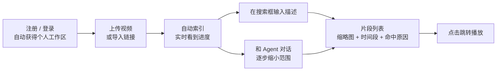

几个典型的查询：

- 「海边有人弹吉他的画面」：主要靠画面通道。
- 「他讲到滚动更新的地方」：主要靠转录通道。
- 「有掌声的片段」：依赖暂缓的声音通道，当前不承诺声音识别。
- 后续 Agent 场景「张老师在白板前讲 maxSurge」：由 Agent 拆开，「张老师在白板前」交给画面通道，「maxSurge」交给转录通道。

---

## 2. 需求

### 2.1 首版功能需求

| 编号 | 需求 | 说明 | 状态 |
|---|---|---|---|
| FR-1 | 上传视频文件 | 浏览器分片直传 S3，大文件不经过服务器 | 已定 |
| FR-2 | 导入视频链接 | 首版支持 YouTube、哔哩哔哩链接，用开源工具 yt-dlp 下载；是否同时支持直接的视频文件链接，见[问题 5](#12-待确认问题) | 已定 |
| FR-3 | 自动索引 | 上传后自动生成画面、转录、音频向量和转录文本；前端实时显示进度 | 已定 |
| FR-4 | 搜索框检索 | 输入描述，返回按相关度排序的片段：时间段、跳转点、缩略图、命中了哪几路 | 已定 |
| FR-5 | Agent 对话 | 多轮细化搜索：拆解描述、调整通道权重、必要时看图复核；回答引用具体片段 | 已定 |
| FR-6 | 项目 | 用项目把视频分组；项目是搜索和对话的范围 | 已定 |
| FR-7 | 播放跳转 | 点击片段，播放器跳到对应时间 | 已定 |
| FR-8 | 工作区隔离 | 注册即有个人工作区；工作区之间数据完全隔离 | 已定 |
| FR-9 | 删除视频 | 提供删除接口，采用软删除：视频立刻从列表和搜索里消失，保留期满后再彻底清除文件和数据 | 已定 |
| FR-10 | 失败可见、可重试 | 哪个处理阶段失败、为什么失败都能看到，可以手动重试 | 已定 |

### 2.2 非功能需求

| 编号 | 需求 | 设计上的保证 |
|---|---|---|
| NFR-1 隔离 | 工作区 A 永远看不到工作区 B 的任何数据 | 所有表带 `workspace_id`；所有查询必带；Agent 工具从会话上下文取工作区，不信任模型传入的 id；S3 路径按工作区分前缀 |
| NFR-2 可替换 | 换 embedding 模型、换 LLM 不改 Go 代码 | Go 只认 space 契约；LLM 只认 OpenAI 兼容接口 + 配置 |
| NFR-3 可靠 | 任何一步失败都能重试，重试不产生脏数据 | 阶段状态存在 Postgres；所有写入按主键覆盖；任务 id 去重 |
| NFR-4 公平 | 一个工作区的大批量上传不能堵住其他工作区 | GPU 任务按工作区限并发 |
| NFR-5 成本可控 | GPU、LLM 用量可计量、可限额 | `usage_event` 计量；按套餐配额（额度待定） |
| NFR-6 可观测 | 能看到每个视频处理到哪一步、哪里慢、哪里错 | 阶段状态 + 进度事件 + 结构化日志 |
| NFR-7 性能 | 搜索、索引的速度目标 | 目标值待定，见[问题 2](#12-待确认问题) |

### 2.3 首版不做

| 不做的事 | 原因 | 以后怎么加 |
|---|---|---|
| OCR | 已定首版不跑 | `text_span` 预留 `kind=ocr`，加一个阶段即可 |
| 章节摘要 | 已定以后再做 | 加一个 LLM 阶段和 `chapter` 表 |
| 笔记、问答、跨视频分析 | 首版聚焦找画面 | Agent 加工具；加 `note` 表 |
| 人物 / 物体识别（Detection） | 需要标注界面，涉及人脸隐私合规 | 加 `detection` 表和过滤参数 |
| 以图搜片段 | 首版没有这个需求 | 查询改用图片编码，检索内核不变 |
| 关键词检索 | 已定不做；转录内容靠 speech 通道的语义检索 | 加一个 keyword 通道：`text_span` 上建全文索引，search 多一路召回，融合逻辑不变 |

---

## 3. 设计原则

整个设计从第一性原理出发，用奥卡姆剃刀控制复杂度：每个组件都必须回答「没有它会怎样」，答不上来就不引入。

### 3.1 六条原则

1. **一个事实只存一处。** Postgres 是唯一的真实数据来源。向量、缩略图都是派生数据，丢了可以重建。
2. **Go 编排，Python 计算。** Python 只负责「读媒体 → 跑模型 → 返回结果」，不连数据库、不碰队列、不存业务数据。
3. **只认契约，不认模型。** Go 只知道向量空间（space）的 id、维度和距离算法，代码里不出现任何模型名。
4. **检索内核不依赖 LLM。** 搜索框和 Agent 共用同一个确定性的检索内核，内核可以单独测试、单独调参。
5. **一切以时间为锚。** 所有检索结果、引用、跳转都用（视频, 起点, 终点）表示，和模型、切片方式无关。
6. **先少后多。** 首版只有一个 Go 二进制（两种进程）、一个 Python 服务、一个 Postgres、一个 Redis、一个 S3。规模到了再拆，拆的时候代码结构不用变。

### 3.2 用「变化场景」检验高内聚、低耦合

好的边界意味着：一种变化只落在一个地方。

| 变化 | 需要改的地方 | 不需要改的地方 |
|---|---|---|
| 换或新增 embedding 模型 | Python 加一个 adapter 和一行 `models.yaml`；执行 `videohelper space add` 建索引（提议）；`channels.yaml` 加候选 | Go 代码、表结构、API |
| 换 LLM，或接入 LLM gateway | 配置里的 `base_url` / 模型名 | 工具、检索、业务代码 |
| 换向量库（pgvector → Qdrant） | Go 的 `index` 包 | 检索算法、流水线编排、API |
| 加新通道（比如 OCR） | 新增一个产出阶段；`channels.yaml` 加一路；需要新模型时 Python 加 adapter | 检索融合、API、其他阶段 |
| 改切片规则 | Go 的 `timeline` 包 + 切片版本号 + 回填（存量视频重跑的入口首版不做，见问题 25） | 引用、跳转（按时间锚定） |
| 换 ASR 模型 | `models.yaml` + 重跑 asr 阶段（重跑的入口首版不做，见问题 25） | 契约、Go 代码 |
| 扩容 | 部署配置：同一镜像多开副本 | 代码 |

---

## 4. 核心概念

| 概念 | 含义 |
|---|---|
| 工作区（Workspace） | 业务数据的归属与访问隔离边界。项目、视频等业务数据都属于一个工作区。首版用户注册即自动创建个人工作区 |
| 项目（project） | 一组视频，是搜索和 Agent 对话的范围（scope） |
| 原片 / 标准化视频（normalized_video） | 原片是用户上传或导入的原始文件；标准化视频由原片转码生成，采用 H.264/AAC、最高 720p、每秒一个关键帧，作为播放和后续音视频处理的统一输入 |
| 媒体预处理（prepare_media） | 生成标准化视频和缩略图的处理阶段：转码、生成缩略图雪碧图，再上传处理结果 |
| 格子（cell） | 画面、音频的切片单位：视频不短于 90 秒时每 2.5 秒一格，短于 90 秒时每 1 秒一格。边界由时长算出，不存储 |
| 句子（sentence） | 转录的切片单位：ASR 输出的一句话，过短的与相邻句合并 |
| 通道（channel） | 一路向量召回：visual（画面）、speech（ASR 转录语义）；audio（声音）暂缓 |
| 向量空间（space） | 一个模型的一个版本产生的向量空间，如 `wemm-2b@r1`。只有同一空间的向量才能互相比较 |
| active / shadow | 某通道当前用于查询的空间是 active；正在回填、等待评估的候选空间是 shadow |
| 切片版本（seg） | 切片规则的版本号，如 `grid@v1`、`sentence@v1`。规则一变，版本号就变 |
| 片段（moment） | 返回给用户的结果：同一视频里相邻命中合并后的时间段，带跳转点和证据。查询时计算，不入库 |
| 阶段（stage） | 一个视频要经过的处理步骤，如 probe、prepare_media、asr、`embed:visual:wemm-2b@r1` |

---

## 5. 总体架构

### 5.1 系统上下文

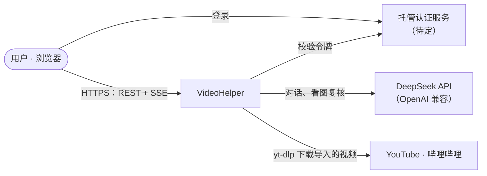

### 5.2 模块与连接

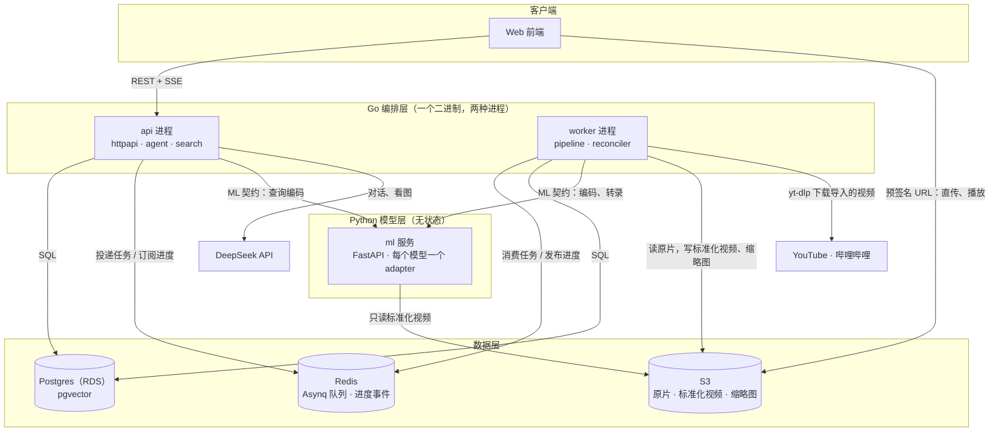

### 5.3 模块职责：负责什么，不负责什么

「不负责」一栏和「负责」一样重要，它划清了边界。

| 模块 | 负责 | 不负责 |
|---|---|---|
| Web 前端 | 上传、搜索、对话、播放的界面 | 任何业务规则 |
| api 进程 | 对外 REST + SSE；鉴权与工作区识别；搜索；Agent 对话 | 转码这类媒体处理、长时间任务（例外：可选工具 inspect_clip 会现抽几帧，见问题 9） |
| worker 进程 | 消费队列；执行处理阶段（包括用 yt-dlp 下载导入的视频）；推进阶段依赖；补投漏掉的任务 | 对外提供接口 |
| search（api 内） | 查询编码 → 多路召回 → 融合 → 合并成片段 | 调用 LLM；理解复杂意图 |
| agent（api 内） | 和 DeepSeek 对话；决定调用哪些工具；组织带引用的回答 | 直接写 SQL（数据都通过 search、index、library 的函数读取，且都带工作区）；越过会话范围 |
| ml 服务 | 读标准化视频、抽帧或取音频、跑模型、返回向量或句子 | 存储任何业务数据；连数据库；碰队列 |
| Postgres | 所有业务数据、阶段状态、转录、向量、Agent 会话 | 文件存储 |
| Redis | 任务队列；进度事件；工作区并发计数 | 任何不能丢的数据（丢了可以从 Postgres 重建） |
| S3 | 原片、标准化视频、缩略图、推理原始输出 | 元数据 |

### 5.4 Go 内部分层

Go 是一个 module，按「能力」分包，只允许上层依赖下层，同层之间不能形成环。每个包的文件清单和接口签名见 [spec.md 第 2 章](spec.md#2-go-后端)。

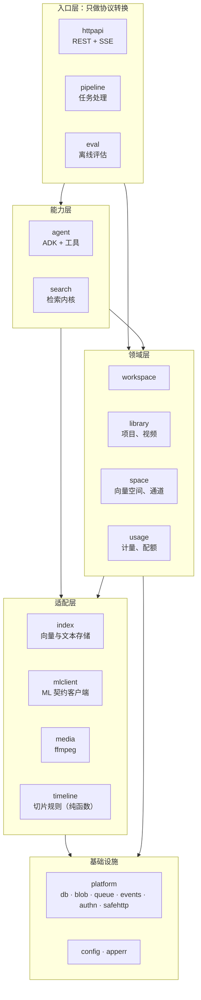

几条关键的依赖规则：

- **所有和 pgvector 相关的 SQL 只放在 `index` 包。** 换向量库时只改这一个包。
- **所有和 ADK 相关的类型只出现在 `agent` 包。** httpapi 只拿到产品自己的事件类型，不引用 ADK。
- **所有调用 Python 的代码只放在 `mlclient` 包。** 契约变了只改这一个包。
- **`timeline` 是纯函数**，不依赖任何东西，可以完整单元测试。

### 5.5 三层接口

| 接口 | 两端 | 形式 | 设计要点 |
|---|---|---|---|
| 对外 API | 浏览器 ↔ httpapi | REST + SSE，JSON | 登录凭证 → workspace_id；大文件走预签名 URL |
| ML 契约 v1 | Go ↔ Python | HTTP/JSON，3 个接口 | 只认 space id；只传 S3 引用和时间段，不传字节 |
| Agent 工具 | ADK ↔ Go 函数 | 进程内调用 | 范围取自会话；不信任模型传入的 id |

ML 契约只有三个接口：

| 接口 | 作用 |
|---|---|
| `GET /v1/spaces` | Python 报告自己加载了哪些向量空间（id、维度、距离算法、接受的输入、fingerprint） |
| `POST /v1/embed` | 统一的编码接口：`role=query` 编码查询文字，`role=document` 编码视频片段、音频片段或句子 |
| `POST /v1/transcribe` | ASR：返回按句子切好的文本和词级时间戳 |

字段级定义见 [spec.md 第 4、5、9 章](spec.md#4-对外-api)。

---

## 6. 核心流程

### 6.1 从上传到可以搜索

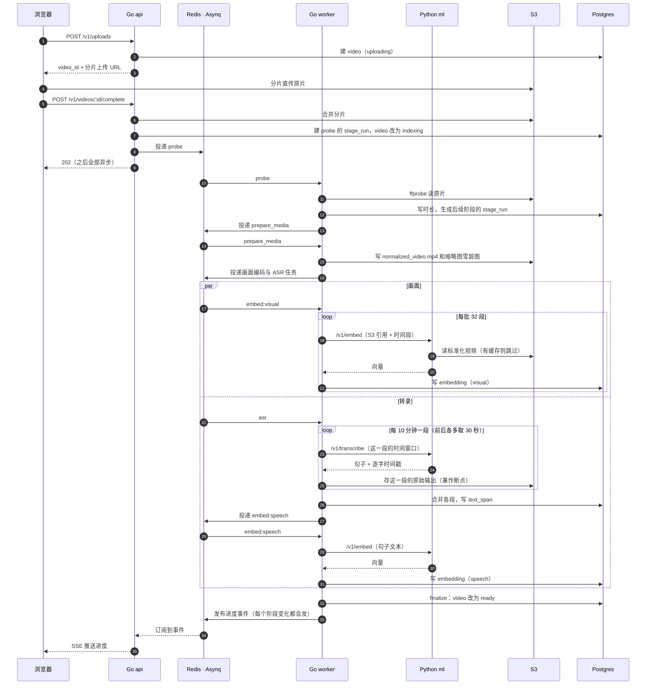

要点：

- 上传接口在第 9 步就返回，之后全部异步，用户通过 SSE 看进度。
- **画面编码一完成就能搜到画面**，不用等转录和音频。
- 导入链接时，第 1~8 步换成下面的导入流程，原片进入 S3 之后就和上传的视频完全一样。

#### 导入 YouTube、哔哩哔哩的视频

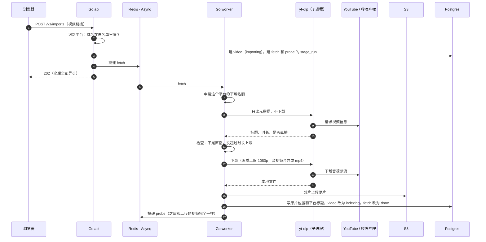

- yt-dlp 是成熟的开源下载工具，和 ffmpeg 一样作为外部命令由 Go worker 调用。它不放进 Python 模型服务，因为 Python 只负责模型推理。
- 下载前先读元数据：直播、超过时长上限、私密、地区限制、需要登录的视频，都在下载前就失败，并把原因告诉用户。
- 每个平台限制同时下载的数量，避免被平台限流或封禁出口 IP。

### 6.2 处理阶段的依赖关系

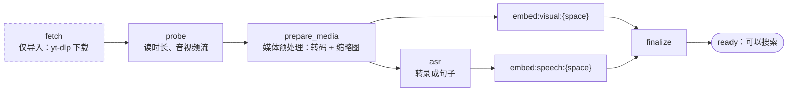

- 只有 probe 之前的阶段在一开始就创建。**probe 完成时**，根据探测结果和 channels 配置生成后续阶段：没有音轨就不建 asr 和 speech 阶段，没有画面就不建画面阶段。
- 每个通道的每个空间（active 和 shadow）各有一个 embed 阶段；**finalize 只等 active 的阶段**，shadow 的回填不影响视频变成 ready。哪些阶段是必需的，在生成计划时就记进 `stage_run`，之后改 channels 配置不影响已经在索引中的视频。
- cpu 阶段（fetch、probe、prepare_media、finalize）由 Go 自己调用外部命令完成（yt-dlp、ffmpeg）；gpu 阶段（asr、embed）由 Go 调用 Python。

### 6.3 一个任务是怎么被消费的

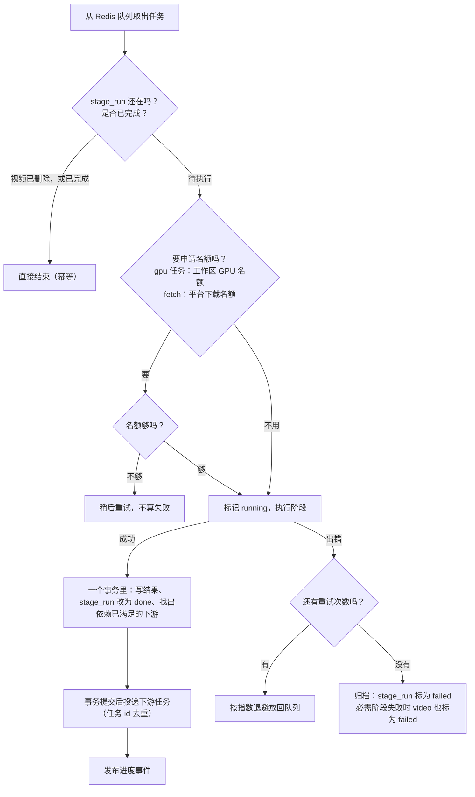

另外有一个每 5 分钟跑一次的 **reconciler**，负责三件事：

1. 补投「状态是待执行、但队列里没有对应任务」的阶段，比如投递失败或 Redis 丢了数据。
2. 收回「执行中，但 worker 已经崩溃」的阶段。
3. 发现 channels 配置里新增了候选空间时，为存量视频补建 embed 阶段，开始回填。

Redis 里只放丢了也能重建的东西：任务通知、并发名额、进度事件。阶段能不能执行、执行完没有，一律以 `stage_run` 为准，Redis 只负责通知，不做判断；以后加缓存、限流也照这个规则。所以 Redis 的数据就算全丢，reconciler 也能把任务补回来。

### 6.4 状态机

视频状态：

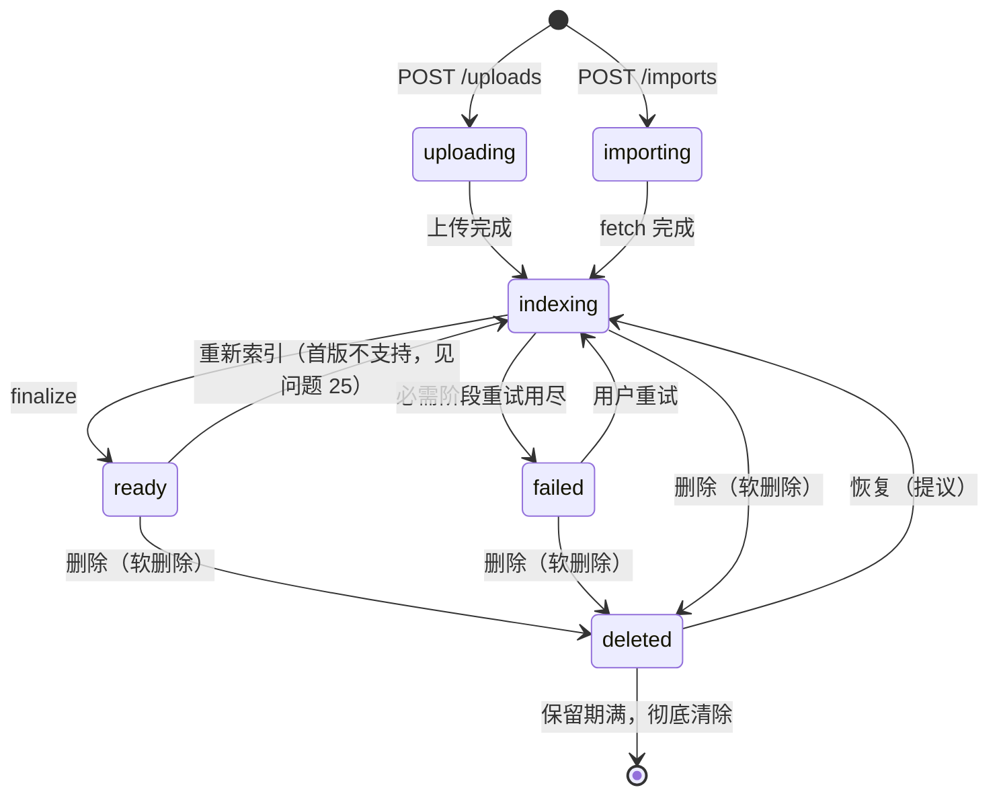

阶段状态（`stage_run.status`）：

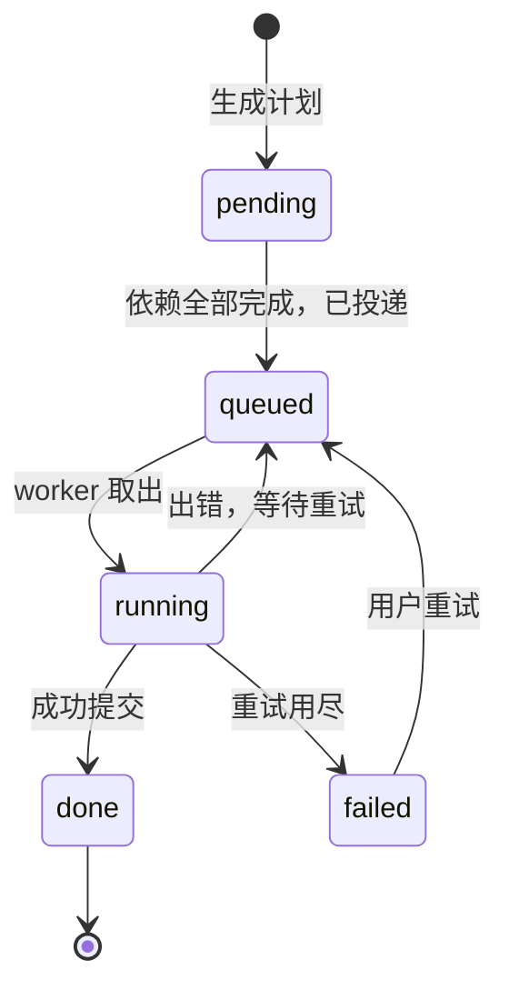

### 6.5 搜索

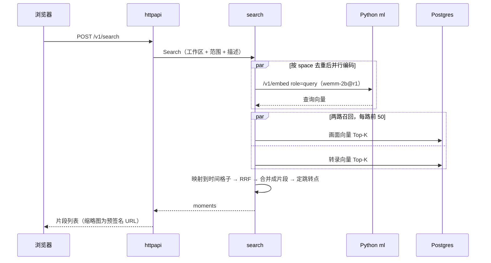

检索算法：

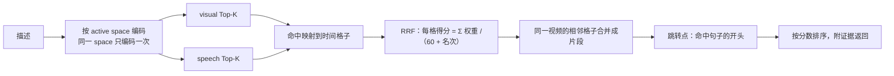

- 画面的命中本身就是格子；转录的命中是句子，**一句话覆盖到的每个格子都记上这句话的名次**。
- RRF 只看名次、不看分值，不同空间的分数不需要互相校准。
- 某一路编码或召回失败时，跳过这一路继续，结果里标明缺了哪一路；所有通道都失败才报错（提议）。
- 搜索不能被索引拖慢：Python 给查询编码单独一个小闸门，不排在批量编码后面；请求带上超时，排队已经超时的请求 Python 不再推理（提议）。
- 每路取多少名、RRF 常数、权重、合并间隔都是参数，要用评估集来调。

### 6.6 Agent 对话（暂缓）

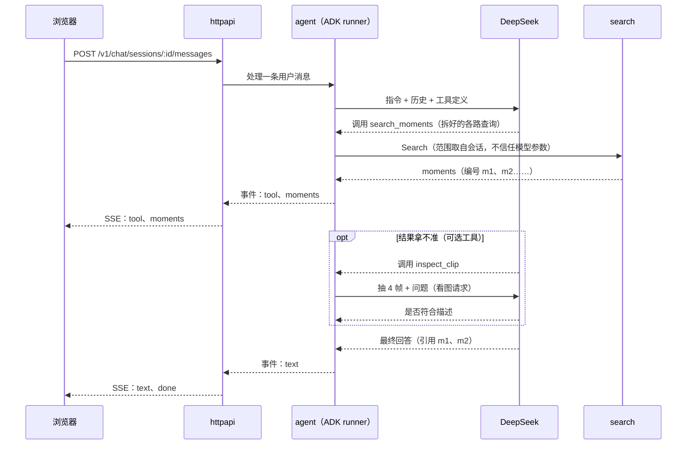

Agent 的价值是**把用户的描述变成更好的检索**：

- 把一句话拆成画面描述、讲到的内容、声音描述，分别填进不同通道。CLAP 只懂英文，所以声音描述要给一句英文。
- 根据问题调整通道权重，比如问声音时调高音频权重。
- 多轮细化，比如「只要室外的」「再找几个类似的」。
- 可选：把排名靠前的候选各抽几帧交给 deepseek-flash 看图复核，再重新排序。

### 6.7 换一个 embedding 模型

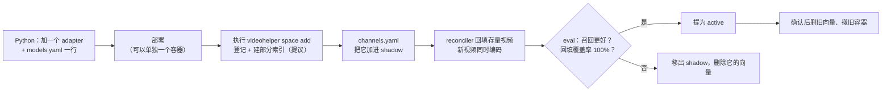

全程不改 Go 代码，也不影响线上查询；回滚就是把配置改回去。

### 6.8 删除视频（软删除）

1. 用户调用删除接口。一个事务里给视频打上删除时间 `deleted_at`，同时删掉它的向量、转录句子和阶段记录。这些都是派生数据，恢复时可以重建。视频立刻从列表、搜索和 Agent 的范围里消失。
2. 原片、标准化视频和项目关联先保留，所以视频还能恢复。恢复接口是提议，恢复后从 probe 重新索引一遍。
3. 队列里还没执行完的该视频的任务，执行时找不到阶段记录，直接结束。
4. 保留期满后（期限待定），后台任务先删 S3 上 `workspaces/{工作区}/videos/{视频}/` 下的文件，再删视频记录。

状态图里的 deleted 只是示意。实际上它用 `deleted_at` 字段表示，不是 `status` 的一个取值。

---

## 7. 数据设计概览

### 7.1 数据放在哪

| 数据 | 存放位置 | 能否重建 |
|---|---|---|
| 工作区、用户、项目、视频元数据 | Postgres | 不能（真实数据） |
| 阶段状态 | Postgres `stage_run` | 不能（但可以重跑） |
| 转录句子、词级时间戳 | Postgres `text_span`；原始 ASR 输出另存 S3 | 能（重跑 ASR） |
| 向量 | Postgres `embedding`（pgvector） | 能（重新编码） |
| 原片 | S3 | 不能 |
| 标准化视频、缩略图 | S3 | 能（重新转码） |
| Agent 会话 | Postgres（ADK 自建的表） | 不能 |
| 任务队列、进度事件、工作区并发计数 | Redis | 能（从 `stage_run` 补投） |

### 7.2 实体关系

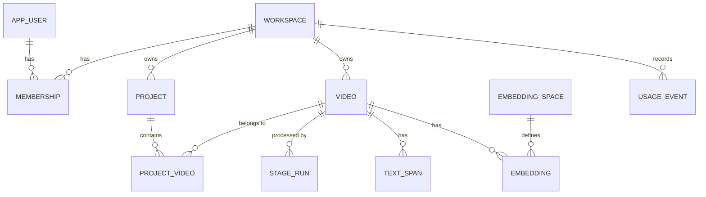

初始迁移 11 张业务表：`workspace`、`app_user`、`membership`、`project`、`project_video`、`video`、`stage_run`、`text_span`、`embedding_space`、`embedding`、`usage_event`；迁移 `0002` 增加可信分片上传会话表 `video_upload`。ADK 会话表暂缓。完整 DDL 见 [spec.md 第 3 章](spec.md#3-数据库)。

刻意不建的表：

| 不建 | 原因 |
|---|---|
| `segment` | 格子边界由视频时长和切片规则算出，存了也是冗余 |
| 切点表 | 固定时长切片用不到；以后改成按镜头切时再加 |
| `chat` | ADK 的会话表已经够用 |
| `chapter`、`note`、`detection` | 对应功能首版不做 |

### 7.3 向量行上只放不变的字段

`embedding` 的一行只放永远不变的定位字段：视频、工作区、通道、空间、切片版本、起止时间。项目归属、标题、人名这类会变的属性放在各自的表里，查询时先筛出 video_id 列表，再进向量查询。原因是：

- 每个视频的向量是「3 个通道 × 每个空间」各一份，属性挂在向量上，改一次就要改很多行。
- edit-mind 正是因为把属性挂在向量上，才不得不专门写 `updateVideoMetadata`、`faceRenaming` 这类任务。

---

## 8. 关键设计决策

| # | 决策 | 状态 | 理由 | 放弃的方案 |
|---|---|---|---|---|
| D1 | Go 做后端与编排，Python 只做推理 | 已定 | 语言各取所长；Python 无状态，容易扩容 | 全 Python；全 TypeScript（edit-mind 的做法） |
| D2 | Agent SDK 用 ADK Go v2（`google.golang.org/adk/v2`） | 已定 | 用户指定；自带会话存储、工具、流式 | 自写 Agent 循环 |
| D3 | LLM 暂定 DeepSeek，走 OpenAI 兼容接口，以后接 gateway | 已定 | 中文好、便宜；deepseek-flash 支持看图；换供应商只改配置 | Gemini（ADK 原生支持最好，但数据出境、可用性另需考虑） |
| D4 | Go 只认 space 契约，模型可随时替换 | 已定 | 用户明确要求解耦；按评估结果换模型 | 按模型写死接口 |
| D5 | 向量库首版用 pgvector，以后视规模再换 | 已定 | 少一个有状态服务；元数据和向量能在一个事务里 | 一开始就上 Qdrant |
| D6 | 画面、音频每 2.5 秒一格（短于 90 秒每 1 秒），转录按句子 | 已定 | 定位精细；句子才有完整语义；边界可计算 | 固定 10 秒；按镜头切 |
| D7 | SaaS，按工作区隔离数据 | 已定 | 产品形态 | 单用户自托管 |
| D8 | 检索内核不调用 LLM，搜索框和 Agent 共用 | 提议 | 快、便宜、可测试；LLM 只负责拆解问题 | 每次搜索都先让 LLM 解析 |
| D9 | 阶段状态存 Postgres，Asynq 只负责投递和重试 | 提议 | Redis 数据丢了也能恢复；状态可查；重试、退避、超时、收回崩溃 worker 的任务、多副本只跑一份的定时任务都是 Asynq 现成的 | 只靠队列；引入 Temporal 等工作流引擎；直接用 `stage_run` 当队列（见问题 24） |
| D10 | 按资源分队列：cpu、gpu，另有放维护任务的 maint、放回填的 gpu_low；GPU 按工作区限并发 | 提议 | 转码不挤占编码；回填不堵新上传；工作区之间公平 | 一个队列 |
| D11 | 不建 segment 表，向量行自带时间段 | 提议 | 召回一张表完成；边界可计算 | 单独的 segment 表 |
| D12 | 转录与 OCR 共用 `text_span` 表（首版只有 speech） | 已定 | 按时间段取原话的查询只写一套；以后加 OCR 零迁移 | 每种文本一张表 |
| D13 | 多种信号不拼进同一个向量 | 提议 | 不互相稀释；换一个模型只重算一路 | edit-mind 的英文模板拼接 |
| D14 | 大文件经预签名 URL 直传 S3 | 提议 | 不占用服务器带宽和内存 | 经 Go 中转 |
| D15 | 首版不做 OCR、章节摘要 | 已定 | 聚焦找画面 | — |
| D16 | 用开源工具 yt-dlp 导入视频，首版支持 YouTube、哔哩哔哩 | 已定 | 成熟、维护活跃，平台改版后跟进快 | 自己写各平台的下载器；付费的第三方下载接口 |
| D17 | yt-dlp 在 Go worker 里作为子进程运行，和 ffmpeg 一样 | 提议 | 下载属于媒体处理，不属于模型推理；Python 服务保持只做推理 | 放进 Python 模型服务；单独做一个下载服务 |
| D18 | ASR 用阿里 FunASR，Go 按 10 分钟分段调用 | 已定 | 中文识别效果好；分段后每次请求时长有上限，失败只重跑一段 | Whisper；整段一次调用 |
| D19 | 删除视频采用软删除 | 已定 | 误删可以恢复；派生数据立即删除，搜索马上看不到 | 立即物理删除 |
| D20 | 前端与 API 不同域部署 | 已定 | 前端可以独立部署和发布 | 同域部署 |
| D21 | Go 调用 Python 时带服务间共享令牌 | 已定 | 内网隔离之外再加一道防线 | 只靠内网隔离 |
| D22 | Postgres 用 AWS RDS 托管，只装 pgvector；不做关键词检索 | 已定 | 不需要关键词检索，也就不需要 pg_search 和分词；备份、补丁、故障恢复交给 AWS | 自建 Postgres（ParadeDB 镜像）+ BM25 关键词检索 |
| D23 | 私有 GitHub 仓库 + GitHub Actions 自动部署到 AWS | 已定 | 常见、成熟；合并即发布，可以回滚 | 手动部署 |

---

## 9. 质量属性

### 9.1 工作区隔离（三道防线）

1. **数据库**：所有业务表带 `workspace_id`；所有查询函数必须传入工作区，没有「不带工作区的查询」。不开 Postgres 行级安全（已定），靠评审时逐条检查。
2. **Agent**：工具从会话上下文取工作区和范围，模型传入的 video_id 必须在范围内，否则拒绝。
3. **文件**：S3 路径按工作区分前缀；浏览器只拿到短时效的预签名 URL；Python 只有只读权限。

### 9.2 可靠性

- 每个阶段的写入都按主键覆盖，重跑不会产生重复数据。
- 任务 id 由「视频:阶段:版本」生成，重复投递会被去重。
- 编码阶段每写完一批就记录进度，失败后从断点继续，不用从头再跑。
- reconciler 兜底：补投漏掉的任务，收回崩溃 worker 手里的阶段。

### 9.3 公平与成本

- GPU 任务按工作区限制并发数，超出的任务稍后执行，不算失败。每个工作区的名额要小于 GPU 总并发，否则一个工作区就能占满。
- 换模型时的成批回填走低优先级队列，不和新视频抢 GPU（提议）。
- 每个工作区的 GPU 时间、LLM token、索引时长都记入 `usage_event`，用于配额检查和以后计费。具体额度待定。

### 9.4 安全

- 导入链接防 SSRF（防止借导入功能访问内网）：
  - 平台链接只接受白名单里的域名；yt-dlp 只启用 YouTube 和哔哩哔哩的提取器，不启用会访问任意地址的通用提取器。
  - yt-dlp 自己发起网络请求，Go 的防护管不到它，所以 worker 所在网络还要在出口禁止访问内网和云服务器元数据地址（169.254.169.254），作为兜底。
  - 如果支持直链：只允许 http/https；拒绝内网、回环、链路本地地址；跟随重定向时每一跳都重新检查；限制大小和时长。
- Python 服务只在内网可达，不暴露公网；Go 调用它时还要带服务间共享令牌（已定）。
- 前端与 API 不同域部署（已定）。API 只允许配置里的前端来源跨域访问；令牌放在 Authorization 头里，不用 cookie。
- 密钥只放环境变量，不进配置文件和代码仓库。

### 9.5 可观测性

- 用户看得到：每个视频的每个阶段状态、失败原因，实时推送。
- 开发看得到：结构化日志统一带 request_id、workspace_id、video_id、stage、task_id；请求 id 透传到 Python。

---

## 10. 部署视图（云端暂缓）

**本地开发**：docker compose 启动 postgres、redis、minio；Go api/worker 和 Python ML 在宿主机运行。本地组合使用 MPS 上的 WeMM 与 CPU 上的 ASR；显式 fake 仅用于协议和流程测试。

**AWS**：代码放在私有 GitHub 仓库，用 GitHub Actions 自动部署（已定）。下图的资源形态是提议：

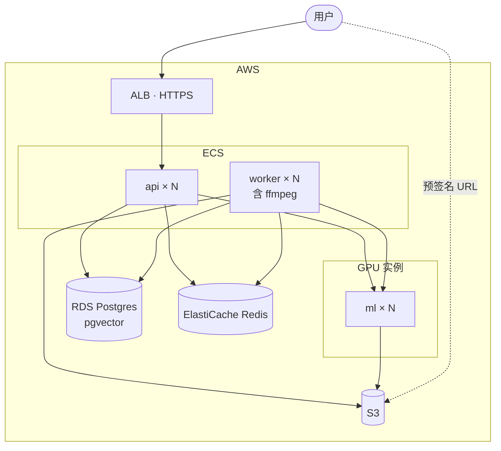

- api、worker 是同一个镜像，用不同子命令启动。
- 前端与 API 不同域部署（已定）。
- ml 可以按模型拆成多组容器，比如候选模型单独一组，评估完就撤。Go 只需要在配置里多写一个地址。
- Postgres 用 AWS RDS 托管（已定），只装 pgvector 扩展；要不要开 Multi-AZ 见问题 20。

**发布流程**（私有 GitHub 仓库 + GitHub Actions，已定）：

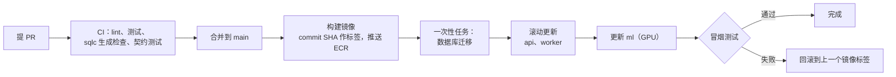

- GitHub 用 OIDC 换取临时凭证来连接 AWS，不保存长期有效的密钥。
- 数据库只由基础设施代码创建一次，部署流程只执行迁移，不会重建它。
- 迁移要向后兼容（表结构先加后删），这样回滚时只需要回滚代码。
- 细节见 [spec.md 14.4 节](spec.md#144-发布流程github-actions)。

---

## 11. 风险与验证计划

正式开发前，先用小实验验证风险最大的四个点。

| 风险 | 怎么验证 | 不行怎么办 |
|---|---|---|
| WeMM 画面检索效果（1~2.5 秒短片段、中文描述、显存与速度） | 3~5 个真实视频，30~50 条「描述 → 期望时间段」，算 recall@10 | 换模型（契约不变），或调整格子时长 |
| CLAP 音频检索（2.5 秒片段、中文查询） | 同一批视频，用中文和英文的声音描述各查一遍 | 在 CLAP adapter 里加翻译；或调整片段时长 |
| FunASR 的分句与时间戳（ASR 已定用阿里 FunASR） | 抽查句子边界和时间戳准确度 | 调整语音活动检测和标点模型；或换模型，契约不变 |
| DeepSeek + ADK `openaimodel` | 跑通工具调用、流式输出、非思考模式、图片输入 | 图片不行就让 inspect_clip 绕开 ADK 直接调用；工具调用不稳就自己实现 `model.LLM` |
| 按工作区过滤的 HNSW 查询 | 压测：小工作区、大工作区、大量 video_id 过滤 | 小范围直接精确扫描；开 iterative scan；规模大了换 Qdrant |
| 每小时约 3.5k 条向量的存储与编码成本 | 按预期规模估算存储、GPU 时间 | 调整格子时长，或用 halfvec 之外的压缩 |
| YouTube 限制云服务器 IP 下载（要求登录、验证不是机器人） | 在目标部署环境实测一批链接的导入成功率 | 配置平台账号的登录态（cookies）；或换下载出口（需评估合规） |
| 平台改版导致 yt-dlp 暂时失效 | 监控导入成功率 | 固定版本、定期升级；失败时给用户清楚的原因 |
| 哔哩哔哩不登录拿不到高画质 | 实测不登录能拿到的画质 | 首版接受较低画质（反正都会转成标准化视频），或配置账号 |
| 版权与平台服务条款 | 法务评估 | 用户协议写明导入内容的权利由用户负责；导入时让用户确认（见问题 17） |

验证用的「描述 → 期望时间段」标注数据，同时就是评估集的第一版。之后换模型、调参数都靠它。

---

## 12. 待确认问题

请逐条回答，正文会据此更新。编号保持不变，方便对照。

### 12.1 已确认（2026-10-25）

| # | 问题 | 结论 |
|---|---|---|
| 2（部分） | 单个文件的大小上限 | 上传与存储都不设上限 |
| 8（部分） | 删除视频后怎么处理 | 软删除：先从列表和搜索里消失，保留期满后再彻底清除 |
| 11（部分） | 前后端是否同域部署 | 不同域部署 |
| 12 | ASR 模型 | 阿里 FunASR |
| 15 | 平台登录态 | 暂时不带登录态 |
| 21 | pg_search 的许可（AGPL） | 不再适用：不做关键词检索，Postgres 用 RDS，不用 pg_search |

### 12.2 仍待确认

- **1. 目标用户与主要视频类型**：教程、录屏、讲座、生活视频、影视素材，各占多少？这会影响模型选型和格子时长。
- **2. 性能目标**：搜索的 P95 延迟要多少？一小时视频期望多久索引完？预期的工作区数和视频总时长？
- **3. 认证方案**：用哪家托管认证服务？部署在 AWS 上可以用 Cognito。
- **4. 团队功能**：首版要不要支持一个工作区有多个成员？表结构已经支持，问的只是功能做不做。
- **5. 直链**：除了 YouTube 和哔哩哔哩，首版还要不要支持直接指向视频文件的链接（比如 `https://…/talk.mp4`）？
- **6. 配额与套餐**：免费额度多少（每月可索引多少小时、每天多少 LLM token）？超额时怎么处理？
- **7. 数据合规**：工作区的转录和画面帧会发给 DeepSeek，需要怎样的告知和同意？AWS 部署在哪个区域？是否涉及数据出境？
- **8. 数据保留**：软删除的视频保留多久再彻底清除？用户能不能在回收站里自己恢复？没被删除的视频，原片、标准化视频、缩略图、推理原始输出是否也有保留期限？
- **9. inspect_clip（看图复核）**：首版是否启用？它每次调用都有 token 成本。如果启用，帧从哪来：从标准化视频现抽 720p 的帧（看得清，但 api 进程要跑 ffmpeg），还是直接用已有的雪碧图（api 不做任何媒体处理，但只有 320 宽，白板上的字这类细节可能看不清）？
- **10. 评估集**：由谁标注？首批多少条？
- **11. 前端技术栈**：React、Next.js 还是其他？
- **13. 视频语言**：以中文为主吗？需要支持多语言吗？ASR 已定为 FunASR，它以中文为主，如果有英文视频，需要再加一个英文模型。这也影响 CLAP 是否需要翻译。
- **14. 部署预算**：GPU 实例类型和数量、目标月成本。
- **16. 下载上限**：导入视频的画质上限（建议 1080p，反正都会转成标准化视频）、单个视频的时长上限。上传已定不设上限，导入是否也不设？
- **17. 版权与条款**：导入时是否要求用户确认自己拥有内容的使用权？用户协议怎么写？
- **18. 播放列表与分 P**：首版只导入链接指向的单个视频，还是也支持整个播放列表、合集，以及哔哩哔哩的多 P 视频？
- **19. 平台字幕**：YouTube、哔哩哔哩自带的字幕，要不要用来代替或校正 ASR？首版建议统一用自己的 ASR，结果一致、流程简单。
- **20. 数据库高可用**：RDS 要不要开 Multi-AZ？开了会多一台备用实例，主库故障时自动切换，实例费用大约翻倍。自动备份保留几天？
- **22. 基础设施代码的工具**：Terraform 还是 AWS CDK？
- **23. 发布环境**：要不要 staging 环境？生产发布要不要人工审批？
- **24. 任务队列**：首版保留 Redis + Asynq，阶段状态以 `stage_run` 为准（D9、D10，目前是提议），可以改成已定吗？另一个做法是直接用 `stage_run` 当队列（用 `FOR UPDATE SKIP LOCKED` 认领），能少维护一个 Redis，但重试、退避、定时任务都要自己写。按每个视频约 8 个任务估算，首版的任务量很小，两种做法都撑得住。建议先保留；如果以后对账逻辑经常出问题，或者想省掉 Redis 的运维，再回头看。
- **25. 存量视频重跑**：改切片规则或换 ASR 模型后，已经索引好的视频要重跑对应的阶段。首版要不要做这个入口？建议首版不做，正文先标「首版不支持」。以后的做法：给阶段升版本号，reconciler 发现已就绪的视频缺当前版本的阶段就补跑，和换 embedding 模型的回填共用一套机制。
