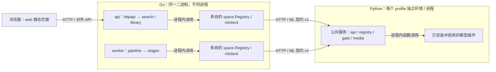
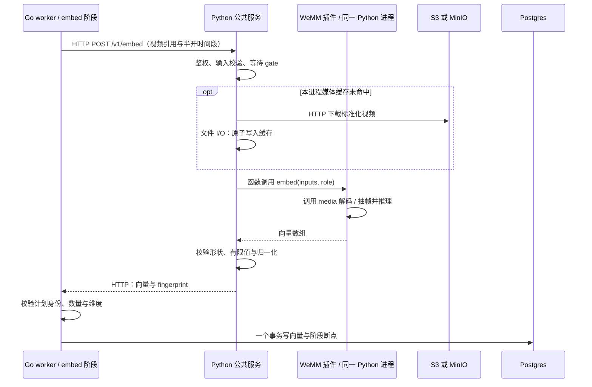
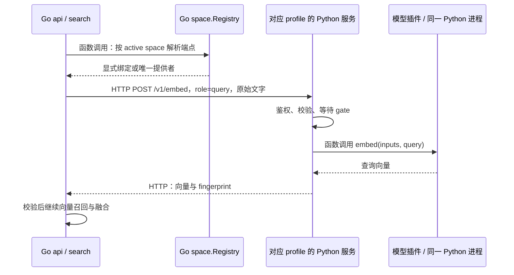
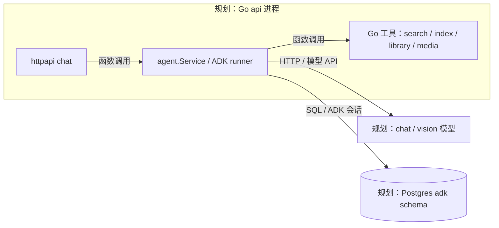
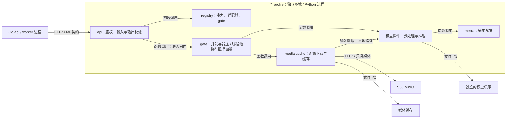
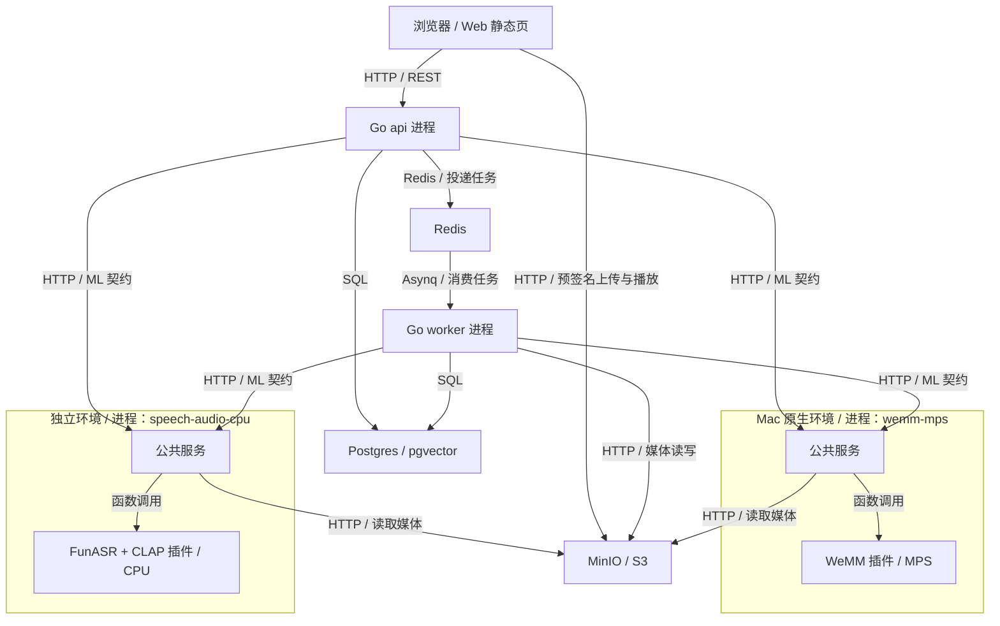

# VideoHelper 实现文档（Spec，首版）

> 状态：实现边界与后续设计并列记录　｜　更新：2026-10-27
> 配套文档：[设计文档 design.md](design.md) · [设计画布](https://claude.ai/artifact/38jtvjPEShFP1fSfD1CKXb)

## 0. 说明

**范围**：Go 后端、Python 模型服务、数据库、所有接口，以及模块之间怎么交互。前端（`web/`）只依赖对外 API，见[第 16 章](#16-前端)。

## 当前实施范围（2026-10-27）

本地处理链路为「视频 → 标准化视频 → WeMM 画面编码 / CLAP 声音编码 / ASR → WeMM 转录文本编码 → 文字检索 → 时间片段与证据」。WeMM-Embedding-2B 统一支持视频、文字、图片编码；图片是编码输入，本轮搜索入口只接受文字。启用 `visual`、`speech` 与 `audio`，保留音轨供 ASR 和 CLAP 使用。声音通道采用 edit-mind 同款 CLAP HTSAT unfused；查询文字原样传入，英文转换后续再做。LLM/Agent、AWS 部署与验收暂缓；前端已实现登录、资料库与上传、视频详情、搜索；下文相关章节保留为后续设计，不构成本轮实现要求。真实模型验证与显式 fake 的协议/流程测试分开。

模型服务已拆成可安装的 `videohelper-ml` 公共包与 WeMM、FunASR、CLAP 三个插件包；插件通过 Python entry point 注册，在同一个 Python 进程内以函数调用执行。`ml/profiles/` 锁定各自依赖与模型清单，可分别运行 MPS、CPU 和 CUDA 服务；Go 通过 HTTP 发现能力、路由并调用推理（第 5、10、14 章）。CUDA profile 是候选配置，尚未完成真实 GPU 验收。

本轮提供本地上传、阶段状态/重试、项目范围和文字搜索。已就绪视频可自动补建新通道/空间缺失的编码阶段；URL 导入、上传分片续签、SSE 事件、到期 purge、配额计费仍是后续设计；软删除保留原片和处理文件。当前只记录索引时长。操作入口见 [README](../README.md)。

离线评估已提供独立的 [Eval 工作区](../Eval/README.md)：通过现有业务服务执行真实上传和完整索引，检查实际切片/向量覆盖，再对固定快照运行 visual、speech 和 fused。入口为 `Eval/tools/run.py`，不向应用主命令增加 `videohelper eval` 子命令；具体协议和指标见 [Evaluation 契约](../Eval/CONTRACT.md)。

**写到哪一层**：写到「目录与文件职责、类型与函数签名、表结构、协议字段、处理步骤」。不写函数实现。签名用来说明模块边界，实现时可以调整名字，但边界和职责不变。

**标注约定**：

- **已实现**：当前代码已有对应入口；不等于已完成真实模型或云端验收。
- **已定**：用户明确拍板；单独出现时不代表已经实现。
- **规划 / 暂缓**：保留后续边界，当前没有对应业务入口。
- **提议**：讨论中提出、用户没有反对，但还没正式确认。
- **建议**：本文给出的默认做法，需要确认。

拿不准的地方统一列在[第 17 章](#17-待确认问题)，正文不自行敲定。

**通用约定**：

| 项目 | 约定 |
|---|---|
| 时间段 | 一律用毫秒整数：`start_ms`、`end_ms`，左闭右开 |
| 时间戳 | RFC 3339，UTC，如 `2026-10-25T08:00:00Z` |
| JSON 字段 | snake_case |
| 数据库 | 表名用单数；主键用 `bigint` 自增或自然键 |
| ID | 数据库自增 `bigint`；对外 JSON 里一律是字符串，如 `"42"`，避免 JavaScript 丢精度（已定） |
| 空间 id | `{模型短名}@{版本}`，如 `wemm-2b@r1` |
| 媒体命名 | 标准化视频为 `normalized_video`，文件名 `normalized_video.mp4`，存储字段 `normalized_video_key`；媒体预处理阶段为 `prepare_media`，负责转码、生成缩略图和上传结果 |
| 阶段名 | `probe`、`prepare_media`、`asr`、`embed:{channel}:{space}`、`finalize`、`fetch` |
| 切片版本 | `grid@v1`（画面、音频格子）、`sentence@v1`（转录句子）。画布上的示例名 `fixed2.5s@v1`、`asr-sentence@whisper-r1` 以本文为准 |

---

## 目录

1. [仓库结构](#1-仓库结构)
2. [Go 后端](#2-go-后端)
3. [数据库](#3-数据库)
4. [对外 API](#4-对外-api)
5. [ML 契约 v1](#5-ml-契约-v1)
6. [异步任务](#6-异步任务)
7. [S3 存储布局](#7-s3-存储布局)
8. [检索内核](#8-检索内核)
9. [Agent（暂缓）](#9-agent暂缓)
10. [Python 模型服务](#10-python-模型服务)
11. [换模型与评估](#11-换模型与评估)
12. [安全](#12-安全)
13. [可观测性](#13-可观测性)
14. [本地开发与部署](#14-本地开发与部署)
15. [测试策略](#15-测试策略)
16. [前端](#16-前端)
17. [待确认问题](#17-待确认问题)

---

## 1. 仓库结构

### 1.1 顶层目录

当前结构如下。Go 与 Python 独立构建，SQL 包各有 `sqlc.yaml`，由 `make generate` 统一执行。AWS 的 `infra/`、发布工作流和链接导入相关组件仍属规划，不列为当前文件。

```text
videohelper/
├── go.mod / go.sum
├── Makefile                     # Go / Web 检查与本地基础服务
├── cmd/videohelper/             # Go 单一二进制；api / worker / migrate / 本地命令
├── internal/                    # Go 业务模块与基础设施适配（第 2 章）
├── migrations/                  # goose 迁移，也是 sqlc 的表结构输入
├── contracts/ml-v1.yaml         # Go / Python 共用的 HTTP 契约
├── config/
│   ├── config.example.yaml      # 通用配置，不含密钥
│   ├── local.yaml               # 本地配置
│   └── channels.yaml            # 通道、active / shadow 空间
├── Eval/                        # 独立离线评估入口（第 11 章）
├── ml/
│   ├── app/                     # 通用 HTTP 服务、插件发现、缓存、闸门、共享类型
│   ├── plugins/{wemm,funasr,clap}/ # 独立安装的模型插件包
│   ├── profiles/                # wemm-mps / speech-audio-cpu / wemm-cuda
│   ├── pyproject.toml / uv.lock # 公共包与开发环境
│   └── Dockerfile               # 按 profile 构建 Linux 模型镜像
├── web/                         # React + TypeScript + Tailwind，多页 Vite
├── deploy/
│   ├── docker-compose.yml       # Postgres、Redis、MinIO
│   ├── minio.Dockerfile
│   └── ml-compose.yml           # Linux CPU / 可选 CUDA 模型服务
└── docs/
    ├── design.md
    └── spec.md
```

### 1.2 文件类型

| 类型 | 用途 | 位置 |
|---|---|---|
| `.go` | Go 源码 | `cmd/`、`internal/` |
| `_test.go` | Go 测试，和被测文件放在同一目录 | 同上 |
| `.sql` | 数据库迁移（goose）；各包的查询（sqlc 的输入） | `migrations/`、`internal/*/queries.sql` |
| 生成的 `.go` | sqlc 根据 `queries.sql` 生成，不手改 | `internal/*/*db/` |
| `.yaml` | Go 配置、ML 契约、模型清单 | `config/`、`contracts/`、`ml/profiles/*/models.yaml`；fake 清单在 `ml/models.yaml` / `ml/app/resources/models.yaml` |
| `.md` | 设计、契约和运行说明 | `docs/`；Agent 的 `instruction.md` 为后续规划 |
| `.py` | Python 公共服务、插件与测试 | `ml/app/`、`ml/plugins/`、`ml/tests/` |
| `pyproject.toml`、`uv.lock` | 公共包 / 插件元数据、profile 锁定依赖 | `ml/`、`ml/plugins/*/`（包）、`ml/profiles/*/`（独立锁文件） |
| `.jsonl` | 评估集 | `Eval/annotations/` |
| `Dockerfile`、Compose YAML | 模型镜像与本地基础服务 | `ml/Dockerfile`、`deploy/`；Go 云镜像仍属规划 |

### 1.3 进程边界与模块边界



- Go 模块在进程内调用；api 与 worker 通过 Redis 队列及数据库协作，不互相发 HTTP。
- Go 与 Python 只共同遵守 `contracts/ml-v1.yaml`，不导入对方代码。多个 profile 各提供一个 HTTP 端点，Go 按模型 ID 路由。
- Python 公共包提供服务与共享类型，插件负责模型相关准备、加载、预处理和推理；安装插件不会自动增加 Go 的新证据类型。
- 前端调用 Go 对外 API；媒体分片上传与播放使用 Go 签发的对象存储 URL，不直接调用模型服务。

---

## 2. Go 后端

### 2.1 进程与子命令

一个二进制 `videohelper`，按子命令启动不同角色。

| 子命令 | 作用 | 启动的内容 | 副本数 |
|---|---|---|---|
| `videohelper api` | 对外服务 | 已认证 REST、search；SSE/agent 暂缓 | 可多副本，无状态 |
| `videohelper worker` | 后台处理 | cpu server（cpu、maint）、gpu server（gpu、gpu_low）；定时投递 reconcile、刷新模型发现 | 可多副本 |
| `videohelper migrate` | 执行数据库迁移 | 迁移完成后退出 | 每次部署跑一次 |
| `Eval/tools/run.py` | 离线索引验收与检索回归 | 独立快照、逐题评分、结果比较 | 手动执行 |
| `videohelper space add <channel> <id>` | 为一个通道接入新的向量空间（已实现） | 从 ML 端点登记这个空间，为 (channel, space) 建部分 HNSW 索引；用迁移账号执行 | 换模型时手动执行，在写进 channels.yaml 之前 |
| `videohelper local-init / local-upload / local-search / local-video` | 本地初始化、上传、搜索、查看状态 | 复用业务模块；参数见 `videohelper -help` | 手动执行 |
| `videohelper space drop <id>`（规划） | 下线向量空间 | 当前没有此子命令；删除旧数据和卸载流程尚待实现 | — |

多个 worker 副本都会定时投递 reconcile。reconcile 任务按时间窗口生成任务 id，并且完成后在 Asynq 里保留 1 小时（6.1 节）：其他副本再投递同一个窗口的任务，会因为 id 冲突被拒绝，所以同一个窗口只执行一次。

### 2.2 目录结构

```text
cmd/videohelper/
├── main.go              # 命令解析、迁移、space add
├── runtime.go           # 装配 Registry、ML 客户端、业务模块与基础设施
├── api.go / worker.go   # HTTP 服务 / 队列消费者与周期补偿
└── local.go             # 复用业务模块的本地命令

internal/
├── config/              # config.go / validate.go：加载与启动校验
├── apperr/              # 业务错误与 HTTP 映射所需分类
├── platform/
│   ├── db/              # pgx、事务辅助
│   ├── blob/            # S3 / MinIO、预签名、分片上传、对象路径
│   ├── queue/           # Asynq 队列、任务载荷、消费者与投递
│   └── authn/           # JWT / JWKS 校验
├── workspace/           # 用户、工作区、Principal
├── library/             # 项目、视频、上传、范围、软删除 / 恢复；定义流水线接口
├── timeline/            # 半开时间段、grid@v1、sentence@v1、雪碧图布局
├── space/               # /v1/spaces 发现、身份校验、端点绑定与通道配置
├── mlclient/            # HTTP 发现 / embed / transcribe；错误、输出与超时校验
├── media/               # ffprobe / ffmpeg 子进程；标准化视频与雪碧图
├── index/               # 向量与转录存取、部分 HNSW 索引、派生数据清理
├── pipeline/
│   ├── plan.go / types.go # 阶段依赖、必需性、冻结的模型身份与参数
│   ├── service.go / runner.go # 任务注册、认领、执行、断点、提交与下游推进
│   ├── reconcile.go / backfill.go # 补偿、ready 视频的缺失通道 / 空间回填
│   ├── status.go        # 阶段状态
│   └── stages/          # media.go / asr.go / encode.go：实际处理函数
├── search/              # models.go / search.go / fuse.go：模型目录与就绪校验、编码、召回、融合
├── usage/               # 当前记录 indexed_ms；配额与其他计量暂缓
└── httpapi/             # httpapi.go / library.go / search.go：路由、中间件与协议转换
```

各持久化模块的 `queries.sql` / `sqlc.yaml` 与生成的 `*db/` 保持包内归属。`library` 定义流水线接口，`pipeline` 实现，`cmd/videohelper/runtime.go` 注入；实际媒体与模型执行函数位于 `pipeline/stages`，避免 `pipeline` 反向导入它。

后文保留的 `agent`、`platform/events`、`platform/safehttp`、`media/ytdlp.go`、`fetch`、`purge` 以及导入 / SSE 处理器均属后续设计，当前不在这份目录树中。逐包签名用于说明边界，不表示每个规划接口均已实现。

### 2.3 包依赖规则

下表约束模块的依赖方向；`agent`、`eval`、`platform/safehttp` 行保留为规划，当前评估入口在 `Eval/`。这张表就是高内聚、低耦合的具体约束。

| 包 | 允许依赖 |
|---|---|
| `httpapi` | workspace、library、pipeline（Retry、ListStages）、search、mlclient（请求关联信息）、timeline（缩略图类型）、platform/authn、platform/blob、apperr |
| `agent` | search、library、index、media、usage、workspace、platform/blob、apperr、config |
| `search` | space、index、mlclient、timeline、library（范围与时长）、workspace、apperr、config |
| `pipeline` | library、space、index、mlclient、platform/*、apperr、config |
| `pipeline/stages` | pipeline、library、space、index、mlclient、media、timeline、usage、platform/*、apperr、config；由 cmd 装配，pipeline 不反向导入 |
| `eval` | search、space、index、workspace、config |
| `library` | platform/db、platform/blob、platform/safehttp、workspace、timeline（只用类型）、apperr、config |
| `space` | mlclient、index、platform/db、apperr、config |
| `usage` | platform/db、apperr、config |
| `workspace` | platform/db、platform/authn、apperr |
| `index` | platform/db、timeline、apperr |
| `mlclient` | apperr、config |
| `media` | timeline；其余只依赖标准库和外部库 |
| `timeline`、`apperr`、`config` | 只依赖标准库和外部库 |
| `platform/queue` | config；其余只依赖标准库和外部库 |
| 其他 `platform/*` | 只依赖标准库和外部库 |

两处依赖倒置，用来避免循环：

- `library` 在上传完成、导入、恢复视频时需要启动流水线，软删除时要删掉流水线产生的派生数据。为此在 `library/library.go` 定义 `Starter`、`DerivedDropper` 两个接口，由 `pipeline` 实现，在 `cmd/videohelper/runtime.go` 注入。所以 `library` 不依赖 `pipeline`，也不直接写别的包的表。
- `mlclient` 需要知道某个 space 在哪个端点，但不能依赖 `space`。它接收一个 `Resolver` 函数，由 `space.Registry` 提供。

### 2.4 逐包说明

下面每个包按「职责 / 不负责 / 对外接口」说明。接口用 Go 签名表示，省略 `context.Context` 以外的实现细节。

#### config

- **职责**：定义配置结构，读 `config.yaml` 和 `channels.yaml`，用环境变量覆盖密钥，启动时校验必填项。
- **不负责**：解释配置的业务含义。比如通道的合法性由 `space` 校验。

```go
type Config struct {
    Server   ServerConfig
    Database DatabaseConfig
    Redis    RedisConfig
    S3       S3Config
    Auth     AuthConfig
    ML       MLConfig
    LLM      LLMConfig
    Worker   WorkerConfig
    Media    MediaConfig
    Search   SearchConfig
    Import   ImportConfig   // 导入链接：平台白名单、yt-dlp 参数、上限
    Limits   LimitsConfig
    Channels ChannelsConfig // 从 channels_file 读入
}
func Load(path string) (Config, error)
```

#### apperr

- **职责**：所有包统一使用的错误类型，让 httpapi 能用同一套规则映射状态码。

```go
type Kind int
const (
    Invalid Kind = iota + 1 // 400
    Unauthenticated         // 401
    Forbidden               // 403
    NotFound                // 404
    Conflict                // 409
    TooLarge                // 413
    Quota                   // 429
    Unavailable             // 503
    Internal                // 500
)
type Error struct {
    Kind Kind
    Code string // 机器可读，如 "url_not_allowed"
    Msg  string // 给用户看的中文说明
    Err  error  // 原始错误，只写日志，不返回给用户
}
func New(k Kind, code, msg string) *Error
func Wrap(k Kind, code string, err error) *Error
func KindOf(err error) Kind // 非 *Error 一律视为 Internal
```

#### platform/db

- **职责**：创建连接池；提供事务辅助；注册 pgvector 类型。

```go
type Querier interface { // pgxpool.Pool 和 pgx.Tx 都满足
    Exec(ctx context.Context, sql string, args ...any) (pgconn.CommandTag, error)
    Query(ctx context.Context, sql string, args ...any) (pgx.Rows, error)
    QueryRow(ctx context.Context, sql string, args ...any) pgx.Row
}
func Open(ctx context.Context, url string, maxConns int) (*pgxpool.Pool, error)
func WithTx(ctx context.Context, pool *pgxpool.Pool, fn func(tx pgx.Tx) error) error
```

`Querier` 的方法和 sqlc 生成的 `DBTX` 接口完全一致，所以 sqlc 生成的查询既能直接用连接池执行，也能放进别人的事务里。

**SQL 怎么组织（已定用 sqlc）**：每个拥有表的包写一个 `queries.sql`，sqlc 读取 `migrations/` 里的表结构，为每个包生成一个 `{包名}db` 子包，比如 `librarydb`、`pipelinedb`。业务代码直接调用生成的查询，不再手写 store 层。唯一的例外是 `index/vector.go`：它的 SQL 里有运行时才知道的字面量（维度、通道、空间），sqlc 表达不了，只能手写。

#### platform/blob

- **职责**：S3 操作；对象路径规则。
- **不负责**：判断谁有权访问哪个对象。权限在调用方检查，这里只管签名和读写。

```go
type Part    struct { N int; ETag string }
type PartURL struct { N int; URL string }

func (s *Store) CreateMultipart(ctx context.Context, key, contentType string) (uploadID string, err error)
func (s *Store) PresignParts(ctx context.Context, key, uploadID string, count int, ttl time.Duration) ([]PartURL, error)
func (s *Store) CompleteMultipart(ctx context.Context, key, uploadID string, parts []Part) error
func (s *Store) PutStream(ctx context.Context, key string, r io.Reader, maxBytes int64) (int64, error) // fetch 用：边读边分片上传
func (s *Store) Put(ctx context.Context, key string, r io.Reader, contentType string) error
func (s *Store) PresignGet(ctx context.Context, key string, ttl time.Duration) (string, error)
func (s *Store) DeletePrefix(ctx context.Context, prefix string) error
func (s *Store) URI(key string) string // "s3://{bucket}/{key}"，传给 Python

// keys.go：路径规则的唯一来源
func VideoPrefix(workspaceID, videoID int64) string                // workspaces/{w}/videos/{v}/
func SourceKey(workspaceID, videoID int64, ext string) string
func NormalizedVideoKey(workspaceID, videoID int64) string      // workspaces/{w}/videos/{v}/normalized_video.mp4
func SpriteKey(workspaceID, videoID int64, n int) string            // 第 n 张缩略图雪碧图
func RawKey(workspaceID, videoID int64, name string) string
// 流水线使用 RunNormalizedVideoKey / RunSpriteKey / RunRawKey：额外传入执行 generation 和 attempt。
// 展示缩略图使用 SpriteKeyForVideo(normalizedVideoKey, n)，跟随已提交的媒体版本。
```

#### platform/queue

- **职责**：Asynq 的薄封装，把队列名、任务类型、任务 id 规则、重试策略集中在一处。

```go
const (
    QueueCPU   = "cpu"
    QueueGPU   = "gpu"
    QueueMaint = "maint"

    TypeStage     = "stage"
    TypePurge     = "purge"
    TypeReconcile = "reconcile"
)
type StagePayload struct { WorkspaceID, VideoID int64; Stage, Version string }
type PurgePayload struct { WorkspaceID, VideoID int64 }

var ErrThrottled = errors.New("throttled") // 名额不够：稍后重试，不计失败

func StageTaskID(p StagePayload) string // "stage:{video_id}:{stage}:{version}"
func EnqueueStage(ctx context.Context, c *asynq.Client, p StagePayload, queue string, timeout time.Duration, maxRetry int) error // 任务 id 冲突视为成功
func EnqueuePurge(ctx context.Context, c *asynq.Client, p PurgePayload, maxRetry int) error
func NewServers(cfg config.WorkerConfig, r asynq.RedisConnOpt) (cpu, gpu *asynq.Server) // 配置 IsFailure 与 RetryDelayFunc
func EnqueueReconcile(ctx context.Context, c *asynq.Client, now time.Time, every time.Duration) error // worker ticker 调用；按时间窗口生成唯一 id
```

#### platform/events（规划）

- **职责**：进度事件的发布与订阅。事件丢了不影响正确性，因为状态以 `stage_run` 为准，前端重连后重新拉取即可。

```go
type Event struct {
    Type        string    // "stage" | "video"
    WorkspaceID int64
    VideoID     int64
    Stage       string    // Type=stage 时有值
    Status      string
    Progress    *float64  // embed 阶段的完成比例，可选
    Error       string
    At          time.Time
}
func (b *Bus) Publish(ctx context.Context, e Event) error // 同时发往视频频道和工作区频道
func (b *Bus) SubscribeVideo(ctx context.Context, videoID int64) (<-chan Event, func())
func (b *Bus) SubscribeWorkspace(ctx context.Context, workspaceID int64) (<-chan Event, func())
```

#### platform/authn

- **职责**：校验 Bearer 令牌，得到认证服务里的用户身份。具体用哪家认证服务待定（[设计文档问题 3](design.md#12-待确认问题)），本包按 OIDC/JWKS 的通用方式设计。

```go
type Claims struct { Sub, Email, Name string }
func (v *Verifier) Verify(ctx context.Context, bearer string) (Claims, error)
```

#### platform/safehttp（规划）

- **职责**：Go 里所有「按用户给的地址发起请求」的地方都必须用它，目前是直链下载和 `b23.tv` 短链解析。平台视频由 yt-dlp 下载，不经过这里，防护方式见 12.2 节。

```go
func CheckURL(ctx context.Context, raw string) (*url.URL, error) // 规则见第 12.2 节
func NewClient(maxBytes int64, timeout time.Duration) *http.Client // 拨号时校验 IP；每次重定向重新校验；最多 3 次重定向
```

#### workspace

- **职责**：用户、工作区、成员关系；把「令牌里的用户」解析成「这次请求在哪个工作区内操作」。
- **不负责**：登录、密码，这些交给认证服务。

```go
type Role string // "owner" | "member"
type Principal struct { UserID, WorkspaceID int64; Role Role }

// 首次登录：一个事务里建 app_user、个人 workspace、owner membership。
// requested 为 0 时：只有一个工作区就用它，有多个就返回 Invalid（要求带 X-Workspace-ID）。
func (s *Service) Resolve(ctx context.Context, c authn.Claims, requested int64) (Principal, error)

func WithPrincipal(ctx context.Context, p Principal) context.Context
func PrincipalFrom(ctx context.Context) (Principal, bool)
```

#### library

上传会话持久化在 `video_upload`（迁移 `0002`）：`video_id`、`object_key`、`upload_id`、`size_bytes`、`part_size`。完成上传核对所属工作区、会话凭据、分片集合及对象实际字节数；S3 调用在事务外执行。成功后才写入 `source_key`，未成功启动的上传与恢复由 R4 补偿。

- **职责**：项目、视频的业务规则与存取；上传、导入的登记；范围解析。
- **不负责**：处理视频（pipeline 负责）、检索（search 负责）。

```go
type Video struct {
    ID, WorkspaceID int64
    Title, Status, SourceKind, SourceURL, SourceKey, NormalizedVideoKey, Error string
    DurationMs         *int
    HasVideo, HasAudio *bool
    Thumbs             *timeline.SpriteLayout // `prepare_media` 完成后才有
    DeletedAt          *time.Time             // 软删除时间；面向用户的查询只返回为空的视频
    CreatedAt, UpdatedAt time.Time
}
type UploadPlan struct { UploadID string; PartSize int64; Parts []blob.PartURL; ExpiresAt time.Time }
type Scope struct { ProjectID *int64; VideoIDs []int64 }

// library.go：接口由 pipeline 实现
type Starter interface { Start(ctx context.Context, videoID int64) error }
type DerivedDropper interface {
    // 删掉一个视频的派生数据：embedding、text_span、stage_run；在调用方的事务里执行
    DropDerived(ctx context.Context, q db.Querier, videoID int64) error
}

func (s *Service) StartUpload(ctx context.Context, p workspace.Principal, filename string, size int64, contentType string, projectID *int64) (Video, UploadPlan, error)
func (s *Service) CompleteUpload(ctx context.Context, p workspace.Principal, videoID int64, uploadID string, parts []blob.Part) (Video, error) // 内部调用 Starter.Start
func (s *Service) StartImport(ctx context.Context, p workspace.Principal, rawURL, title string, projectID *int64) (Video, error)  // 规划；内部调用 Starter.Start

// importurl.go（规划）：哪些链接能导入，是业务规则，放在 library
type ImportSource struct {
    Kind string // youtube | bilibili | direct
    URL  string // 规范化后的地址
}
// 域名在 import.platforms 的白名单里 → 对应平台；否则在允许直链时按 safehttp 规则校验；都不满足 → apperr Invalid（url_not_allowed）
func ClassifyURL(ctx context.Context, raw string, cfg config.ImportConfig) (ImportSource, error)
func (s *Service) Get(ctx context.Context, p workspace.Principal, id int64) (Video, error)
func (s *Service) List(ctx context.Context, p workspace.Principal, f ListFilter) (videos []Video, nextCursor string, err error)
func (s *Service) Delete(ctx context.Context, p workspace.Principal, id int64) error            // 软删除（已定）：一个事务里设 deleted_at，并调用 DerivedDropper 删掉派生数据（3.5 节）
func (s *Service) Restore(ctx context.Context, p workspace.Principal, id int64) (Video, error)  // 恢复 upload；已有原片时从 probe 重建，否则回到 uploading
func (s *Service) PlaybackURL(ctx context.Context, p workspace.Principal, id int64) (url string, expires time.Time, err error)

// scope.go
func (s *Service) ResolveScope(ctx context.Context, p workspace.Principal, sc Scope) ([]int64, error) // nil 表示当前工作区的全部视频
func (s *Service) Durations(ctx context.Context, workspaceID int64, ids []int64) (map[int64]int, error)

// 项目
func (s *Service) CreateProject(ctx context.Context, p workspace.Principal, name string) (Project, error)
func (s *Service) ListProjects(ctx context.Context, p workspace.Principal) ([]Project, error)
func (s *Service) DeleteProject(ctx context.Context, p workspace.Principal, id int64) error // 不删除视频
func (s *Service) AddVideo(ctx context.Context, p workspace.Principal, projectID, videoID int64) error
func (s *Service) RemoveVideo(ctx context.Context, p workspace.Principal, projectID, videoID int64) error

// 供 pipeline 在事务里调用（包级函数，接收 Querier）
func UpdateSource(ctx context.Context, q db.Querier, videoID int64, sourceKey string) error // 写原片位置；导入的视频同时从 importing 改为 indexing
func UpdateProbe(ctx context.Context, q db.Querier, videoID int64, durationMs int, hasVideo, hasAudio bool) error
func UpdatePreparedMedia(ctx context.Context, q db.Querier, videoID int64, normalizedVideoKey string, thumbs timeline.SpriteLayout) error
func SetStatus(ctx context.Context, q db.Querier, videoID int64, status, errMsg string) error
func GetForWorker(ctx context.Context, q db.Querier, videoID int64) (Video, error) // 不校验工作区，只给 worker 用
```

#### timeline

- **职责**：所有和「怎么切、时间怎么换算」有关的规则。纯函数，必须有完整的单元测试。

```go
type Span struct { StartMs, EndMs int } // 左闭右开
func (s Span) Overlaps(o Span) bool

const GridSeg = "grid@v1"
func CellMs(durationMs int) int                        // durationMs >= 90000 ? 2500 : 1000
func Cells(durationMs int) []Span                      // 最后一格截到视频结尾
func CellsOverlapping(durationMs int, s Span) []int    // 一个区间覆盖到的格子序号

const SentenceSeg = "sentence@v1"
type Sentence struct { Span Span; Text string }
// 过短的句子按原顺序与相邻句合并，允许时间重叠；范围取最早起点、最晚终点，文字原样连接。
// 合并后不超过 maxChars。首版不拆长句：超长的原样保留，由 adapter 按模型的最大长度截断
func MergeSentences(in []Sentence, minChars, maxChars int) []Sentence // 初始值 minChars=8、maxChars=120，待评估

// sprite.go：缩略图雪碧图（已定）
type SpriteLayout struct {
    TileW, TileH int // 每格缩略图的宽高
    Cols, Rows   int // 每张雪碧图的列数、行数
    Count        int // 格子总数
}
func (l SpriteLayout) Tile(cell int) (sprite, x, y int) // 第几张图，以及这一格在图里的左上角坐标
```

#### space

- **职责**：向量空间的登记与校验；召回通道配置；space 到 ML 端点的路由。
- **不负责**：存取向量（index 负责）。

```go
type Info struct {
    ID, Metric, Fingerprint string
    Dim, MaxSpanMs, MaxBatch int
    DocInputs, QueryInputs   []string
    Endpoint                 string
    Disabled                 bool
}
func (r *Registry) Sync(ctx context.Context) error             // 启动时执行，之后每 5 分钟刷新
func (r *Registry) Get(id string) (Info, bool)
func (r *Registry) List() []Info                               // 排序、深拷贝发现快照；包含禁用或无可路由端点的条目
func (r *Registry) Resolve(id string) (endpoint string, ok bool) // 传给 mlclient
func (r *Registry) Transcriber() (info mlclient.TranscriberInfo, endpoint string, ok bool)
func (r *Registry) GetTranscriber(id string) (info mlclient.TranscriberInfo, endpoint string, ok bool)

type Channel struct {
    Name   string   // visual | speech | audio
    Doc    string   // video | text | audio
    Seg    string   // grid@v1 | sentence@v1
    Weight float64
    Active []string // 默认查询用
    Shadow []string // 回填；不参与默认查询，完成后可被显式选择
}
func (c *Channels) List() []Channel
func (c *Channels) Get(name string) (Channel, bool)
func (c *Channels) Validate(ctx context.Context, r *Registry) error
```

`Sync` 对每个 space 的处理：

| 情况 | 处理 |
|---|---|
| 表里没有 | 插入 `embedding_space`，不建索引。索引由 `videohelper space add` 建：在线服务的数据库账号没有建索引的权限，建索引的耗时也不该卡住服务启动 |
| 表里有，fingerprint 一致 | 无事 |
| 表里有，fingerprint 不一致 | 标记 `disabled=true`，打错误日志并告警；这个空间不再写入，也不再查询 |
| 维度和表里不一致 | 同上 |
| 同 ID 多个提供者，未显式绑定 | 不提供路由；不因此永久禁用数据库中的空间 |
| 已绑定端点不可用 | 不回退到其他提供者，待下次发现恢复 |

`Transcriber()` 选择配置中的新任务模型；`GetTranscriber(id)` 用于旧任务冻结的模型 ID，调用方继续核对 fingerprint。

`Channels.Validate` 在启动时检查 channels.yaml 里的每个 (channel, space)：已经登记、文档类型被这个空间支持，并且部分索引存在且有效（`index.VectorIndexReady`）。缺了就拒绝启动，并提示先执行 `space add`。

#### mlclient

- **职责**：ML 契约 v1 的客户端。
- **不负责**：决定用哪个 space，那是 search 和 pipeline 的事。

```go
type Resolver func(spaceID string) (baseURL string, ok bool)
func New(cfg config.MLConfig, resolve Resolver) *Client
func (c *Client) Spaces(ctx context.Context, baseURL string) (SpacesResponse, error)
func (c *Client) Embed(ctx context.Context, req EmbedRequest) (EmbedResponse, error)
func (c *Client) Transcribe(ctx context.Context, baseURL string, req TranscribeRequest) (TranscribeResponse, error)
```

行为约定：

- 遇到 503 时按 `Retry-After` 退避，最多 3 次，之后返回 `apperr.Unavailable`。
- 400、404、422 直接返回，不重试。
- 每个请求都带 `X-Request-ID`，从 context 取，没有就生成一个。
- 每个请求都带 `X-Internal-Token`（服务间共享令牌，已定，取自环境变量 `VH_ML_TOKEN`）。收到 401 说明两边配置不一致，直接返回错误并告警。

#### media

- **职责**：封装外部媒体命令：ffprobe、ffmpeg、yt-dlp。ffmpeg 的输入可以是预签名 URL，也可以是本地文件路径。
- **不负责**：判断一个链接能不能导入（library 负责）；限流（pipeline 负责）。

```go
type ProbeInfo struct { DurationMs int; HasVideo, HasAudio bool; Width, Height int; FPS float64 }
type TranscodeOptions struct { MaxHeight int; GOPSeconds int; CRF int }

func Probe(ctx context.Context, src string) (ProbeInfo, error)
func Transcode(ctx context.Context, src, dst string, o TranscodeOptions) error
func Sprites(ctx context.Context, src, outDir string, cells []timeline.Span, tileW, cols, rows int) ([]string, timeline.SpriteLayout, error) // 每格取起点一帧，按行拼成雪碧图
func Frames(ctx context.Context, src string, atMs []int, width int) ([][]byte, error)                       // JPEG，inspect_clip 用

// ytdlp.go
type RemoteInfo struct {
    Platform, ID, Title, Uploader string
    DurationMs                    int
    IsLive                        bool
}
type YtdlpOptions struct {
    Extractors  []string      // 只启用这些提取器（如 youtube、BiliBili），不启用通用提取器
    MaxHeight   int           // 画质上限
    MaxBytes    int64         // 文件大小上限
    Timeout     time.Duration // 首版不带平台登录态（已定），所以没有 cookies 参数
}
var (
    ErrRemotePermanent = errors.New("remote permanent") // 不存在、私密、需要登录、地区限制、直播等：不重试
    ErrRemoteTemporary = errors.New("remote temporary") // 网络、限流、5xx：交给 Asynq 重试
)
func RemoteProbe(ctx context.Context, url string, o YtdlpOptions) (RemoteInfo, error)               // yt-dlp -J --no-playlist：只读元数据
func RemoteDownload(ctx context.Context, url, outDir string, o YtdlpOptions) (path string, err error) // 下载，音视频合并成 mp4
```

yt-dlp 的输出和退出码在 `ytdlp.go` 里统一翻译成上面两类错误，并附上给用户看的中文原因，调用方不解析 yt-dlp 的原始输出。

#### index

- **职责**：`embedding`、`text_span` 两张表的全部 SQL，以及 pgvector 的所有细节：类型转换、运算符、索引、查询参数。
- **不负责**：决定查哪个通道、怎么融合，那是 search 的事。

```go
type VectorSpace struct { ID string; Dim int; Metric string }
type VectorRow struct {
    VideoID, WorkspaceID int64
    Channel, SpaceID, Seg string
    Span timeline.Span
    Vec  []float32
}
type VectorQuery struct {
    WorkspaceID int64
    VideoIDs    []int64          // nil 表示当前工作区的全部视频
    Channel     string
    Seg         string
    Space       VectorSpace
    Vec         []float32
    TimeRange   *timeline.Span   // 可选
    K           int
}
type VectorHit struct { VideoID int64; Span timeline.Span; Distance float32; Rank int }

func UpsertVectors(ctx context.Context, q db.Querier, rows []VectorRow) error
func SearchVectors(ctx context.Context, pool *pgxpool.Pool, vq VectorQuery) ([]VectorHit, error) // 内部开事务，用 SET LOCAL 设置 HNSW 参数
func EnsureVectorIndex(ctx context.Context, pool *pgxpool.Pool, channel string, sp VectorSpace) error // 只由 space add 调用：CREATE INDEX CONCURRENTLY IF NOT EXISTS；同名索引无效（上次建到一半失败）时先删再建
func VectorIndexReady(ctx context.Context, q db.Querier, channel, spaceID string) (bool, error)      // 部分索引存在且有效；启动校验与模型选择共用
type CoverageCounts struct { EligibleVideos, IndexedVideos int }
func SpaceCoverage(ctx context.Context, q db.Querier, workspaceID int64, videoIDs []int64, channel, seg, spaceID, fingerprint string) (CoverageCounts, error) // 按工作区与范围检查冻结编码阶段是否完整完成
func DeleteVideoChannel(ctx context.Context, q db.Querier, videoID int64, channel string) error
func DeleteVideo(ctx context.Context, q db.Querier, videoID int64) error // 删除一个视频的全部向量和文本；软删除时由 pipeline 的 DropDerived 调用
func DropSpace(ctx context.Context, pool *pgxpool.Pool, spaceID string, batch int) error // 分批删除向量，再删除部分索引
func Coverage(ctx context.Context, q db.Querier, channel, spaceID string) (videos int, err error) // 全局已有向量的视频数，不用于面向用户的索引就绪判断

type Word struct { W string `json:"w"`; S int `json:"s"`; E int `json:"e"` }
type TextSpan struct {
    VideoID, WorkspaceID int64
    Kind  string
    Span  timeline.Span
    Text  string
    Words []Word
    Model string
}

// 一个事务里：删这个视频的 speech 句子 → 删它的 speech 向量 → 写入新句子
func ReplaceSpeech(ctx context.Context, tx pgx.Tx, workspaceID, videoID int64, model string, sents []TextSpan) error // 调用方拥有事务，与阶段完成一起提交
func TextRange(ctx context.Context, q db.Querier, workspaceID, videoID int64, s timeline.Span) ([]TextSpan, error)
func SpeechSentences(ctx context.Context, q db.Querier, videoID int64) ([]TextSpan, error)
```

拼 SQL 的规则：`channel`、`space_id`、`seg`、维度、运算符直接写进 SQL 文本（部分索引要求它们是字面量）。这些值只能来自 `embedding_space` 表和 channels 配置，写进 SQL 前用白名单格式校验（`^[a-z0-9@._-]+$`），绝不来自用户输入。工作区、视频 id、向量、K 一律用参数。

#### pipeline

- **职责**：把一个视频从原片处理到可以搜索；推进阶段依赖；失败重试；定时补偿。
- **不负责**：对外接口；检索。

```go
type Commit func(context.Context, pgx.Tx) error
type RunFunc func(context.Context, *StageCtx) (Commit, error)
type StageOptions struct {
    Channel, Seg string
    Space space.Info                     // 模型身份、维度与能力的计划快照
    Transcriber, Fingerprint string
    MaxWindowMs int
}
type StageDef struct {
    Name, Version, Queue string          // Version 是逻辑版本 v1
    Deps []string
    Timeout time.Duration
    Required bool
    Options StageOptions
}
type StageCtx struct {
    Video library.Video
    Payload queue.StagePayload           // Version 含随机执行代次
    Def StageDef
    Attempt int
    Progress json.RawMessage
    SaveProgress func(context.Context, any, Commit) error
}
func InitialPlan(library.Video) []StageDef // 当前上传从 probe 开始
func ExpandPlan(library.Video, []space.Channel, *space.Registry) ([]StageDef, error)
func (s *Service) Start(context.Context, int64) error
func (s *Service) DropDerived(context.Context, db.Querier, int64) error
func (s *Service) Retry(ctx context.Context, workspaceID, videoID int64) error
func (s *Service) ListStages(ctx context.Context, workspaceID, videoID int64) ([]StageStatus, error)
func (s *Service) Register(*asynq.ServeMux) // stage、reconcile；purge 暂缓
func (s *Service) Reconcile(context.Context) error
```

`pipeline/stages.Handlers.Runs()` 提供执行函数，由 cmd 注入 `pipeline.Deps.Runs`。外部 I/O 在事务外执行；返回的 `Commit` 在 runner 的短事务中写入产出。`SaveProgress` 把一批产出与断点一起提交。每次写入先锁视频、再锁阶段，并核验执行代次和 attempt；已删除、已重试或过期的任务不能发布结果。

#### search

- **职责**：检索内核，算法见[第 8 章](#8-检索内核)。
- **不负责**：调用 LLM；理解复杂意图（agent 负责）；把缩略图换算成雪碧图坐标并签名（httpapi 负责）。

```go
type Query struct {
    Text           string
    Scope          library.Scope
    TimeRange      *timeline.Span
    ChannelWeights map[string]float64 // visual / speech / audio
    ChannelQueries map[string]string  // 为某个通道单独指定查询文字
    Limit          int
    OnlyChannels   []string           // 内部 eval 使用，不暴露 HTTP
    SpaceOverride  map[string]string  // 通道 → space；HTTP space_overrides
}
type ChannelHit struct { Channel string; Rank int }
type Moment struct {
    VideoID  int64
    Span     timeline.Span
    JumpMs   int
    Score    float64
    Channels []ChannelHit
    Snippet   string
    ThumbCell int // 缩略图对应的格子序号；httpapi 按 video.thumbs 换算成雪碧图里的一块
}
type Result struct {
    Moments []Moment
    Skipped []string // 这次没参与的通道：编码或召回失败（提议）
}
func (s *Service) Search(ctx context.Context, p workspace.Principal, q Query) (Result, error)
func (s *Service) Models(ctx context.Context, p workspace.Principal, scope library.Scope) ([]ChannelModels, error)
```

#### agent（暂缓）

- **职责**：用 ADK 组装 Agent；把一条用户消息变成产品事件流，细节见[第 9 章](#9-agent暂缓)。
- **不负责**：直接写 SQL；HTTP 细节。所有 ADK 类型都不出这个包。

```go
type Event struct {
    Type    string         // text | tool | moments | done | error
    Delta   string         // text
    Tool    string         // tool：工具名
    Status  string         // tool：running | done | error
    Moments []CitedMoment  // moments
    Usage   *Usage         // done
    Err     *apperr.Error  // error
}
type CitedMoment struct { ID string; search.Moment; VideoTitle string }

func (s *Service) CreateSession(ctx context.Context, p workspace.Principal, sc library.Scope, title string) (Session, error)
func (s *Service) ListSessions(ctx context.Context, p workspace.Principal) ([]Session, error)
func (s *Service) History(ctx context.Context, p workspace.Principal, sessionID string) (Session, []Message, error)
func (s *Service) Send(ctx context.Context, p workspace.Principal, sessionID, text string) (iter.Seq[Event], error)
```

#### usage

本轮只实现 `RecordIndexed(ctx, tx, workspaceID, videoID, durationMs)`，与 finalize 共用事务。以下配额与其他计量接口是后续设计。

```go
const (
    KindGPUSeconds = "gpu_seconds"
    KindLLMTokens  = "llm_tokens"
    KindIndexedMs  = "indexed_ms"
)
func (s *Service) Record(ctx context.Context, q db.Querier, workspaceID int64, kind string, amount int64, ref string) error
func (s *Service) Check(ctx context.Context, workspaceID int64, kind string, need int64) error // 超额返回 apperr.Quota
func (s *Service) Summary(ctx context.Context, workspaceID int64) (Summary, error)
```

配额检查点：

| 检查点 | 检查什么 |
|---|---|
| 上传登记、导入登记 | 本月已索引时长 |
| 每轮 Agent 对话之前 | 今天已用 LLM token |

额度数值待定（[设计文档问题 6](design.md#12-待确认问题)）。

#### httpapi

- **职责**：协议转换。解析请求、调用服务、写响应，不含业务规则。

```go
type Config struct { CORSOrigins []string; PresignTTL time.Duration }
type Deps struct {
    Workspace *workspace.Service
    Library   *library.Service
    Pipeline  *pipeline.Service
    Search    *search.Service
    Blob      *blob.Store
    Authn     *authn.Verifier
    Config    Config
    Ready     func(context.Context) error
}
func New(d Deps) http.Handler
```

中间件顺序：request id → 访问日志 → panic 恢复 → CORS → 鉴权（`/healthz`、`/readyz` 和允许来源的 CORS 预检请求除外）。

#### eval

见[第 11 章](#11-换模型与评估)。

### 2.5 配置文件

`config/config.example.yaml`：

```yaml
# Go 服务配置。密钥一律走环境变量，不写进这个文件。
server:
  addr: ":8080"
  cors_origins: ["https://app.example.com"]   # 前后端不同域部署（已定）：允许跨域访问的前端地址

database:
  url_env: VH_DB_URL               # 环境变量名：postgres://...
  max_conns: 20

redis:
  addr_env: VH_REDIS_ADDR

s3:
  bucket: videohelper
  region: us-east-1
  endpoint: ""                     # 本地 MinIO 填 http://minio:9000
  presign_ttl: 1h

auth:                              # 认证服务待定
  issuer: ""
  audience: ""
  jwks_url: ""

ml:
  endpoints: ["http://ml:8000"]    # 每个 profile 一个服务地址；按 ID 发现与路由
  transcriber: paraformer-zh@r1    # 新 ASR 任务使用的模型 ID
  model_endpoints: {}              # 同 ID 多服务时填写，例如 {"wemm-2b@r1": "http://ml:8000"}
  token_env: VH_ML_TOKEN           # 服务间共享令牌；Python 端配置同一个值
  query_timeout: 5s                # 查询编码
  embed_timeout: 60s               # 每批文档编码
  embed_batch: 32
  transcribe_chunk_ms: 600000      # 转录分段调用（已定）：每段 10 分钟
  transcribe_overlap_ms: 30000     # 每段前后各多取 30 秒，保证句子不被切断
  transcribe_timeout: 10m          # 每段的超时

worker:
  cpu_concurrency: 8
  gpu_concurrency: 2
  workspace_gpu_limit: 1               # 每个工作区同时最多跑几个 gpu 任务；必须小于 gpu_concurrency，否则一个工作区就能占满（启动时校验）
  max_retry: 8
  reconcile_every: 5m

media:
  normalized_video_max_height: 720     # 最高 720p（已定）
  normalized_video_gop_seconds: 1      # 每秒一个关键帧，seek 准
  thumb_width: 320                     # 每格缩略图的宽度
  sprite_cols: 10                      # 雪碧图（已定）：每张 10 列 × 10 行，即 100 格
  sprite_rows: 10
  tmp_dir: /tmp/videohelper

search:
  k: 5                                 # 每路召回数；参数版本见 Evaluation.md
  rrf_k: 60
  merge_gap_cells: 1                   # 相邻命中间隔不超过 1 格就合并
  channel_weights: {visual: 1, speech: 1, audio: 0} # 默认查询乘数，保留三路索引
  max_limit: 50

import:                                # 导入链接
  ytdlp_path: /usr/local/bin/yt-dlp    # 镜像里固定版本的 yt-dlp
  allow_direct: false                  # 是否接受直链（见设计文档问题 5）
  max_height: 1080                     # 下载画质上限，反正都会转成标准化视频（待定）
  max_duration_ms: 14400000            # 单个视频时长上限，4 小时（待定）
  max_bytes: 10737418240               # 下载文件大小上限，10 GB（待定）
  timeout: 2h                          # 首版不带平台登录态（已定）
  platforms:
    youtube:
      hosts: [youtube.com, www.youtube.com, m.youtube.com, youtu.be]
      extractors: [youtube]            # 提取器名以 yt-dlp 文档为准
      max_concurrency: 2               # 全局同时下载数，避免被平台限流
    bilibili:
      hosts: [bilibili.com, www.bilibili.com, m.bilibili.com, b23.tv]   # b23.tv 短链先解析成 bilibili.com
      extractors: [BiliBili]
      max_concurrency: 2

limits:                                # 上传与存储不设上限（已定）
  upload_part_bytes: 16777216          # 分片大小下限 16 MB；文件很大时自动放大，保证不超过 S3 的 10000 片
  soft_delete_purge_after: 720h        # 软删除后多久彻底清除（期限待定，见设计文档问题 8）
  plans:                               # 额度待定
    free: { indexed_ms_month: 36000000, llm_tokens_day: 200000 }

channels_file: config/channels.yaml
```

`config/channels.yaml`：

```yaml
# 召回通道：同一能力换模型无需改 Go；先安装插件、启动端点、登记并建索引。
# active：默认查询；shadow：回填与评估，索引就绪后可被单次请求显式选择。
channels:
  visual:
    doc: video              # 文档输入类型，必须在 space 的 doc_inputs 里
    seg: grid@v1
    weight: 1.0
    active: [wemm-2b@r1]
    shadow: []
  speech:
    doc: text               # 文本，来自 text_span
    seg: sentence@v1
    weight: 1.0
    active: [wemm-2b@r1]
    shadow: []
  audio:
    doc: audio              # 标准化视频中的音轨，与 ASR 转录独立
    seg: grid@v1
    weight: 1.0
    active: [clap-htsat-unfused@r1]
    shadow: []
```

通道配置放在配置文件里（已定），改了需要滚动重启 api 和 worker。

### 2.6 第三方依赖

| 用途 | 依赖 | 说明 |
|---|---|---|
| Postgres | `github.com/jackc/pgx/v5` | 连接池、事务；sqlc 生成的代码也用它 |
| SQL 代码生成 | sqlc（开发工具，已定） | 根据各包的 `queries.sql` 生成类型安全的 Go 代码 |
| 向量类型 | `github.com/pgvector/pgvector-go` | halfvec 编解码 |
| 队列 | `github.com/hibiken/asynq` | 任务、重试、调度器、inspector |
| Redis | `github.com/redis/go-redis/v9` | pub/sub、限流脚本 |
| S3 | `github.com/aws/aws-sdk-go-v2`（s3、s3 presign） | 兼容 MinIO |
| Agent | `google.golang.org/adk/v2` | llmagent、runner、session/database、model/openaimodel、tool/functiontool |
| YAML | `gopkg.in/yaml.v3` | 配置 |
| 导入平台视频 | yt-dlp（外部命令，固定版本，打进 Go 镜像） | 合并音视频要用 ffmpeg，镜像里已有；平台改版时需要升级 |
| JWT/JWKS | 待定 | 取决于认证方案 |
| 迁移 | `github.com/pressly/goose/v3`（已定） | 迁移文件用 `go:embed` 打包进二进制 |
| 日志 | 标准库 `log/slog` | JSON 输出 |
| HTTP | 标准库 `net/http` | Go 1.22 起的路由模式已够用，不引入框架 |

Go 版本以 ADK v2 的 `go.mod` 要求为准。

---

## 3. 数据库

### 3.1 约定

- Postgres 16 或更新，线上用 AWS RDS 托管（已定）；只用一个扩展：pgvector ≥ 0.8（需要 iterative scan）。
- 所有业务数据都能追溯到 `workspace_id`。`text_span`、`embedding` 上冗余存了 `workspace_id`：视频的归属不会变，冗余之后召回查询不用联表。
- 删除分两步（软删除，已定）：软删除时打上 `deleted_at`，同时删掉派生数据（向量、句子、阶段记录）；保留期满彻底清除时删 video 行，项目关联等其余数据通过外键级联删除。
- 时间段用 `int` 毫秒，最长约 24 天，够用。

### 3.2 表结构

`migrations/0001_init.sql`：

```sql
-- +goose Up
CREATE EXTENSION IF NOT EXISTS vector;  -- pgvector：向量类型与 HNSW 索引

-- 工作区：业务数据的归属与访问隔离边界
CREATE TABLE workspace (
  id          bigint GENERATED ALWAYS AS IDENTITY PRIMARY KEY,
  name        text        NOT NULL,
  plan        text        NOT NULL DEFAULT 'free',   -- 套餐名；额度在配置里
  created_at  timestamptz NOT NULL DEFAULT now()
);

-- 登录的人。不叫 user，因为 user 是 Postgres 保留字。登录本身由认证服务负责。
CREATE TABLE app_user (
  id          bigint GENERATED ALWAYS AS IDENTITY PRIMARY KEY,
  auth_sub    text        NOT NULL UNIQUE,           -- 认证服务里的用户 id（令牌的 sub）
  email       text        NOT NULL,
  name        text        NOT NULL DEFAULT '',
  created_at  timestamptz NOT NULL DEFAULT now()
);

-- 谁属于哪个工作区、什么角色
CREATE TABLE membership (
  workspace_id bigint      NOT NULL REFERENCES workspace(id)   ON DELETE CASCADE,
  user_id     bigint      NOT NULL REFERENCES app_user(id) ON DELETE CASCADE,
  role        text        NOT NULL CHECK (role IN ('owner', 'member')),
  created_at  timestamptz NOT NULL DEFAULT now(),
  PRIMARY KEY (workspace_id, user_id)
);
CREATE INDEX membership_user_idx ON membership (user_id);

-- 项目：一组视频，是搜索与对话的范围
CREATE TABLE project (
  id          bigint GENERATED ALWAYS AS IDENTITY PRIMARY KEY,
  workspace_id bigint      NOT NULL REFERENCES workspace(id) ON DELETE CASCADE,
  name        text        NOT NULL,
  created_at  timestamptz NOT NULL DEFAULT now()
);
CREATE INDEX project_workspace_idx ON project (workspace_id);

-- 视频元数据；文件本身在 S3
CREATE TABLE video (
  id           bigint GENERATED ALWAYS AS IDENTITY PRIMARY KEY,
  workspace_id bigint      NOT NULL REFERENCES workspace(id) ON DELETE CASCADE,
  title        text        NOT NULL,
  source_kind  text        NOT NULL CHECK (source_kind IN ('upload', 'youtube', 'bilibili', 'direct')),  -- 来源：上传 / 平台导入 / 直链
  source_url   text,                                 -- 导入链接时的原始地址
  source_key   text,                                 -- S3 原片路径；上传完成或下载完成后填写
  normalized_video_key text,                                 -- S3 标准化视频路径；prepare_media 阶段完成后填写
  duration_ms  int CHECK (duration_ms > 0),                                  -- probe 填写；格子边界由它算出
  has_video    boolean,                              -- probe 填写；false 时不建画面阶段
  has_audio    boolean,                              -- probe 填写；false 时不建 asr 和音频阶段
  thumbs       jsonb,                                -- 雪碧图布局 {"tile_w":320,"tile_h":180,"cols":10,"rows":10,"count":1440}；prepare_media 填写
  status       text        NOT NULL CHECK (status IN ('uploading', 'importing', 'indexing', 'ready', 'failed')),
  error        text,                                 -- failed 时给用户看的原因
  deleted_at   timestamptz,                          -- 软删除时间；非空表示已删除，列表、检索、Agent 都看不到
  created_at   timestamptz NOT NULL DEFAULT now(),
  updated_at   timestamptz NOT NULL DEFAULT now(),
  UNIQUE (id, workspace_id)
);
CREATE INDEX video_workspace_created_idx ON video (workspace_id, created_at DESC, id DESC)
  WHERE deleted_at IS NULL;                          -- 列表分页，只含未删除的视频
CREATE INDEX video_deleted_idx ON video (deleted_at)
  WHERE deleted_at IS NOT NULL;                      -- 清除任务查找到期的软删除视频

-- 项目与视频：多对多
CREATE TABLE project_video (
  project_id  bigint      NOT NULL REFERENCES project(id) ON DELETE CASCADE,
  video_id    bigint      NOT NULL REFERENCES video(id)   ON DELETE CASCADE,
  added_at    timestamptz NOT NULL DEFAULT now(),
  PRIMARY KEY (project_id, video_id)
);
CREATE INDEX project_video_video_idx ON project_video (video_id);

-- 流水线阶段状态：流水线状态的唯一来源（Asynq 只负责投递）
CREATE TABLE stage_run (
  video_id    bigint      NOT NULL REFERENCES video(id) ON DELETE CASCADE,
  stage       text        NOT NULL,                  -- fetch / probe / prepare_media / asr / embed:visual:wemm-2b@r1 / finalize
  version     text        NOT NULL,                  -- 阶段实现版本；有不兼容变化时升级
  status      text        NOT NULL CHECK (status IN ('pending', 'queued', 'running', 'done', 'failed')),
  required    boolean     NOT NULL DEFAULT true,     -- finalize 是否要等它；生成计划时写死，shadow 的 embed 阶段为 false
  attempt     int         NOT NULL DEFAULT 0 CHECK (attempt >= 0),        -- 已执行次数
  error       text,                                  -- 最近一次错误
  output      jsonb       NOT NULL DEFAULT '{}',     -- 阶段产出与断点进度
  updated_at  timestamptz NOT NULL DEFAULT now(),
  PRIMARY KEY (video_id, stage, version)
);
CREATE INDEX stage_run_open_idx ON stage_run (status, updated_at)
  WHERE status IN ('pending', 'queued', 'running');  -- reconciler 扫描用

-- 文本片段：首版只有转录句子（speech）；OCR 以后用同一张表，kind 加 'ocr'
CREATE TABLE text_span (
  video_id    bigint      NOT NULL,
  workspace_id bigint      NOT NULL,                  -- 冗余，便于按工作区过滤
  kind        text        NOT NULL CHECK (kind IN ('speech')),
  start_ms    int         NOT NULL CHECK (start_ms >= 0),
  end_ms      int         NOT NULL,
  text        text        NOT NULL,
  words       jsonb,                                 -- 词级时间戳 [{"w":"接下来","s":12300,"e":12900}]，仅 speech
  model       text        NOT NULL,                  -- 产出它的模型，如 paraformer-zh@r1
  PRIMARY KEY (video_id, kind, start_ms),
  CHECK (end_ms > start_ms),
  FOREIGN KEY (video_id, workspace_id) REFERENCES video(id, workspace_id) ON DELETE CASCADE
);
CREATE INDEX text_span_workspace_idx    ON text_span (workspace_id, kind);

-- 向量空间登记：一个模型的一个版本
CREATE TABLE embedding_space (
  id             text        PRIMARY KEY,            -- 如 wemm-2b@r1
  dim            int         NOT NULL CHECK (dim BETWEEN 1 AND 4000),  -- halfvec 的 HNSW 上限是 4000 维
  metric         text        NOT NULL CHECK (metric IN ('cosine', 'ip', 'l2')),
  fingerprint    text        NOT NULL,               -- 权重 + 预处理配置的 hash
  doc_inputs     text[]      NOT NULL,               -- 能编码的文档类型：video / audio / text
  query_inputs   text[]      NOT NULL,               -- 能编码的查询类型：text
  max_span_ms    int CHECK (max_span_ms > 0),                                -- 视频、音频输入的单段最长时长
  disabled       boolean     NOT NULL DEFAULT false, -- fingerprint 或维度不一致时停用
  registered_at  timestamptz NOT NULL DEFAULT now()
);

-- 向量：一行一条；只放永远不变的定位字段，会变的属性（项目、标题）不放这里
CREATE TABLE embedding (
  video_id   bigint      NOT NULL,
  workspace_id bigint      NOT NULL,                   -- 工作区隔离；所有查询必带
  channel    text        NOT NULL CHECK (channel IN ('visual', 'speech', 'audio')),
  space_id   text        NOT NULL REFERENCES embedding_space(id),
  seg        text        NOT NULL,                   -- 切片版本：grid@v1 / sentence@v1
  start_ms   int         NOT NULL CHECK (start_ms >= 0),
  end_ms     int         NOT NULL,
  vec        halfvec     NOT NULL,                   -- 不写维度，各 space 共用一列；维度由写入方按登记表校验
  PRIMARY KEY (video_id, channel, space_id, seg, start_ms),
  CHECK (end_ms > start_ms),
  FOREIGN KEY (video_id, workspace_id) REFERENCES video(id, workspace_id) ON DELETE CASCADE
);
CREATE INDEX embedding_scan_idx ON embedding (workspace_id, channel, space_id, seg);  -- 小范围精确扫描、统计
-- 每个 (channel, space) 组合一个部分 HNSW 索引，由 videohelper space add 调用 index.EnsureVectorIndex 创建，
-- 不放在迁移文件里，因为它取决于接入了哪些空间：
--   CREATE INDEX CONCURRENTLY IF NOT EXISTS emb_hnsw_visual_wemm_2b_r1 ON embedding
--     USING hnsw ((vec::halfvec(1024)) halfvec_cosine_ops)
--     WHERE channel = 'visual' AND space_id = 'wemm-2b@r1';

-- 计量：配额检查与以后计费
CREATE TABLE usage_event (
  id         bigint GENERATED ALWAYS AS IDENTITY PRIMARY KEY,
  workspace_id bigint      NOT NULL REFERENCES workspace(id) ON DELETE CASCADE,
  kind       text        NOT NULL CHECK (kind IN ('gpu_seconds', 'llm_tokens', 'indexed_ms')),
  amount     bigint      NOT NULL CHECK (amount >= 0),
  ref        text,                                   -- 关联对象，如 video:42、session:s_9f2
  at         timestamptz NOT NULL DEFAULT now()
);
CREATE INDEX usage_event_workspace_idx ON usage_event (workspace_id, kind, at);

-- +goose Down
DROP TABLE usage_event, embedding, embedding_space, text_span, stage_run,
           project_video, video, project, membership, app_user, workspace;
```

和画布上「数据库表」画板相比的变化：

- `video` 增加了 `source_kind`、`source_url`、`has_video`、`has_audio`、`thumbs`（雪碧图布局）、`deleted_at`（软删除），状态增加了 `importing`。
- `text_span` 增加了 `workspace_id`。
- `embedding` 带上了 `seg`。
- `embedding_space` 增加了 `doc_inputs`、`query_inputs`、`max_span_ms`、`disabled`。
- `stage_run` 增加了 `required`：生成计划时就写死哪些阶段是必需的，改 channels 配置不影响已经在索引中的视频。

### 3.3 索引策略

| 索引 | 服务于 | 说明 |
|---|---|---|
| 部分 HNSW（每个 channel + space 一个） | 向量召回 | 表达式 `vec::halfvec(dim)` + 条件 `channel = … AND space_id = …`；运算符类按 metric 选：cosine → `halfvec_cosine_ops`、ip → `halfvec_ip_ops`、l2 → `halfvec_l2_ops` |
| `embedding_scan_idx` | 小范围精确扫描、覆盖率统计 | B-tree |
| `stage_run_open_idx` | reconciler 扫描未完成的阶段 | 部分索引，只覆盖未完成的行 |
| `video_workspace_created_idx` | 视频列表分页 | (workspace_id, created_at desc, id desc)，只含未删除的视频 |
| `video_deleted_idx` | 清除任务查找到期的软删除视频 | 部分索引，只含已软删除的视频 |

部分索引的名字统一为 `emb_hnsw_{channel}_{space}`，其中 space 里的非字母数字字符换成下划线。

### 3.4 关键查询

**向量召回**（`index.SearchVectors` 生成）：

```sql
BEGIN;
SET LOCAL hnsw.ef_search = 100;                -- 初始值，待压测
SET LOCAL hnsw.iterative_scan = relaxed_order;  -- 过滤后结果不够 K 条时继续扫描（pgvector ≥ 0.8）
WITH hits AS MATERIALIZED (
  SELECT video_id, start_ms, end_ms,
         vec::halfvec(1024) <=> $1 AS distance   -- 维度与运算符来自登记表
  FROM embedding
  WHERE channel = 'visual' AND space_id = 'wemm-2b@r1' AND seg = 'grid@v1'  -- 字面量，与部分索引一致
    AND workspace_id = $2
    AND video_id = ANY($3)                       -- 范围是当前工作区的全部视频时去掉这一行
    AND start_ms < $5 AND end_ms > $6            -- 有时间范围时才加
  ORDER BY vec::halfvec(1024) <=> $1
  LIMIT $4
)
SELECT * FROM hits ORDER BY distance;            -- relaxed_order 下结果可能乱序，这里重新排序
COMMIT;
```

**阶段认领**（runner 第 4 步）：

```sql
-- 先锁非删除的视频，再锁对应阶段；只有 queued 可认领，running 由 reconciler 回收
UPDATE stage_run
SET status = 'running', attempt = attempt + 1, updated_at = now()
WHERE video_id = $1 AND stage = $2 AND version = $3 AND status = 'queued'
RETURNING attempt, output;
```

**阶段完成与推进下游**（runner 第 7 步，在同一个事务里）：

```sql
-- 先锁 video 行，再锁阶段，检查 generation、running 状态和 attempt 后写产出
SELECT stage, version, status FROM stage_run WHERE video_id = $1 FOR UPDATE;
UPDATE stage_run SET status = 'done', error = NULL, output = $4, updated_at = now()
WHERE video_id = $1 AND stage = $2 AND version = $3 AND status = 'running' AND attempt = $5;
-- Go 根据阶段依赖图，算出「status = pending 且所有依赖都是 done」的阶段（finalize 的依赖是所有 required = true 的阶段），再执行：
UPDATE stage_run SET status = 'queued', updated_at = now()
WHERE video_id = $1 AND (stage, version) IN (...);
```

**回填扫描**（reconciler R3）：

```sql
-- channels 配置里的某个 (channel, space) 在 ready 视频上还没有对应阶段
SELECT v.id, v.workspace_id
FROM video v
WHERE v.status = 'ready'
  AND v.deleted_at IS NULL
  AND v.has_video IS TRUE                      -- visual 通道需要画面；audio、speech 通道改成 has_audio
  AND NOT EXISTS (
    SELECT 1 FROM stage_run s
    WHERE s.video_id = v.id AND s.stage = $1)  -- 如 'embed:visual:wemm-2b@r2'
ORDER BY v.id
LIMIT $2;                                      -- 每轮最多回填多少个视频，防止一次投递太多
```

### 3.5 数据规则

| 场景 | 规则 |
|---|---|
| 工作区隔离 | 所有查询函数的参数里都有 workspace_id，没有「不带工作区」的查询函数；唯一例外是 worker 内部按 video_id 取视频（`GetForWorker`），它的 video_id 来自任务载荷，不来自用户 |
| 删除视频（软删除，已定） | 一个事务里：设 `deleted_at` → 调用 `DerivedDropper`（由 pipeline 实现）删除这个视频的 `embedding`、`text_span`、`stage_run`。这些都是派生数据，恢复时重建。项目关联、原片、标准化视频保留。列表、范围解析、Agent 工具一律过滤 `deleted_at IS NULL`。还在队列里的任务找不到阶段记录，直接成功结束 |
| 恢复（已实现） | 仅支持 upload；已有完整原片时从 probe 重建，未完成上传回到 uploading |
| 彻底清除（规划） | 软删除超过 `limits.soft_delete_purge_after`（期限待定）后，purge 任务先删 S3 前缀，再删 video 行，其余数据级联删除 |
| ASR 重跑 | asr 阶段在一个事务里替换全部 speech 句子并删掉旧的 speech 向量（`ReplaceSpeech`），之后它的下游 `embed:speech:*` 一起重置并重新编码。触发重跑的入口首版不做，见设计文档问题 25 |
| 重置阶段 | 重置一个阶段（重试、重跑）时，它的全部下游阶段一起重置为 pending，保证派生数据和来源一致 |
| 换模型 | 接入时先执行 `videohelper space add`，再写进 channels.yaml 的 shadow；新 space 的向量写在新的 space_id 下，与旧数据并存；索引就绪后可被显式选择，提为 active 后参与默认查询；下线清理与 `space drop` 子命令尚未实现 |
| 切片规则升级 | seg 版本号变化（如 grid@v2）；新旧 seg 的向量并存，查询按 channels 配置里的 seg 过滤；切换后删除旧 seg。存量视频重跑的入口首版不做，见设计文档问题 25 |

### 3.6 迁移

- 迁移文件按 `NNNN_说明.sql` 编号，只增不改：已经执行过的迁移绝不修改，要变更就写新的迁移。
- 部分 HNSW 索引不放在迁移里，由 `videohelper space add` 创建（见 2.1、3.2 节）。
- 用 goose（已定）：迁移文件带 `-- +goose Up` / `-- +goose Down` 标记，用 `go:embed` 打包进二进制，由 `videohelper migrate` 执行。
- sqlc（已定）直接读取 `migrations/` 作为表结构，生成各包的查询代码。改表的顺序是：先写新的迁移，再重新生成代码。

### 3.7 ADK 会话表（规划）

- 由 ADK 的 `session/database` 通过 GORM 自动创建，表结构归 ADK 管理，我们不手写迁移。
- ADK 的表和业务表隔离（已定）：给 ADK 单独开一个连接池，连接串里设 `search_path=adk`，让它的表落在 `adk` schema。实现时确认 ADK 的 GORM 配置支持这种方式。
- ADK 会话里的 app name 固定为 `videohelper`；user id 用 `"{workspace_id}:{user_id}"`，从结构上避免跨工作区读到会话。

---

## 4. 对外 API

### 4.1 通用约定

| 项目 | 约定 |
|---|---|
| 地址 | 所有接口在 `/v1` 下；JSON 请求和响应，`Content-Type: application/json` |
| 鉴权 | `Authorization: Bearer <令牌>`；`/healthz` 除外 |
| 工作区 | 可选请求头 `X-Workspace-ID`。用户只属于一个工作区时可以不带；属于多个工作区时必须带 |
| 分页 | 请求带 `limit`（默认 20，最大 100）和 `cursor`；响应里 `next_cursor` 为 null 表示没有下一页 |
| 错误体 | `{ "error": { "code": "not_found", "message": "视频不存在" } }` |
| 请求 id | 响应头 `X-Request-ID`；请求里带了就沿用 |
| ID | 一律是字符串，如 `"42"`（已定）；路径参数同理 |
| 跨域 | 前端与 API 不同域部署（已定）。允许的来源在 `server.cors_origins`；允许请求头 `Authorization`、`Content-Type`、`X-Workspace-ID`、`X-Request-ID`；暴露响应头 `X-Request-ID` |
| SSE | 前端用 fetch 读取响应流，不用浏览器原生的 EventSource，因为 EventSource 不能带 `Authorization` 头，也不支持 POST |

错误码：

| HTTP | code | 含义 |
|---|---|---|
| 400 | `invalid_argument` | 参数不合法 |
| 400 | `url_not_allowed` | 导入链接被安全规则拒绝 |
| 401 | `unauthenticated` | 没有令牌，或令牌无效 |
| 403 | `permission_denied` | 资源不属于当前工作区，或角色不够 |
| 404 | `not_found` | 资源不存在 |
| 409 | `conflict` | 状态不允许这个操作，比如对非 uploading 的视频调用 complete |
| 409 | `not_ready` | 资源还没准备好，比如标准化视频还没生成就请求播放地址 |
| 413 | `payload_too_large` | 超过 S3 单个对象 5 TB 的上限（我们自己不设上限） |
| 429 | `quota_exceeded` | 超出套餐额度 |
| 500 | `internal` | 服务器内部错误 |
| 503 | `unavailable` | 依赖暂时不可用，比如 ML 服务繁忙 |

### 4.2 公共数据类型

```jsonc
// Video
{
  "id": "42",
  "title": "第二节课",
  "status": "indexing",              // uploading / importing / indexing / ready / failed
  "source_kind": "upload",           // upload / youtube / bilibili / direct
  "duration_ms": 3480000,            // probe 完成前为 null
  "error": null,                     // failed 时的原因
  "thumbnail": null,                 // 封面：视频中间那一格的雪碧图块，形状同 Moment.thumbnail；prepare_media 完成前为 null
  "created_at": "2026-10-25T08:00:00Z",
  "updated_at": "2026-10-25T08:05:00Z"
}

// Stage：视频详情里的阶段列表
{
  "stage": "embed:visual:wemm-2b@r1",
  "status": "running",               // pending / queued / running / done / failed
  "attempt": 1,
  "progress": 0.42,                  // 只有 embed 阶段有，其余为 null
  "error": null,
  "updated_at": "2026-10-25T08:04:10Z"
}

// Moment：检索结果中的一个片段
{
  "video_id": "42",
  "video_title": "第二节课",
  "start_ms": 750000,
  "end_ms": 820000,
  "jump_ms": 752300,                 // 点击后跳到这里
  "score": 0.081,                    // RRF 分数，只用于排序，不要给用户展示成百分比
  "channels": [                      // 命中了哪几路、各自的最好名次
    { "channel": "visual", "rank": 1 },
    { "channel": "speech", "rank": 3 }
  ],
  "snippet": "……先把 maxSurge 设成 1……",   // 转录片段，可能为 null
  "thumbnail": {                     // 雪碧图里的一块（已定用雪碧图）；前端用 CSS 背景定位显示
    "url": "https://…/sprites/3.jpg",   // 预签名，1 小时有效
    "x": 640, "y": 360, "w": 320, "h": 180
  }
}

// Project
{ "id": "7", "name": "K8s 课程", "video_count": 12, "created_at": "2026-10-25T08:00:00Z" }
```

### 4.3 接口清单

| 方法与路径 | 作用 | 当前实现 |
|---|---|---|
| `GET /healthz` | 进程健康检查，不鉴权 | 已实现 |
| `GET /readyz` | 数据库、Redis、通道可用性检查，不鉴权 | 已实现 |
| `GET /v1/me` | 当前用户、工作区与角色；用量额度暂缓 | 已实现 |
| `POST /v1/projects` / `GET /v1/projects` | 新建 / 列出项目 | 已实现 |
| `DELETE /v1/projects/{id}` | 删除项目，不删视频 | 已实现 |
| `PUT /v1/projects/{id}/videos/{video_id}` / `DELETE /v1/projects/{id}/videos/{video_id}` | 加入 / 移出视频 | 已实现 |
| `POST /v1/uploads` | 登记上传、签发分片 URL | 已实现 |
| `POST /v1/videos/{id}/complete` | 完成上传、启动索引 | 已实现 |
| `GET /v1/videos` / `GET /v1/videos/{id}` | 列表 / 详情与阶段状态 | 已实现 |
| `DELETE /v1/videos/{id}` / `POST /v1/videos/{id}/restore` | 软删除 / 恢复上传视频 | 已实现 |
| `POST /v1/videos/{id}/retry` | 重试失败阶段 | 已实现 |
| `GET /v1/videos/{id}/playback` | 预签名播放地址 | 已实现 |
| `POST /v1/search` | 搜索 ready 视频中的时间片段 | 已实现 |
| `POST /v1/search/models` | 按搜索范围列出各通道模型、默认值与索引就绪状态 | 已实现 |
| `POST /v1/imports` | YouTube、哔哩哔哩链接导入 | 规划 |
| `POST /v1/videos/{id}/upload-parts` | 重新签发过期的分片 URL | 规划 |
| `GET /v1/videos/{id}/events` | SSE 索引进度 | 规划；当前轮询详情 |
| `POST /v1/chat/sessions` / `GET /v1/chat/sessions` | 新建 / 列出 Agent 会话 | 暂缓 |
| `GET /v1/chat/sessions/{id}` / `POST /v1/chat/sessions/{id}/messages` | 会话历史 / SSE 消息 | 暂缓 |

后文保留规划接口定义供后续实现使用；没有注册的路由当前返回 404。规划的配额、SSE 和导入限制不构成现有运行能力。

### 4.4 接口定义

#### `GET /v1/me`

```jsonc
// 200
{
  "user_id": "3",
  "workspace_id": "1",
  "role": "owner"
}
```

#### `POST /v1/projects`

```jsonc
// 请求
{ "name": "K8s 课程" }
// 201
{ "project": { "id": "7", "name": "K8s 课程", "video_count": 0, "created_at": "…" } }
```

`GET /v1/projects` 返回 `{ "projects": [Project] }`，不分页，单个工作区的项目数量预计不多。其余三个项目接口成功时返回 204，视频或项目不属于当前工作区时返回 403。

#### `POST /v1/uploads`

```jsonc
// 请求
{
  "filename": "lesson2.mp4",
  "size_bytes": 734003200,
  "content_type": "video/mp4",
  "project_id": "7"                    // 可选：上传后直接加入项目
}
// 201
{
  "video": { /* Video，status = uploading */ },
  "upload": {
    "upload_id": "u_81c…",
    "part_size": 16777216,
    "parts": [ { "n": 1, "url": "https://s3…" }, { "n": 2, "url": "https://s3…" } ],
    "expires_at": "2026-10-25T09:00:00Z"
  }
}
```

- 校验：不限制文件大小（已定），只受 S3 单个对象 5 TB 的限制；`content_type` 以 `video/` 开头（400）；本月额度校验仍属规划。
- 分片大小：取 `limits.upload_part_bytes`（16 MB）和 `size_bytes / 10000`（向上取整到 MB）中较大的那个，保证分片数不超过 S3 的 10000 片上限。
- 行为：建 video（`source_kind=upload`、`status=uploading`）→ 在 `SourceKey` 上创建分片上传 → 一次签发全部分片的 URL，有效期 1 小时。当前 URL 过期时需重新上传；`upload-parts` 续签仍属规划。

#### `POST /v1/videos/{id}/complete`

```jsonc
// 请求：浏览器上传每个分片后从响应头 ETag 拿到值
{ "upload_id": "u_81c…", "parts": [ { "n": 1, "etag": "\"9b2…\"" } ] }
// 202
{ "video": { /* Video，status = indexing */ } }
```

- 校验：视频属于当前工作区（403/404）；状态是 uploading（409）。
- 行为：完成分片上传 → 写 `source_key` → `Starter.Start`（建初始阶段，状态改为 indexing，投递 probe）。

#### `POST /v1/videos/{id}/upload-parts`（规划）

```jsonc
// 请求：还没传完的分片序号
{ "upload_id": "u_81c…", "parts": [37, 38, 39] }
// 200
{ "parts": [ { "n": 37, "url": "https://s3…" } ], "expires_at": "2026-10-25T10:00:00Z" }
```

上传和存储不设上限之后，超大文件可能要传好几个小时，一开始签发的 URL 会过期，所以需要这个接口。视频不是 uploading 状态时返回 409。

#### `POST /v1/imports`（规划）

```jsonc
// 请求
{ "url": "https://www.bilibili.com/video/BV1xx411c7mD", "title": "技术分享", "project_id": "7" }   // title、project_id 可选
// 202
{ "video": { /* Video，status = importing，source_kind = bilibili */ } }
```

- **支持的链接**（已定）：YouTube（`youtube.com`、`youtu.be`）和哔哩哔哩（`bilibili.com`、`b23.tv` 短链）。直链是否支持待定（设计文档问题 5）。
- **校验**：`library.ClassifyURL` 识别平台。链接不在白名单里、也不符合直链规则时，返回 400 `url_not_allowed`。本月额度用完时返回 429。
- **行为**：建 video，`source_kind` 设为识别出的平台 → `Starter.Start`（建 fetch 和 probe，投递 fetch）→ 立即返回。
- **视频信息**：标题、时长，以及视频能不能下载，要到 fetch 阶段才知道。直播、超出时长上限、需要登录、地区限制都会让 fetch 失败，原因通过视频状态和进度事件告诉用户。
- **标题**：用户没填 `title` 时先用链接当标题，fetch 拿到平台标题后再替换。
- **一次只导入一个视频**：链接属于播放列表或合集时，只取它指向的那一个；哔哩哔哩多 P 视频只取链接里 `p` 参数指定的那一 P，没有就取第 1 P（见设计文档问题 18）。

#### `GET /v1/videos`

查询参数：`project_id`（可选）、`status`（可选）、`limit`、`cursor`。

```jsonc
// 200
{ "videos": [ /* Video */ ], "next_cursor": "eyJ0IjoiMjAyNi0…" }
```

游标内容是最后一条的 `(created_at, id)`，经过编码，对客户端不透明。

#### `GET /v1/videos/{id}`

```jsonc
// 200
{ "video": { /* Video */ }, "stages": [ /* StageStatus：stage/version/status/attempt/required/progress?/error?/updated_at */ ] }
```

#### `DELETE /v1/videos/{id}`

返回 202。这是软删除（已定），具体规则见 3.5 节：

- 视频立刻从列表、搜索和 Agent 的范围里消失。
- 向量、转录句子随即删除，原片和标准化视频先保留。
- 自动到期清除尚未实现，当前不会因保留期配置自动删除媒体。

#### `POST /v1/videos/{id}/restore`

返回 202 `{ "video": Video }`。当前支持已软删除的 upload 视频：清空 `deleted_at`；已有完整原片时从 probe 重建索引，未完成上传时恢复为 uploading。非删除状态或非 upload 来源返回 409。自动 purge 与回收站界面尚未实现。

#### `POST /v1/videos/{id}/retry`

返回 202。保留已完成阶段与已提交断点；所有未完成阶段换一个执行代次，依赖已满足的改为 queued 并投递，其余为 pending。清理旧的非 active 队列记录；旧 active 任务被代次检查隔离。failed 视频改回 indexing。ready 视频仅在存在失败的非必需阶段时允许重试，保持 ready 且不重跑 finalize；其余状态返回 409。

#### `GET /v1/videos/{id}/playback`

```jsonc
// 200
{ "url": "https://s3…/normalized_video.mp4", "expires_at": "2026-10-25T09:00:00Z" }
```

标准化视频还没生成时返回 409 `not_ready`。

#### `GET /v1/videos/{id}/events`（SSE，规划）

```text
event: stage
data: {"video_id":"42","stage":"embed:visual:wemm-2b@r1","status":"running","progress":0.42}

event: video
data: {"video_id":"42","status":"ready"}

: heartbeat
```

- 每 15 秒发一行心跳注释，防止代理断开空闲连接。
- 首版不支持 `Last-Event-ID` 断点续传。重连后前端先调一次 `GET /v1/videos/{id}` 对齐状态。

#### `POST /v1/search/models`

只读目录使用 POST 以复用搜索的 JSON 范围格式。需要 JWT，工作区由认证中间件确定；不接受调用方指定工作区身份。请求 `{}` 表示当前工作区全部视频，`project_id` 与 `video_ids` 互斥，显式空数组表示空范围；外部或已删除的视频 / 项目返回 404。不接收 query、time_range、limit。

```jsonc
// 请求
{ "project_id": "7" }
// 200，示例只展示 visual；实际包含所有已配置通道
{
  "channels": [{
    "channel": "visual",
    "doc_input": "video",
    "default_space_ids": ["wemm-2b@r1"],
    "default_weight": 1,
    "models": [{
      "space_id": "wemm-2b@r1",
      "doc_inputs": ["video", "text", "image"],
      "query_inputs": ["text"],
      "status": "ready",
      "eligible_videos": 2,
      "indexed_videos": 2
    }]
  }]
}
```

`default_space_ids` 是当前 active；`default_weight` 是默认**查询乘数**（未配置时 1），与 `channel_weights` 同义，仍会乘通道基础权重。`models` 包含发现且能力兼容的空间，以及当前 active/shadow 中尚不可用的空间；不包含 ASR transcriber。多模态空间可出现在多个通道；未配置的新兼容空间也可展示。ID 唯一且有序，数组没有内容时为 `[]`；响应不暴露 ML 端点或令牌。

| status | 含义 |
|---|---|
| `ready` | 模型可路由且兼容、部分 HNSW 索引有效、范围内所有适用视频编码完成 |
| `index_missing` | 对应通道 / 空间的 HNSW 索引尚不存在或无效 |
| `indexing` | 适用视频中至少一条尚未完成当前模型的编码，含失败或待回填 |
| `incompatible` | 已配置空间缺少文字查询 / 该通道文档能力，或无法处理 2.5 秒格子 |
| `unavailable` | 发现快照中缺失，或端点绑定不可用 / 同 ID 多提供者无法路由 |
| `disabled` | 空间因身份冲突或管理操作被停用 |

覆盖计数仅针对该工作区 / 项目 / 视频范围中 ready、未删除且具备所需媒体的视频：visual 要有画面，speech/audio 要有音轨。已完成数来自 `stage_run.status=done`，且冻结计划的通道、seg、space.ID、space.Fingerprint 都匹配；不以“已有一条向量”判断完整性。静音 speech 完成但无句子也算完成。零适用视频为 0/0，在模型和 HNSW 索引就绪时仍为 ready；表示没有待完成的视频，不保证有命中。未就绪模型的计数应结合 status 解读。

目录是发现与索引状态的快照，不主动调用推理、安装、建索引或回填。搜索提交时再次校验显式模型；就绪按整条视频判断，搜索中的 `time_range` 不缩小覆盖要求。

#### `POST /v1/search`

```jsonc
// 请求
{
  "query": "海边有人弹吉他",           // 必填
  "project_id": "7",                  // 可选，也可改用 video_ids: ["42", "43"]；不能同时提供
  "time_range": { "start_ms": 0, "end_ms": 600000 },   // 可选，视频内的时间段
  "limit": 20,                        // 默认 20，最大 50
  "space_overrides": {                // 可选：每路一个 space ID，未提供的路沿用 active
    "visual": "wemm-2b@r1",
    "speech": "wemm-2b@r1",
    "audio": "clap-htsat-unfused@r1"
  },
  "channel_weights": { "visual": 1, "speech": 1, "audio": 1 } // 可选，逐项覆盖默认查询乘数
}
// 200
{
  "moments": [ /* Moment，按 score 降序 */ ],
  "skipped_channels": ["audio"]       // 编码或召回失败的通道；正常或权重为 0 时不计入
}
```

`space_overrides` 与 `channel_weights` 已对 HTTP 开放。Web 搜索页的「模型」对话框读取 `POST /v1/search/models`，只允许选 ready 或默认模型；选择存在浏览器 localStorage（`vh-models`），只发送与默认不同的项。权重必须是已配置通道的有限非负数，乘通道基础权重不能溢出；0 表示跳过查询，不停止后台索引。省略字段保持原默认行为；只选 audio 模型不会开启声音查询，还需将 audio 乘数设为正值。`ChannelQueries`、`OnlyChannels` 保留内部使用。

每一个显式模型（包括权重为 0 的通道）都会检查：未知空间、未知通道、空 ID 或不兼容返回 400 `invalid_argument`；模型不可路由或 disabled 返回 503 `unavailable`；缺少 HNSW 索引或范围内编码不全返回 409 `not_ready`。即使空范围，也先验证显式选择。模型选择不改配置、不重建索引、不切换 ASR；不把请求自动换成另一个模型。相同模型维度不代表空间相同，查询编码及召回始终使用所选 ID / fingerprint。

通过选择校验后，运行中某一路编码或召回失败时跳过这一路，其余照常返回；所有可用路线都失败才返回 503 `unavailable`。默认查询不增加完整覆盖要求，保持原有的降级行为。

#### `POST /v1/chat/sessions`（暂缓）

```jsonc
// 请求：scope 建会话时确定，之后不能扩大
{ "scope": { "project_id": "7" }, "title": "找白板画面" }   // scope 也可以是 { "video_ids": ["42"] }，或省略表示当前工作区的全部视频
// 201
{ "session": { "id": "s_9f2…", "title": "找白板画面", "scope": { "project_id": "7" }, "created_at": "…" } }
```

#### `GET /v1/chat/sessions/{id}`（暂缓）

```jsonc
// 200
{
  "session": { /* 同上 */ },
  "messages": [
    { "role": "user", "text": "找出他在白板前讲解的画面", "created_at": "…" },
    { "role": "assistant", "text": "找到 3 段……[m1]……", "moments": [ /* CitedMoment */ ], "created_at": "…" }
  ]
}
```

#### `POST /v1/chat/sessions/{id}/messages`（SSE，暂缓）

```jsonc
// 请求
{ "text": "找出他在白板前讲解的画面" }
```

SSE 事件：

| event | data | 说明 |
|---|---|---|
| `text` | `{ "delta": "找到 3 段……" }` | 回答的文字增量 |
| `tool` | `{ "name": "search_moments", "status": "running" }` | 工具进度：running / done / error |
| `moments` | `{ "moments": [ { "id": "m1", …Moment } ] }` | 这一轮引用的片段，回答里用 `[m1]` 引用 |
| `done` | `{ "message_id": "…", "usage": { "tokens": 1830 } }` | 本轮结束 |
| `error` | `{ "code": "unavailable", "message": "…" }` | 出错，随后关闭连接 |

---

## 5. ML 契约 v1

### 5.1 通用约定

- **形式**：HTTP/JSON，描述文件是 `contracts/ml-v1.yaml`（OpenAPI 3.1）。Go 的 `mlclient/types.go` 和 Python 的 `app/api/schemas.py` 都必须与它一致。
- **网络**：ml 服务只在内网可达，不暴露公网。
- **共享令牌**（已定）：每个 `/v1/*` 请求都必须带 `X-Internal-Token`，值和 Python 端的 `ML_INTERNAL_TOKEN` 一致，比较时用常数时间比较。不一致返回 401。`/healthz`、`/readyz` 不校验，方便编排系统做健康检查。
- **请求头**：`X-Request-ID`（必带，用于串联日志）；`traceparent`（可选）；`X-Timeout-Ms`：调用方最多还愿意等多少毫秒，Go 按 context 的剩余时间填。Python 从收到请求开始计时，排队出来时已经超时就不再推理，直接返回 504（`deadline_exceeded`）。用相对时长而不用绝对时间，是为了不依赖两边的时钟一致。
- **核心原则**：
  - 请求里只出现 space id、模型 id、S3 地址和时间段。
  - Python 不知道工作区，也不知道数据库 id。
  - Python 不连数据库、不碰队列，读取 S3 上的标准化视频、编码图片及模型权重。

### 5.2 `GET /v1/spaces`

Python 仅报告本实例加载的向量空间和转录模型；同一 profile 中的插件可以宣告多个能力。Go 启动时发现 `ml.endpoints` 中各端点，之后每 5 分钟刷新。`ml.model_endpoints` 显式绑定同 ID 的提供者；冲突身份不可用，绑定端点失联时不静默切换。

```jsonc
// 200
{
  "spaces": [
    {
      "id": "wemm-2b@r1",
      "dim": 1024,
      "metric": "cosine",
      "query_inputs": ["text"],
      "doc_inputs": ["video", "text", "image"],
      "max_span_ms": 30000,          // 当前 WeMM 清单声明的视频窗口上限
      "max_batch": 32,               // 单次请求最多多少个 input
      "fingerprint": "sha256:ab12…"
    },
    {
      "id": "clap-htsat-unfused@r1",
      "dim": 512,
      "metric": "cosine",
      "query_inputs": ["text"],
      "doc_inputs": ["audio"],
      "max_span_ms": 10000,
      "max_batch": 32,
      "fingerprint": "sha256:cd34…"
    }
  ],
  "transcribers": [
    { "id": "paraformer-zh@r1", "languages": ["zh"], "max_window_ms": 900000, "fingerprint": "sha256:ef56…" }
  ]
}
```

Go 用 `ml.transcriber` 选择新 ASR 计划的模型，随后将 ID、fingerprint、窗口限制写入计划；已有任务使用冻结身份，不因配置切换而改用新模型。编码计划同样冻结空间、seg 与 fingerprint。

### 5.3 `POST /v1/embed`

唯一的编码接口。

```jsonc
// 请求
{
  "space": "wemm-2b@r1",
  "role": "document",                                   // query | document
  "inputs": [
    { "video": { "uri": "s3://videohelper/workspaces/1/videos/42/normalized_video.mp4", "start_ms": 0, "end_ms": 2500 } },
    { "text": "接下来我们看一下滚动更新是怎么做的" },
    { "image": { "uri": "s3://videohelper/encoding/sample.jpg" } }
  ]
}
// 200
{
  "space": "wemm-2b@r1",
  "fingerprint": "sha256:ab12…",
  "dim": 1024,
  "vectors": [ [0.0123, -0.0456, …], [ … ], [ … ] ]    // 顺序与 inputs 一致
}
```

规则：

| 规则 | 不满足时 |
|---|---|
| 每个 input 有且只有 `text`、`video`、`image`、`audio` 之一；WeMM 支持前三者，CLAP 的文档输入为 audio | 400 `invalid_input` |
| `role=query` 时 input 类型必须在 `query_inputs` 里；`role=document` 时必须在 `doc_inputs` 里 | 400 |
| 视频/音频输入满足 `0 ≤ start_ms < end_ms`，且 `end_ms - start_ms ≤ max_span_ms`；图片仅有 `uri` | 400 |
| `end_ms` 超过媒体时长 | 截到媒体结尾，不报错 |
| inputs 数量 ≤ `max_batch` | 400 |
| space 不在本实例 | 404 `unknown_space` |
| 读不到或解不开媒体 | 422 `media_unreadable` |
| 队列已满，或模型还没加载完 | 503 `busy`，带 `Retry-After` 秒数 |

`role` 存在的原因：有些模型对查询和文档的编码方式不同，比如查询要加指令前缀。这个差异由 Python 的 adapter 处理，Go 不需要知道。

`metric=cosine` 时返回 L2 归一化后的向量。声音编码使用独立空间，例如：

```json
{"space":"clap-htsat-unfused@r1","role":"document","inputs":[{"audio":{"uri":"s3://videohelper/workspaces/1/videos/42/runs/v1.example/1/normalized_video.mp4","start_ms":1000,"end_ms":2000}}]}
```

声音查询仍为 `role=query`、`inputs=[{"text":"a dog barking"}]`。中文等输入也原样传入，不做自动翻译。

### 5.4 `POST /v1/transcribe`

```jsonc
// 请求：转录分段调用（已定），Go 每次只请求一个时间窗口
{
  "model": "paraformer-zh@r1",
  "uri": "s3://videohelper/workspaces/1/videos/42/normalized_video.mp4",
  "language": "zh",
  "start_ms": 570000,
  "end_ms": 1230000
}
// 200
{
  "model": "paraformer-zh@r1",
  "fingerprint": "sha256:ef56…",
  "language": "zh",                    // 实际识别出的语言
  "duration_ms": 3480000,
  "sentences": [
    {
      "start_ms": 582300,
      "end_ms": 586800,
      "text": "接下来我们看一下滚动更新是怎么做的",
      "words": [ { "w": "接下来", "s": 582300, "e": 582900 }, { "w": "我们", "s": 582900, "e": 583100 } ]
    }
  ]
}
```

- 只转录 `[start_ms, end_ms)` 这段音频。窗口长度不能超过 `max_window_ms`（15 分钟），否则返回 400。
- 返回的时间都是相对整个视频的绝对时间，由 Python 加上窗口起点的偏移。
- 句子和词保留识别顺序，起点非递减（词序跨句检查），允许区间重叠、包含和相同起点，结束时间不必递增。不按时间重新排序文字，不为消除重叠裁剪或移动词的时间。
- 每个区间必须有正时长并位于请求窗口内；词的时间须在所属句子内。Python 用所含词的最早起点和最晚终点确定句子范围。FunASR 对中文给的是逐字时间戳，`words` 里每一项可能只有一个字。
- 例如「今天」`[1000,1500)`、「下雨」`[1450,1900)` 的句子是「今天下雨」`[1000,1900)`。重叠本身不是错误；起点倒序、非正时长、越出窗口或丢词仍须拒绝。
- 没有语音时 `sentences` 为空数组，不报错。
- 不做短句合并。合并属于切片规则，由 Go 的 `timeline.MergeSentences` 负责，这样换切片规则不用改 Python。

`text_span` 以视频、类型、起点为主键；写入时仅将相邻且起点相同的句子按原顺序连接文字及词列表，终点取最大值，避免主键冲突且不丢内容。S3 中的 ASR 响应保留原句边界。短句合并仍使用 `sentence@v1` 的长度阈值和相邻顺序；此次补充原先被拒绝的重叠输入，不改变已有合法非重叠输入的切片结果。

### 5.5 健康检查

| 接口 | 返回 200 的条件 |
|---|---|
| `GET /healthz` | 进程活着 |
| `GET /readyz` | 所有模型都已加载完成；否则返回 503 |

这两个接口不校验共享令牌。

`GET /v1/runtime` 为受内部令牌保护的诊断接口，返回 `runtime_version: 1`、包版本、已加载模型、设备、dtype、权重修订与 fingerprint。它不参与模型选择，也不替代 `/v1/spaces`；当前 Go 客户端没有自动抓取此接口（字段说明见 10.8 节）。

### 5.6 Go 怎么处理 Python 的错误

| HTTP | code | Go 的处理 |
|---|---|---|
| 401 | `unauthorized` | 共享令牌不一致，属于配置错误：不重试，阶段失败并告警 |
| 400 | `invalid_input` | 不重试，阶段失败。这说明 Go 发错了请求，是代码问题 |
| 404 | `unknown_space` / `unknown_model` | 当前调用直接返回错误；registry 另按周期刷新，不在请求中自动换模型 |
| 422 | `media_unreadable` | 不重试，阶段失败，原因展示给用户 |
| 503 | `busy` / `not_ready` | 按 `Retry-After` 退避，最多 3 次；还不行就返回 `ErrThrottled`，交给 Asynq 稍后重试，不计入失败次数（6.1 节）。GPU 忙只会让任务变慢，不会让它失败 |
| 504 | `deadline_exceeded` | 在 Python 排队时已超时。搜索：跳过这一路；流水线：按 503 处理 |
| 500 | `internal` | 交给 Asynq 的重试 |

错误体统一为 `{ "error": { "code": "busy", "message": "…" } }`。

503 不计入失败次数的代价：模型一直没加载好时（`not_ready`），任务会一直等下去，不会变成失败。这种情况要靠 ml 服务的 `/readyz`（5.5 节）发现。

### 5.7 两边的交互规则

| 调用方 | 接口 | 时机 | 超时 | 批量 |
|---|---|---|---|---|
| `space.Registry`（api、worker） | `/v1/spaces` | 启动时，之后每 5 分钟 | 5 秒 | — |
| `search`（api） | `/v1/embed`，`role=query` | 每次搜索，每个 (space, 查询文字) 一次 | `ml.query_timeout`（local：30 秒） | 1 |
| `pipeline` embed 阶段（worker） | `/v1/embed`，`role=document` | 每批 | `ml.embed_timeout`（local：5 分钟） | `min(ml.embed_batch, max_batch)`（local：最多 8） |
| `pipeline` asr 阶段（worker） | `/v1/transcribe` | 按 `ml.transcribe_chunk_ms` 分段，前后增加 `ml.transcribe_overlap_ms`（local：10 分钟 / 30 秒） | `ml.transcribe_timeout`（local：每段 10 分钟） | — |

Go 收到响应后校验以下内容，不通过则拒绝本批结果、不写入向量或推进断点。注册表发现同 ID 身份漂移时另行停用空间；单次输出错误不等于自动修改空间登记：

1. `len(vectors) == len(inputs)`。
2. 每个向量的长度等于登记的 `dim`，数值有限且满足归一化约定。
3. 返回的 `fingerprint` 和登记值一致。

索引时的一批编码（以 visual 为例；插件调用不经过网络）：



搜索时的查询编码：



---

## 6. 异步任务

### 6.1 队列与消费者

| 队列 | 放什么任务 | 消费者 | 并发（初始值） |
|---|---|---|---|
| `cpu` | stage：probe、prepare_media、finalize；fetch 为规划 | worker 里的 cpu server | `worker.cpu_concurrency` = 8 |
| `maint` | reconcile；purge 执行器为规划 | 同一个 cpu server，权重较低 | 共用 |
| `gpu` | stage：asr、active 空间的 embed:* | worker 里的 gpu server | `worker.gpu_concurrency` = 2 |
| `gpu_low` | stage：shadow 空间的 embed:*，即候选模型的编码，包括存量回填 | 同一个 gpu server，权重较低 | 共用 |

- cpu server 的队列权重为 `cpu: 9, maint: 1`；gpu server 为 `gpu: 9, gpu_low: 1`。这样新视频的必需阶段优先，换模型时成批的回填不会堵住新上传。
- 多个 worker 副本时，gpu 的总并发 = 副本数 × `gpu_concurrency`。Python 闸门只控制本进程推理并发（10.7 节），Go 端限制在途任务；多个进程共用 GPU 的总显存与并发仍由部署方控制。
- 重试策略：最多 `worker.max_retry` = 8 次；间隔指数增长，从 10 秒开始，最长 10 分钟；`ErrThrottled` 固定 15 秒加随机抖动，并且不计入重试次数（通过 Asynq 的 `IsFailure` 配置实现）。
- stage 任务（以及预留的 purge 投递）不设置 Retention：任务完成后立即删除，任务 id 可以复用。重试接口在重新投递前，先删除这个任务 id 的归档任务。
- reconcile 任务例外，设置 Retention 1 小时（初始值）：完成后任务 id 还留在 Asynq 里，其他副本的 ticker 再投递同一个时间窗口的任务，会因为 id 冲突被拒绝。不设的话任务一完成就被删除，同一个窗口的任务还能再投进来，多个副本就会重复执行。

### 6.2 任务类型与载荷

```jsonc
// type = "stage"，任务 id = "stage:{video_id}:{stage}:{version}"
{ "workspace_id": 1, "video_id": 42, "stage": "embed:visual:wemm-2b@r1", "version": "v1.<generation>" }

// 规划：type = "purge"，任务 id = "purge:{video_id}"，队列 maint；当前只有投递封装，无执行器
{ "workspace_id": 1, "video_id": 42 }

// type = "reconcile"，任务 id = "reconcile:{时间窗口起点}"，队列 maint，由 worker ticker 每 5 分钟投递
{}
```

### 6.3 阶段定义

| 阶段 | 队列 | 依赖 | 什么时候存在 | 读 | 写 | 超时 | 必需 |
|---|---|---|---|---|---|---|---|
| `fetch`（规划） | cpu | — | 只有导入链接 | 平台视频（yt-dlp）或直链 | S3 原片；`video.source_key`、标题 | 2 小时 | 是 |
| `probe` | cpu | fetch（如果有） | 总是 | S3 原片（预签名 URL） | `video.duration_ms/has_video/has_audio`；生成后续阶段 | 5 分钟 | 是 |
| `prepare_media` | cpu | probe | 总是 | S3 原片 | S3 `normalized_video.mp4`、`sprites/*.jpg`；`video.normalized_video_key`、`video.thumbs` | 3 小时 | 是 |
| `asr` | gpu | prepare_media | `has_audio` | 标准化视频 | S3 `raw/asr-{model}/chunk-{i}.json`（每段一个）；`text_span` | 2 小时 | 是 |
| `embed:visual:{space}` | gpu；shadow 空间走 gpu_low | prepare_media | `has_video`；每个 active 和 shadow 空间一个 | 标准化视频 | `embedding`（visual） | 3 小时 | 只有 active 的是 |
| `embed:audio:{space}` | gpu；shadow 空间走 gpu_low | prepare_media | `has_audio`；同上 | 标准化视频 | `embedding`（audio） | 3 小时 | 只有 active 的是 |
| `embed:speech:{space}` | gpu；shadow 空间走 gpu_low | asr | `has_audio`；同上 | `text_span` | `embedding`（speech） | 1 小时 | 只有 active 的是 |
| `finalize` | cpu | prepare_media 和所有必需的阶段 | 总是 | `stage_run` | `video.status = ready`；计量 | 1 分钟 | — |

当前执行器为 `probe`、`prepare_media`、`asr`、`embed`、`finalize`；超时来自计划定义。队列名 `gpu` / `gpu_low` 是任务分类，不表示推理一定在 GPU 上：CPU profile 也通过 HTTP 接收这些任务。

计划分两步生成：

1. **Start 时**：当前上传只建 probe；导入时建 fetch 和 probe 是后续设计。
2. **probe 完成时**：在同一个事务里，根据 `has_video`、`has_audio` 和 channels 配置生成其余阶段。

之所以分两步，是因为在 probe 之前不知道视频有没有画面和音轨。

### 6.4 处理一个任务的步骤（runner）

1. **解析载荷**。
2. **检查**：只读地查一次这个阶段。查不到（视频已删除）或者已经是 done，直接返回成功（幂等）。
3. **限流**：gpu 队列的任务申请工作区 GPU 名额（6.6 节）；gpu_low 的任务不申请。fetch 与平台下载名额仍属规划。名额不够就返回 `ErrThrottled`，稍后重试，不计失败。这时阶段还是 queued，执行次数也不变。
4. **认领**：执行 3.4 节的认领 SQL，状态改为 running，执行次数加 1。返回 0 行说明检查之后视频被删除了，或者阶段已经完成：释放名额，直接返回成功。
5. **状态可见**：详情接口读取持久化状态；事件发布/SSE 暂缓。
6. **执行** `Deps.Runs` 中对应的 `RunFunc`。耗时阶段调用 `SaveProgress(ctx, progress, commit)`，在同一事务写入一批产出和断点。
7. **成功时**：
   1. 开一个事务：先锁视频、再锁阶段并核验代次与 attempt → 写阶段产出 → 状态改为 done → 根据依赖图把就绪的下游改为 queued → 提交。
   2. 提交之后投递下游任务。任务 id 冲突视为成功。投递失败也不要紧，reconciler 会补投。
   3. 释放工作区名额；事件发布暂缓。
8. **失败时**（执行中遇到 ML 服务 503 返回的 `ErrThrottled` 也走这里，但不计入重试次数）：
   1. 把错误信息写进 `stage_run.error`，状态改回 queued，表示等待重试。
   2. 达到配置的真实失败重试预算，或错误不可重试时：状态改为 failed；如果是必需阶段，视频也改为 failed，错误原因写给用户看。
   3. 释放名额，把错误返回给 Asynq。Asynq 额外保留一个非失败节流槽；runner 按 `worker.max_retry` 控制真实失败预算，避免最后一次执行遇到繁忙时被提前归档。

先限流、后认领，是为了让被限流的任务保持 queued。反过来的话，它会显示成执行中，执行次数也会白白增加。

阶段执行过程中，不允许在长事务里调用外部服务。外部调用（S3、ffmpeg、Python）都在事务外完成，事务只包住最后的状态推进，保证事务都很短。

### 6.5 各阶段规格

所有派生文件写入 `workspaces/{workspace}/videos/{video}/runs/{generation}/{attempt}/`。文件名仍为 `normalized_video.mp4`、`sprites/{n}.jpg`、`raw/...`；阶段完成的短事务发布实际 `normalized_video_key`。缩略图地址从该已发布路径取得相邻 `sprites/`，不能重新拼 canonical 路径。这样被取消或删除前启动的旧任务即使完成了 S3 上传，也不能覆盖新任务已发布的文件。`source.*` 保持不变，彻底清除时删除整个视频前缀。

**fetch**

按 `video.source_kind` 分两条路。

平台链接（youtube、bilibili）：

1. 重新执行一次 `ClassifyURL`。`b23.tv` 短链先用 safehttp 跟随重定向，得到 `bilibili.com` 的地址；落地域名不在白名单里就失败。
2. 申请这个平台的下载名额 `vh:fetch:{platform}`（6.6 节），不够就稍后重试，不计失败。
3. `media.RemoteProbe`：用 yt-dlp 只读元数据（`-J --no-playlist`，只启用该平台的提取器），拿到标题、时长、是否直播。直播、时长超过 `import.max_duration_ms` 的直接失败。
4. `media.RemoteDownload`：画质不超过 `import.max_height`，音视频合并成 mp4，输出到 `media.tmp_dir`；文件超过 `import.max_bytes` 就中止。
5. 分片上传到 S3 的原片位置；完成时的事务里用 `UpdateSource` 写 `video.source_key`，视频从 importing 改为 indexing；用户没填标题时写入平台标题。平台、视频 id、上传者、原始时长写进 `stage_run.output`。
6. 删除临时文件，释放名额。

直链（direct，是否支持待定）：

1. `safehttp.CheckURL` 再校验一次，防止从登记到执行之间 DNS 结果变了。
2. 用 `safehttp.NewClient` 发起 GET，检查 `Content-Type` 是 `video/*`，或者 `application/octet-stream` 加上视频扩展名。
3. 用 `blob.PutStream` 边读边分片写入 S3，超过 `import.max_bytes` 就中止。
4. 同上：写 `video.source_key`，视频改为 indexing。

两条路的错误都分两类：

| 类型 | 例子 | 处理 |
|---|---|---|
| 永久错误 | 链接不支持、视频不存在或私密、需要登录、地区限制、直播、超过时长或大小上限 | 直接失败，不重试；原因翻译成中文给用户看 |
| 临时错误 | 网络超时、平台限流（HTTP 429）、平台 5xx | 交给 Asynq 重试 |

**probe**

1. 对原片的预签名 URL 执行 ffprobe，读出时长、有无画面、有无音轨、分辨率、帧率。
2. 一个事务里：`UpdateProbe` → `ExpandPlan` 插入后续阶段的 `stage_run`（状态 pending，`required` 按当时的 channels 配置写死）。
3. 时长为 0，或者既没有画面也没有音轨：失败，不重试，提示「无法识别的视频文件」。

**prepare_media（媒体预处理）**

1. ffmpeg 读原片的预签名 URL，生成标准化视频 `normalized_video.mp4`，输出到本地临时目录。参数：H.264（CRF 23，preset veryfast），高度不超过 720（`media.normalized_video_max_height`，已定），关键帧间隔 = 帧率 × `normalized_video_gop_seconds`，关闭场景切换插帧，AAC 128k，`+faststart`。
2. 生成缩略图雪碧图（已定）：对标准化视频按 `timeline.Cells(duration)` 每格取起点一帧，缩放到宽 `thumb_width`，按行拼成 `sprite_cols × sprite_rows`（10 × 10）格一张的 JPEG。1 小时视频有 1440 格，拼成 15 张图。
3. 上传 `normalized_video.mp4` 和 `sprites/{n}.jpg`，在一个事务里调用 `library.UpdatePreparedMedia` 写 `video.normalized_video_key` 和 `video.thumbs`（雪碧图布局），然后删除临时文件。

**asr**（当前默认模型是阿里 FunASR；同类插件可替换）

计划生成时选择 `ml.transcriber` 并冻结 ID、fingerprint 与窗口限制；执行与断点恢复均按冻结身份查找端点并核对响应。切换配置只影响新计划，旧模型不可用时不能用新模型继续旧断点。

1. 把视频按 `ml.transcribe_chunk_ms`（10 分钟）切成若干段，第 i 段负责 `[s_i, e_i)`。
2. 逐段处理。断点保存分段参数、next/total 和已提交 raw 文件的实际 key；重试读取这些响应，未提交文件不算完成：
   1. 调用 `mlclient.Transcribe`，音频窗口取 `[s_i − 30 秒, e_i + 30 秒)`（`ml.transcribe_overlap_ms`，截到视频范围以内），`language=zh`。
   2. 把原始响应存到本次执行目录的 `raw/asr-{model}/chunk-{i}.json`，再提交断点。
3. 合并：第 i 段只保留**起点落在 `[s_i, e_i)` 里**的句子。以分段点 b 为例：
   - 跨过 b 的那句话起点在 b 之前，归前一段。前一段的窗口延伸到 b + 30 秒，所以这句话在前一段里是完整的。
   - 后一段的窗口从 b − 30 秒开始，也会转出这句话（或者它的后半截），但它的起点早于 b，按规则被丢掉。
   - 结果是每句话只出现一次，也不会被切断。前提是单句不超过 30 秒，超过 30 秒的极少数长句可能被截断。
4. 新响应与断点响应都校验身份、有效时间范围及起点顺序；按上述归属规则收集后也检查跨窗口词序。允许句子重叠，不以重叠判断重复。一个事务里执行 `index.ReplaceSpeech`。
5. 完成后，runner 把 `embed:speech:*` 推进为 queued。

分段的好处：每次请求的时长有上限，失败只重跑一段，GPU 也不会被一个长视频长时间独占。

**embed:{channel}:{space}**

1. 生成输入列表：
   - visual / audio：`timeline.Cells(duration)`，每格一个 video / audio 输入，URI 指向标准化视频；audio 使用 CLAP，与 ASR 独立。
   - speech：`index.SpeechSentences` → `timeline.MergeSentences`，每句一个 text 输入。
2. 从断点 `Progress.next`（没有就是 0）开始，每批 `min(ml.embed_batch, max_batch)` 个：
   1. 调用 `mlclient.Embed`，`role=document`。
   2. 校验数量、维度、fingerprint。
   3. `SaveProgress(ctx, {next, total}, commit)`：在同一事务调用 `index.UpsertVectors` 并写入断点，`seg` 与模型身份取持久化计划快照。
3. GPU 耗时计量暂缓。

一批向量和断点要么一起提交，要么一起回滚；代次与 attempt 检查阻止旧任务覆盖新结果。

**finalize**

1. 确认这个视频所有 `required = true` 的阶段都是 done。只看 `stage_run` 里记下的，不按当前的 channels 配置重算，所以索引到一半改了配置，视频也不会卡在 indexing。正常情况下 runner 只在这时才推进 finalize，这里再确认一次。
2. 视频状态改为 ready，清空 `error`。
3. 记录 `usage indexed_ms`，值为视频时长。

**purge**（规划；不属于阶段，当前尚无执行器）

1. 确认视频仍是软删除状态，并且已经到期。用户中途恢复了，就直接结束。
2. 先 `blob.DeletePrefix(VideoPrefix)` 删 S3 上的文件，再删除 video 行（其余数据级联删除）。顺序不能反：如果先删了行、删文件时失败，S3 上就会留下没人认领的孤儿文件。
3. 可以重复执行。

### 6.6 工作区 GPU 名额与规划的下载限流

当前 `runner.acquireGPU` 仅对 `gpu` 队列申请工作区名额；`gpu_low` 不申请。平台下载限流随 fetch 规划，尚未接入 runner。

| 名额 | Redis 键 | 上限 | 当前状态 |
|---|---|---|---|
| 工作区 GPU 并发 | `vh:gpu:{workspace_id}` | `worker.workspace_gpu_limit`（local：1，必须小于 `gpu_concurrency`） | 已实现；限制在途 gpu 任务 |
| 平台下载并发 | `vh:fetch:{platform}` | `import.platforms.{平台}.max_concurrency` | 规划 |

工作区名额使用有序集合和 Lua 脚本原子申请：先回收过期成员，未满时写入随机租约 token，分值为当前时间加阶段超时及 1 分钟余量；满时返回 `ErrThrottled`。任务退出时删除自己的 token，worker 崩溃则等待租约到期回收。

队列权重决定 `gpu` / `gpu_low` 的消费优先级，不是设备容量配额。回填也会占用同一个 Python gate；多个模型进程共享 GPU 时，总显存和总并发仍须由部署控制。

### 6.7 reconciler

每 5 分钟执行一次。当前执行 R1、R2、R3、R4；R5 purge 暂缓。R2 回收时更换执行代次、保留已提交断点，防止旧任务发布结果。每条规则单独限量，防止一次投递太多。

| 规则 | 找什么 | 怎么处理 |
|---|---|---|
| R1 投递丢失 | `status = queued` 且超过 10 分钟没更新，并且 Asynq 里查不到这个任务 id | 重新投递 |
| R2 worker 崩溃 | `status = running` 且超过「阶段超时 + 10 分钟」没更新，并且 Asynq 里这个任务不在执行中 | 改回 queued，重新投递 |
| R3 回填 | channels 的 active/shadow (channel, space) 在非删除 ready 视频上缺少阶段，已具备标准化视频且前置阶段完成 | 锁视频后复核，插入缺失阶段（`required = false`，走 gpu_low）并投递；每轮合计最多 100 个视频，不重跑原有阶段 |
| R4 未启动 | `status = uploading`，`source_key` 已有值，但没有任何阶段，说明上传完成后启动失败 | 调用 Start |
| R5 彻底清除（规划） | `deleted_at` 早于「现在 − `limits.soft_delete_purge_after`」的视频 | 投递 purge 任务；每轮最多 100 个 |

### 6.8 Redis 键与频道

| 键 / 频道 | 类型 | 用途 |
|---|---|---|
| `asynq:*` | Asynq 内部 | 队列、重试、调度 |
| `vh:gpu:{workspace_id}` | 有序集合 | 工作区 GPU 名额（6.6 节） |
| `vh:fetch:{platform}`（规划） | 有序集合 | 后续平台下载名额 |
| `vh:ev:video:{video_id}`（规划） | pub/sub 频道 | 单个视频的进度事件 |
| `vh:ev:workspace:{workspace_id}`（规划） | pub/sub 频道 | 工作区维度的事件，视频列表页用 |

Redis 里没有任何不能丢的数据。Redis 清空后，reconciler 会根据 `stage_run` 把任务补回来。

---

## 7. S3 存储布局

```text
{bucket}/
├── models/{model_id}/            # 预留；S3 权重分发尚未实现，当前使用 prepare + HF 缓存
└── workspaces/{workspace_id}/videos/{video_id}/
    ├── source.{ext}              # 原片：上传或导入的文件
    └── runs/{generation}/{attempt}/
        ├── normalized_video.mp4      # 标准化视频：最高 720p H.264/AAC，每秒一个关键帧，faststart
        ├── sprites/{n}.jpg           # 缩略图雪碧图，与已发布的标准化视频属于同一次执行
        └── raw/asr-{model}/chunk-{i}.json   # ASR 原始输出；断点保存实际对象 key
```

| 规则 | 说明 |
|---|---|
| 路径只能通过 `platform/blob/keys.go` 生成 | 布局只有一个来源 |
| 预签名有效期 | 上传分片 1 小时（当前无续签入口，过期需重新上传）；播放、缩略图 1 小时 |
| 浏览器 | 只拿到预签名 URL，不直接拥有任何 S3 权限 |
| bucket 的 CORS | 浏览器从前端域名直传 S3，所以 bucket 要允许前端来源的 PUT 和 GET，并暴露 `ETag` 响应头。不暴露的话，浏览器读不到每个分片的 ETag，就没法调用 complete |
| Python 的权限 | 只读业务媒体；未来采用 S3 权重分发时再增加 `models/*` 的只读权限 |
| worker 的权限 | 读写 `workspaces/*` |
| 保留期 | 当前软删除保留原片与处理文件；自动到期清除尚未实现 |

---

## 8. 检索内核

### 8.1 输入与输出

当前检索仅包含工作区内未删除且状态为 ready 的视频；处理中写入的向量不提前对用户可见。`audio` 仍参与索引，默认查询倍率为 0，显式请求可覆盖此倍率。

输入是 `search.Query` 加上当前的 `Principal`，输出是 `Result`：按分数降序的片段，以及这次没参与的通道。类型见 2.4 节。

### 8.2 算法步骤

1. **校验**：`Text` 不能为空；`Limit` 不超过 `search.max_limit`。
2. **解析范围与模型校验**：`library.ResolveScope` 校验工作区归属；未传范围就是全部视频（nil）。逐项校验 `SpaceOverride` 的能力、路由、HNSW 索引及本范围内完成编码的覆盖情况，规则与模型目录相同；不就绪直接报错。之后若范围为空，返回空结果。未指定模型时保持原查询行为。
3. **确定召回列表**：默认每路取 active，显式 `SpaceOverride[channel]` 替换该路为一个空间，得到若干个 (channel, space)。查询乘数先取 `search.channel_weights[channel]`（缺省 1），若请求显式提供 `ChannelWeights[channel]` 则替换默认乘数；再乘 channels 配置中的基础权重。有效权重为 0 的通道在编码前跳过，不删除其索引或停止索引生成。默认乘数必须指向已配置通道、有限非负、乘积不溢出，且至少保留一路 active 正权重路线。
4. **编码**：每个 (channel, space) 的查询文字是 `ChannelQueries[channel]`，没有就用 `Text`。按 (space, 文字) 去重后并行调用 `mlclient.Embed(role=query)`。某个编码失败（超时、503、504，或者空间已停用）时，用到它的通道记进 `Skipped`，不参与后面的召回（提议）。
5. **召回**，全部并行：
   - 每个 (channel, space) 执行一次 `index.SearchVectors`，取前 K = `search.k` 条。
   - 有 `TimeRange` 时在 SQL 里过滤。
   - 某一路召回出错，也记进 `Skipped`，其余照常（提议）。所有通道都失败才返回错误。
6. **取时长**：`library.Durations`，取所有命中视频的时长，用来计算格子。
7. **映射到格子**：每条命中 → `timeline.CellsOverlapping(duration, hit.Span)`。画面、音频的命中本身就是一个格子；句子会覆盖一到多个格子。每个召回列表记作 l，命中在 l 里的名次记作 r。同一个格子在同一个列表里被多条命中覆盖时，取最好的名次。
8. **RRF**：`score(格子) = Σ_l  w_l / (rrf_k + r_l(格子))`。其中 `w_l` = channels 配置的基础权重 × 第 3 步确定的查询乘数。显式请求覆盖默认乘数，因此 `ChannelWeights.audio=1` 可以重新启用默认关闭的声音路线。
9. **合并成片段**：每个视频内，把有分数的格子按时间排序，间隔不超过 `merge_gap_cells` 个格子的连成一段：
   - 片段的时间段 = [第一格的起点, 最后一格的终点]。
   - 片段的分数 = 其中格子的最高分。
10. **跳转点**：片段内有 speech 命中时，取名次最好的那一句的 `start_ms`；否则取片段起点。
11. **证据**：
    - `Channels`：每个通道在这个片段里的最好名次。
    - `Snippet`：跳转点所在句子的文本；多句重叠时取起点最晚且覆盖跳转点的句子，避免展示刚命中句子之前的原文。
    - `ThumbCell`：片段内画面名次最好的格子序号；没有画面命中就用第一格。httpapi 用 `video.thumbs` 的雪碧图布局，把它换算成「第几张图 + 图内坐标」。
12. **排序截断**：按分数降序，取前 `Limit` 个。

### 8.3 参数

| 参数 | 当前默认值（v2） | 说明 |
|---|---|---|
| `search.k` | 5 | 每路召回数；不等于返回上限 |
| `search.rrf_k` | 60 | RRF 常数，数值越大，名次之间的差距越小 |
| `search.merge_gap_cells` | 1 | 相邻命中之间最多隔几个格子还算同一个片段 |
| `search.max_limit` | 50 | 单次最多返回多少个片段 |
| `search.channel_weights` | visual=1、speech=1、audio=0 | 默认查询乘数；请求逐项覆盖，未提供的项继承默认 |
| 通道基础权重 | 都是 1.0 | channels.yaml，仍须大于 0；与查询乘数相乘 |

v1 基线为 K=50、RRF=60、gap=1、查询权重 1:1:1；v2 的实验记录、收益、回退和回滚配置见 [Evaluation.md](Evaluation.md)。未声明 `search.channel_weights` 的旧配置仍按每路乘数 1 处理。片段的长度上限暂时不处理（已定）。

---

## 9. Agent（暂缓）

本章是后续设计；当前没有 Agent 包、聊天接口或 LLM 调用。图中的 ADK、工具与数据库边界均待实现。

### 9.1 组成



- **模型**：用 ADK v2 的 `model/openaimodel`，走 Chat Completions 接口，`BaseURL` 取 `llm.base_url`。chat 和 vision 两个角色分别配置，首版都是 `deepseek-flash`。
- **非思考模式**：`openaimodel` 不会回传思考内容，而 DeepSeek 默认开思考模式，多轮工具调用时可能出问题，所以首版用非思考模式。DeepSeek 接入的几项能力先不单独验证（已定），实现时按 DeepSeek 文档设置参数。
- **换供应商或接 gateway**：只改 `model.go` 和配置，工具和指令不动。

### 9.2 指令要点（`instruction.md`）

1. 你是视频检索助手，帮用户在他们自己的视频里找到描述的画面。
2. **先检索再回答**。只能引用工具返回的片段（`[m1]`、`[m2]`），绝不编造时间点。
3. 拆解描述：
   - 画面内容写进 `query`。
   - 讲到的内容（台词、话题）写进 `channel_queries.speech`。
   - 声音描述用英文写进 `channel_queries.audio`，这是后续查询编排的职责；当前普通搜索原样传入文字，不做英文转换。
   - 问的是声音时调高 `channel_weights.audio`。
4. 结果不理想时换一种说法再检索一次，每轮最多 3 次检索；还是没有就如实告诉用户。
5. 范围不清楚时先问用户，比如项目里有两个「第二节课」。
6. 用用户的语言回答，简洁，每个结论后面带上引用。
7. 启用了 `inspect_clip` 时，可以用它复核排名前 3 的候选。

### 9.3 工具定义

工具用 ADK 的 `functiontool` 注册。下面的 JSON Schema 是给模型看的参数定义。

**search_moments**

```jsonc
{
  "type": "object",
  "properties": {
    "query":     { "type": "string", "description": "要找的画面或事件，用用户的语言描述" },
    "video_ids": { "type": "array", "items": { "type": "string" }, "description": "只在这些视频里找，必须在会话范围内，可选" },
    "time_range": {
      "type": "object",
      "properties": { "start_ms": { "type": "integer" }, "end_ms": { "type": "integer" } }
    },
    "channel_weights": {
      "type": "object",
      "properties": {
        "visual": { "type": "number" },
        "speech": { "type": "number" },
        "audio":  { "type": "number" }
      }
    },
    "channel_queries": {
      "type": "object",
      "properties": {
        "visual": { "type": "string" },
        "speech": { "type": "string" },
        "audio":  { "type": "string", "description": "英文的声音描述，如 guitar playing by the sea" }
      }
    },
    "limit": { "type": "integer", "minimum": 1, "maximum": 20 }
  },
  "required": ["query"]
}
```

返回给模型的内容不含缩略图 URL，以节省 token：

```jsonc
{ "moments": [ { "id": "m1", "video_id": "42", "video_title": "第二节课", "start_ms": 750000, "end_ms": 820000, "jump_ms": 752300, "channels": ["visual", "speech"], "snippet": "……" } ], "skipped_channels": [] }
```

画布上写的参数是 `scope?`，这里改成了 `video_ids`，含义相同：只能在会话范围内缩小，不能扩大。

**get_transcript**

- 参数：`{ "video_id": string, "start_ms": int, "end_ms": int }`。时间段最长 5 分钟，超出部分截掉。
- 返回：`{ "sentences": [ { "start_ms", "end_ms", "text" } ] }`。

**list_videos**

- 参数：`{ "title_contains": string }`，可选。
- 返回：`{ "videos": [ { "video_id", "title", "duration_ms", "status" } ] }`。只列会话范围内的视频，最多 50 个。

**inspect_clip**（`llm.inspect_clip_enabled=true` 时才注册）

- 参数：`{ "video_id": string, "start_ms": int, "end_ms": int, "question": string }`。
- 行为：从标准化视频上均匀抽 4 帧（宽 512），连同问题发给 vision 模型。
- 返回：`{ "matches": bool, "answer": string }`。

**所有工具的共同规则**：

- workspace_id 和 scope 一律从会话 state 读，不从参数读。
- 参数里的 video_id 必须在会话范围内，否则返回错误给模型，告诉它「这个视频不在范围内」。

### 9.4 会话与引用

| 内容 | 存放 |
|---|---|
| `vh:workspace_id`、`vh:user_id` | session state，创建时写入，之后只读 |
| `vh:scope` | session state，`{ "project_id": "7" }` 或 `{ "video_ids": [...] }`，或为空表示当前工作区的全部视频 |
| `vh:moments` | session state，引用编号 → `{video_id, start_ms, end_ms}`；编号在会话内连续递增（m1、m2……），历史回答里的引用一直有效 |

### 9.5 ADK 事件到产品事件的映射（`events.go`）

| ADK 事件 | 产品事件 |
|---|---|
| 模型输出的文字（流式片段） | `text`，带 delta |
| 模型发起函数调用 | `tool`，status = running |
| 函数返回 | `tool`，status = done 或 error；如果是 search_moments，再发一个 `moments` |
| 本轮结束 | `done`，带 token 用量（取自响应里的 usage） |
| 出错或超时 | `error` |

### 9.6 限制

| 项目 | 值 |
|---|---|
| 每轮最多工具调用次数 | `llm.max_tool_calls_per_turn` = 6 |
| 每轮超时 | `llm.turn_timeout` = 90 秒 |
| 配额 | 每轮开始前检查 `llm_tokens`；结束后记录实际用量 |
| 并发 | 同一个会话同时只处理一条消息，第二条返回 409 |

---

## 10. Python 模型服务

### 10.1 安装包与目录

```text
ml/
├── pyproject.toml / uv.lock      # 通用服务 videohelper-ml；开发环境锁文件
├── models*.yaml                 # fake 与兼容的本地组合清单
├── app/
│   ├── cli.py / runtime.py      # prepare、serve、describe；运行信息
│   ├── api/                    # HTTP、鉴权、输入输出校验
│   ├── core/                   # 插件发现、模型注册、fingerprint、并发闸门
│   ├── adapters/               # 共享输入/接口、fake；旧导入路径的兼容转出
│   ├── resources/models.yaml   # wheel 内默认 fake 清单
│   └── media/                  # 对象缓存、视频/音频解码
├── plugins/{wemm,funasr,clap}/   # 三个独立 Python 包，各有 pyproject.toml
├── profiles/
│   ├── wemm-mps/               # Mac arm64：WeMM
│   ├── speech-audio-cpu/       # Mac arm64 / Linux amd64：ASR + CLAP
│   └── wemm-cuda/              # Linux amd64：WeMM CUDA 候选
├── tools/check_lifecycle.py    # 安装后的服务启动/请求/停止检查，无权重下载
├── Dockerfile                 # 按 profile 安装普通 wheel；模型缓存挂载在外
└── tests/                     # 契约、媒体、插件发现、打包与运行信息检查
```

每个 profile 包含自己的 `pyproject.toml`、`uv.lock`、`models.yaml`。公共服务不强制安装 Torch、Transformers 或 FunASR；插件的 `inference` extra 才引入对应模型依赖。相容插件可共用环境；版本冲突则拆成独立环境与进程。

### 10.2 插件边界



安装包用标准 entry point 声明适配器，不扫描脚本目录，不动态执行用户上传代码：

```toml
[project.entry-points."videohelper.ml.adapters.v1"]
wemm = "videohelper_ml_wemm:WeMMEmbedder"
```

清单里的 `adapter: wemm` 选择这个名字。Registry 先检查所有已启用插件的存在性、唯一性和接口，再加载模型。缺包、重复 entry point、类型不符或加载失败会使启动失败；只有显式 `ML_FAKE=1` 才使用 fake。插件是受信任的进程内 Python 代码，具有服务进程权限，安装前必须审查来源。

当前接口支持 embedder 和 transcriber。新增同类模型只需实现插件、安装到对应环境并配置清单；新增 OCR、检测框或联合音视频等证据类型仍要扩展契约和 Go 业务流程。公共服务不承担模型调度平台、自动安装或热卸载。

### 10.3 模型清单与运行配置

`ml/models.yaml` 是测试用 fake 清单；`models.local.yaml` 保留现有 WeMM + FunASR + CLAP 组合。独立部署优先使用 `profiles/`：

| Profile | 模型 / 设备 | 空间与用途 |
|---|---|---|
| `wemm-mps` | WeMM / MPS float16 | `wemm-2b@r1`，文字查询，文字/视频/图片编码 |
| `speech-audio-cpu` | FunASR + CLAP / CPU float32 | `paraformer-zh@r1` 转录，`clap-htsat-unfused@r1` 声音编码 |
| `wemm-cuda` | WeMM / CUDA float16 | `wemm-2b-cuda-experimental@r1`，未经真实 GPU 验收的候选 |

WeMM 固定 `tencent/WeMM-Embedding-2B` revision `bbd6cd4bf52cfc6716f752a2df80b2706720bd95` 与 Transformers 5.2.0，并检查远程模型代码 SHA256。2048 维按官方 MRL 截至 1024 维后归一化；每段抽 4 帧，图片像素范围 65536–262144，视频每帧 4096–262144，输入最多 4096 token。单批最多 32 项、逐项推理。

FunASR 使用 CPU float32，Paraformer、VAD、标点模型均固定 revision；缺少模型文件时拒绝启动，避免无权重推理。返回原始识别文本和绝对毫秒时间戳，不引入 LLM。CLAP 使用 `laion/clap-htsat-unfused` revision `8fa0f1c6d0433df6e97c127f64b2a1d6c0dcda8a`，512 维、cosine；48 kHz 单声道，最长 10 秒，短音频 repeatpad。查询文字原样传入，不翻译。

`videohelper-ml prepare --models <清单>` 下载并检查固定版本权重；`serve` 加载同一组权重。部署先 prepare，再设置 `HF_HUB_OFFLINE=1` 启动；裸 `serve` 在未启用离线模式时仍可下载。权重缓存由 Hugging Face 管理，可用 `HF_HOME` 指定，与媒体缓存 `ML_CACHE_DIR` 分开。当前没有 S3 权重发布服务。

Go 配置显式选择新任务使用的 `ml.transcriber`；旧任务按计划冻结的 ID 与 fingerprint 执行。`ml.model_endpoints` 可把模型 ID 绑定到 `ml.endpoints` 中的地址；同 ID 被多个服务宣告时必须绑定。绑定端点不可达时不切到另一端点；同 ID 身份不一致仍拒绝使用。

### 10.4 适配器接口

entry point 直接指向适配器类，构造参数为 `(info, config)`：`info` 是 `SpaceInfo` 或 `TranscriberInfo`，`config` 是已校验清单的字典。共享类型见 `app/adapters/base.py`；插件通过 `videohelper-ml==0.1.0` 固定当前 SDK 版本。

| 成员 | 约定 |
|---|---|
| `kind` | `embedder` 或 `transcriber` |
| `shared_query_gate` | bool；真实 WeMM 为 true，查询/文档共用闸门 |
| `prepare(config)` | 静态方法，准备并检查固定版本权重，不启动 HTTP |
| `load()` | 加载模型；失败直接抛错 |
| `info` | 服务登记与返回的空间或转录元数据 |
| `embed(inputs, role)` | 接收 `TextInput`、`ImageInput`、`MediaInput`，返回 `(数量, dim)` float32 数组 |
| `transcribe(path, language, start_ms, end_ms)` | 返回 `Transcript`；时间为视频绝对整数毫秒 |

`MediaInput` 含本地 `path`、`kind`（video/audio）、`start_ms`、`end_ms`；路径由公共缓存提供。插件决定采样与预处理，通用服务检查输出数量、维度、数值、归一化和时间约束。插件不读写业务数据库、任务队列或向量索引。

### 10.5 一次请求是怎么处理的

所有 `/v1/*` 请求都先经过 `api/auth.py` 校验共享令牌，不一致就返回 401。

**`/v1/embed`**：

1. `routes.embed` 从 `registry.embedders` 查找已加载适配器，校验 role、input 类型、时间段与数量；失败返回 400 或 404。
2. `registry.gates[space, role].run` 先等待名额；WeMM 查询和文档共用闸门（10.7 节）。队列满返回 503；超过 `X-Timeout-Ms` 返回 504，尚未执行的推理不再开始。
3. 闸门在线程池执行推理函数。`cache.acquire(uri)` 取得 video、audio、image 的本地路径并持有缓存引用；同批相同 URI 只取得一次。探测时长并截取有效窗口后构造共享输入类型。
4. 函数调用 `adapter.embed(inputs, role)`。插件调用公共 `media` 解码函数并执行各自的预处理与推理；WeMM 当前逐项推理。
5. 公共服务检查结果形状、有限值以及 cosine 归一化，返回向量与 fingerprint。

**`/v1/transcribe`**：

1. 在 `registry.transcribers` 查找模型，校验语言与 `max_window_ms`。
2. 经过对应闸门后，在线程池取得缓存引用、探测媒体时长并限制有效窗口。
3. 函数调用 `adapter.transcribe(path, language, start_ms, end_ms)`：当前 FunASR 插件使用 `media.audio.load` 提取 16 kHz 单声道音频并识别，返回视频绝对毫秒时间。
4. 公共服务校验媒体时长、语言、句子及跨句词序的起点非递减、区间有正时长且在有效范围内后返回；允许词和句子的时间范围重叠。

### 10.6 媒体缓存与解码

| 项目 | 规则 |
|---|---|
| 缓存位置 | 环境变量 `ML_CACHE_DIR`，默认 `/var/cache/videohelper-ml` |
| 上限 | `ML_CACHE_MAX_BYTES`，默认 50 GB |
| 文件名 | `sha256(uri)` |
| 下载 | 先写临时文件，下载完成后原子改名；每个 URI 一把锁，并发请求只下载一次 |
| 淘汰 | 超过上限时，按最近访问时间删除最久没用的文件；命中时更新访问时间 |
| 来源 | 只支持 `s3://bucket/key`；S3 地址可以用 `ML_S3_ENDPOINT` 指向 MinIO |
| 视频解码 | PyAV。标准化视频每秒有一个关键帧，seek 到起点前最近的关键帧再往后解码，开销很小 |
| 音频解码 | PyAV 解码音轨，重采样到 adapter 要求的采样率，转单声道，截取时间段 |

### 10.7 并发与背压

当前真实 WeMM 的实现会修改共享推理状态，`shared_query_gate=true`，查询与文档编码共用同一个串行闸门。ASR 同样限制 `max_concurrency=1`；支持安全并发的 embedder 可分别使用查询和文档闸门。

- 每个闸门最多执行配置的并发数，等待队列有上限；队列满返回 503 与 `Retry-After: 2`。
- 推理在线程池运行。HTTP 超时或取消不会杀掉已经开始的模型线程；直到推理真正结束才释放名额，避免超时请求累积占满设备。
- Go 按 `Retry-After` 退避；仍繁忙则返回 `ErrThrottled`，由任务队列重试。多个进程共享一张 GPU 时各有自己的闸门，部署方仍须控制总显存和并发。

### 10.8 fingerprint

```text
fingerprint = "sha256:" + sha256(JSON，按键排序（{
    "adapter":    "wemm",
    "weights":    "tencent/WeMM-Embedding-2B",
    "revision":   "<commit sha>",
    "weights_digest": null,
    "dtype":      "float16",
    "dim":        1024,
    "metric":     "cosine",
    "preprocess": { ... }
}))
```

- 依赖钉死的 `revision`，不对权重文件逐字节计算 hash，否则启动太慢。
- 本地权重没有 revision 时，必须在 `models.yaml` 里手动填 `weights_digest`。
- 任何一项变了，fingerprint 就变，Go 会拒绝把新向量写进旧空间。换了权重就必须换 space id，比如 `@r1` 改成 `@r2`。

包装路径、包版本和设备名称不直接参与现有 fingerprint；改变输出语义时必须更新 `preprocess.adapter_version` 等语义字段并注册新空间。CUDA profile 使用独立 ID 与 `adapter_version: 2`，不能只改 device 后沿用 MPS 索引。跨后端向量兼容性尚未验证。Fake 始终使用独立 fingerprint。

`GET /v1/runtime` 使用同一内部令牌鉴权，返回实际加载配置的快照：服务/插件/依赖版本、Python 版本、设备、dtype、权重修订与 fingerprint。`runtime_version: 1` 是诊断结构版本；不向原有 `/spaces`、`/embed`、`/transcribe` 响应增加字段。此接口用于排查运行差异，不能证明数值等价。

### 10.9 环境变量

| 变量 | 作用 | 默认 |
|---|---|---|
| `ML_MODELS_FILE` | 直接启动应用时使用的清单；CLI 的 `--models` 优先 | 源码或 wheel 内的默认 fake 清单 |
| `ML_FAKE` | `1` 时所有模型都用 `fake.py`，不需要 GPU | `0` |
| `ML_INTERNAL_TOKEN` | 服务间共享令牌，与 Go 端的 `VH_ML_TOKEN` 相同 | 无，必须设置 |
| `ML_CACHE_DIR` / `ML_CACHE_MAX_BYTES` | 媒体缓存 | 见 10.6 |
| `ML_S3_ENDPOINT`、`AWS_REGION`、`AWS_ACCESS_KEY_ID`、`AWS_SECRET_ACCESS_KEY` | S3 访问（只读） | — |
| `HF_HOME` / `HF_HUB_OFFLINE` | 权重缓存目录 / `1` 禁止联网下载 | Hugging Face 默认目录 / `0` |

### 10.10 依赖

| 用途 | 依赖 |
|---|---|
| Web | fastapi、uvicorn、pydantic v2 |
| 模型 | 各插件的 `inference` extra；由对应 profile 的 `uv.lock` 锁定 |
| 媒体 | av（PyAV）、numpy |
| S3 | boto3 |
| 配置 | pyyaml |
| 开发 | pytest、httpx、ruff、jsonschema；安装包测试使用 uv |

---

## 11. 换模型与评估

### 11.1 当前评估集与标签

固定集在 `Eval/`，包含 5 个合成视频、30 条正例和 5 条负例。`annotations/queries.jsonl` 使用稳定的 `media_id`，运行时另存系统视频 ID 映射；目标区间与跳转窗口均为半开整数毫秒。标签来自合成脚本与实际时间线，独立人工复核尚未完成。

所有查询搜索完整视频库。画面、讲解、组合查询分别统计，负例独立记录返回候选情况。原始素材、脚本、标签和视频哈希固定，不能为改善分数而修改同一版本。

### 11.2 当前运行入口

```sh
ml/.venv/bin/python Eval/tools/run.py build
ml/.venv/bin/python Eval/tools/run.py index --run-id baseline-v1
ml/.venv/bin/python Eval/tools/run.py retrieve --snapshot baseline-v1 --run-id baseline-v1-a
ml/.venv/bin/python Eval/tools/run.py retrieve --snapshot baseline-v1 --run-id baseline-v1-b
ml/.venv/bin/python Eval/tools/score.py compare --before Eval/runs/baseline-v1-a/report.json --after Eval/runs/baseline-v1-b/report.json --output Eval/runs/baseline-v1-a-vs-b
```

`index` 复用真实分片上传、worker 和业务索引，验收全部必要阶段及实际向量覆盖后冻结数据库/对象快照。`retrieve` 不重新索引，调用现有 `search.Service.Search`，分别执行 visual、speech 和包含当前 active audio 的 fused；检查运行前后索引内容指纹。模型、代码、参数、逐题原始响应和指标均保存到 `Eval/runs/`。

同时报告视频 Recall、时间 overlap Recall、tIoU≥0.3/0.5 Recall、MRR、jump Hit 与定位误差，避免仅靠长片段重叠获得虚高分数。缺失、错误和降级响应保留在分母中并明确失败。负例的非空率不是已校准的拒答效果，RRF 分数不是概率。

当前入口没有实现早期 `videohelper eval --space ...` 提议；shadow/active 更换仍须单独设计验收。详细字段和指标见 [Eval 契约](../Eval/CONTRACT.md)，复跑与恢复命令见 [运行手册](../Eval/RUNBOOK.md)，已执行结果见 [当前基线](../Eval/BASELINE.md)。

### 11.3 把 shadow 提为 active 的检查清单

下列是切换默认模型前的验收要求，当前评估工具未自动实现候选升级流程。先把受信任的插件安装到锁定环境并启动 profile，检查 `/readyz`、`/v1/spaces` 与 `/v1/runtime`；新空间先执行 `space add`，再加入 shadow、重启 api/worker 供发现与回填。目录 `POST /v1/search/models` 在目标范围显示 ready 后，可通过 `space_overrides` 单次试用，无须先提升为 active；请求不会自动安装插件或生成索引。改变编码语义须用新 ID / fingerprint，不混用旧索引。

1. 评估集上 recall@10 和 MRR 不低于当前的 active。
2. coverage 达到 100%。
3. 修改 channels.yaml，滚动重启 api 和 worker。
4. 保留旧环境与旧索引以便改回 active。确认没有旧计划或索引引用后再下线；`space drop` 与自动卸载当前尚未实现，不能作为现有操作命令。

---

## 12. 安全

### 12.1 工作区隔离

| 层 | 做法 |
|---|---|
| 鉴权 | 中间件校验令牌 → `workspace.Resolve` 得到 Principal → 放进 context；没有 Principal 的请求到不了业务代码 |
| 数据访问 | 所有面向请求的查询函数都要求传入 Principal 或 workspace_id；评审时检查「SQL 里有 workspace_id」 |
| 范围 | video_ids、project_id 在使用前都要校验归属 |
| Agent | 工具从会话 state 取工作区和范围；会话的 ADK user id 带着工作区 |
| 文件 | 路径按工作区分前缀；只签发短时效的预签名 URL |
| 第二道防线 | 不开启 Postgres 行级安全（已定）；靠所有查询都带 workspace_id，评审时逐条检查 |

### 12.2 导入链接（SSRF，规划）

目标：不能让别人借导入功能访问我们的内网或云服务器元数据。

**平台链接（YouTube、哔哩哔哩）**：

1. 只接受 `import.platforms.*.hosts` 里的域名。
2. yt-dlp 只启用这两个平台的提取器（`import.platforms.*.extractors`），不启用会访问任意地址的通用提取器。
3. yt-dlp 自己发起网络请求，不经过 safehttp，所以还要在网络层兜底：worker 所在网络在出口禁止访问内网和元数据地址。AWS 上用安全组和网络 ACL 实现。
4. yt-dlp 固定版本，打进镜像，升级走正常的发布流程。

**直链**（如果支持），`safehttp` 的规则：

1. 只允许 `http`、`https`。
2. 解析主机名得到全部 IP，任何一个落在禁止网段就拒绝：
   - 回环：127.0.0.0/8、::1
   - 私有：10.0.0.0/8、172.16.0.0/12、192.168.0.0/16、fc00::/7
   - 链路本地：169.254.0.0/16（含云服务器元数据地址 169.254.169.254）、fe80::/10
   - 运营商级 NAT：100.64.0.0/10
   - 0.0.0.0/8、组播地址、保留地址
3. 拨号时再校验一次实际连接的 IP，防止 DNS 重绑定。
4. 最多 3 次重定向，每一跳都重新执行第 1~3 条。
5. 限制总大小（`import.max_bytes`）和总时长（`import.timeout`）。

### 12.3 其他

- **密钥**：数据库地址、Redis 地址、LLM key、S3 凭证都只放环境变量。配置文件里只写环境变量的名字。
- **平台登录态**：首版不给 yt-dlp 配置任何平台账号（已定）。
- **ml 服务**：只在内网可达，并且校验共享令牌；S3 权限只读业务媒体。插件与服务共享进程权限，依赖和模型代码须来自受信任来源。
- **数据库**：RDS 放在私有子网，安全组只放行 api 和 worker；连接走 TLS；主账号和应用用的账号分开，密码放 Secrets Manager。
- **上传**：不设大小上限（已定）；`content_type` 白名单。真正能不能识别，由 probe 判断。
- **跨域**：API 只允许 `server.cors_origins` 里的前端来源。令牌放在 `Authorization` 头里，不用 cookie 鉴权，所以不需要额外防 CSRF。
- **日志**：不记录令牌、预签名 URL 的签名部分、用户上传的内容。

---

## 13. 可观测性

下表包含后续监控目标；当前的请求日志、request id 与 `/v1/runtime` 可用于排查，但不能据此声称指标、追踪和告警系统已部署。

| 项目 | 做法 |
|---|---|
| 日志 | `log/slog`，JSON 格式。统一字段：`request_id`、`workspace_id`、`user_id`、`video_id`、`stage`、`task_id`、`duration_ms`、`error` |
| 请求串联 | httpapi 生成 `X-Request-ID`，透传给 Python；worker 用任务 id 作为 request id |
| 阶段耗时 | 每个阶段结束时打一条日志，带耗时和结果；以后可以据此做指标 |
| 队列 | 用 Asynq 自带的 inspector 查看队列长度、重试、归档任务 |
| ML 服务 | 每个请求一条日志：space、input 数量、排队时间、推理时间 |
| Tracing、指标系统 | 首版不接入，只用结构化日志（已定） |

---

## 14. 本地开发与部署

### 14.1 docker compose（`deploy/docker-compose.yml`）

`deploy/docker-compose.yml` 启动本地基础服务；MPS 模型在 Mac 原生进程运行。另有 `deploy/ml-compose.yml` 提供 Linux CPU 与 CUDA 模型服务，端口均绑定 `127.0.0.1`，不启动数据库。实际安装、准备和启停命令见 README。

| 服务 | 镜像 | 本机端口 |
|---|---|---|
| `postgres` | `pgvector/pgvector:pg16` | 55432 |
| `redis` | `redis:7-alpine` | 56379 |
| `minio` | `deploy/minio.Dockerfile` 从固定官方源码版本构建 | 59000 / 59001 |

MinIO 源码固定为 `v0.0.0-20251015172955-9e49d5e7a648`。本地默认凭证仅用于本机测试；可通过 `VH_LOCAL_DB_PASSWORD`、`VH_LOCAL_S3_USER`、`VH_LOCAL_S3_PASSWORD` 覆盖。`deps-down` 保留数据库和对象存储卷。

### 14.2 模型进程与启动顺序

以下是支持的拆分拓扑示例；默认 `config/local.yaml` 仍指向单个兼容组合服务，使用拆分部署时须显式改为两个端点。不是启动一个 profile 就会自动启动其余 profile。



1. 启动本地 Postgres、Redis、MinIO，执行迁移与 `local-init`，准备本地认证与 Web。
2. 在每个目标 `ml/profiles/<profile>/` 目录执行 `uv sync --locked --no-dev --no-editable`，安装公共包、所需插件和锁定推理依赖。MPS 在 Mac arm64 原生运行；Linux CPU / CUDA 可用 `deploy/ml-compose.yml` 构建。CUDA 通过 Compose 的 `cuda` profile 显式启用，且需要 NVIDIA 设备。
3. 每个环境运行 `videohelper-ml prepare --models models.yaml` 准备固定修订的权重，再在同一环境以 `HF_HUB_OFFLINE=1 videohelper-ml serve --models models.yaml --host 127.0.0.1 --port <端口>` 启动前台进程。容器映射到宿主的端口仅绑定 loopback；容器读取宿主 MinIO 时须配置容器可达的 `ML_S3_ENDPOINT`。
4. 检查每个实例的 `/readyz`、鉴权 `/v1/spaces` 与 `/v1/runtime`。在 Go 的 `ml.endpoints` 配置地址，选择 `ml.transcriber`；同 ID 多提供者设置 `ml.model_endpoints`。先执行各通道的 `space add`，再启动 api / worker。
5. 通过现有上传、阶段状态和检索做验收。停止模型进程后保留权重缓存、媒体缓存、数据库与对象卷，便于重启；不自动卸载插件或清理旧索引。

上述 serve 命令用于原生前台进程；容器由镜像 CMD 使用 `0.0.0.0:8000`，通过 Compose 的 loopback 映射访问。共享令牌、对象存储凭据与缓存路径按 README 配置。

`wemm-cuda` 使用独立候选空间 `wemm-2b-cuda-experimental@r1`；它可另开环境 / 进程作为 shadow，不与 MPS 共用旧索引。CPU / MPS / CUDA 的依赖锁定不构成跨设备数值等价或真实硬件验收。

### 14.3 Makefile 目标

| 目标 | 作用 |
|---|---|
| `make deps-up` / `make deps-down` | 启动 / 停止本地基础服务 |
| `make build` / `make generate` | 构建 Go 二进制 / 按包重新生成 sqlc 代码 |
| `make test-go` | 已实现 Go 包的 race 测试，排除 `model-test/` |
| `make vet` / `make fmt` | Go 静态检查 / 格式化 |
| `make test-web` | Web 纯函数测试 |
| `make ml-install ML_PROFILE=<profile>` | 用 profile 锁文件安装普通包与推理依赖 |
| `make ml-prepare ML_PROFILE=<profile>` | 准备对应清单的固定权重 |
| `make ml-serve ML_PROFILE=<profile> ML_PORT=<port>` | 前台启动该 profile；离线模式需另设 `HF_HUB_OFFLINE=1` |
| `make ml-status ML_PORT=<port>` | 检查该端口的 `/readyz`；不抓取 runtime 元数据 |
| `make test-ml-lifecycle` | 临时环境中构建 / 安装公共 wheel，显式 fake 检查启动、请求与停止，无权重下载 |
| `cd ml && uv run pytest` | Python 协议与 fake 测试 |
| `cd ml && uv run ruff check .` | Python 静态检查 |

### 14.4 AWS 资源（暂缓）

| 组件 | AWS 资源 |
|---|---|
| api、worker | ECS，同一个镜像，不同子命令 |
| ml | 带 GPU 的 EC2（加入 ECS 集群或单独部署） |
| Postgres | AWS RDS 托管（已定），装 pgvector 扩展 |
| 镜像仓库 | ECR |
| Redis | ElastiCache |
| 文件 | S3 |
| 入口 | ALB + HTTPS |

### 14.5 发布流程（GitHub Actions，暂缓）

以下是后续 AWS 发布设计，当前没有完成这些工作流与云资源的部署验收。发布按 Go 二进制和各 ML profile 分开，不将全部模型依赖合并进一个通用环境。

| 工作流 | 触发 | 做什么 |
|---|---|---|
| `ci.yml` | 提 PR | lint；Go 和 Python 测试；检查 sqlc 生成的代码是否最新；契约测试；构建镜像但不推送 |
| `deploy.yml` | 合并到 main | 见下面的步骤 |
| `infra.yml` | 修改 `infra/` | 先输出变更计划，确认后再执行（基础设施代码的工具待定，设计文档问题 22） |

`deploy.yml` 的步骤：

1. 构建 Go 镜像和 ml 镜像，用 commit SHA 打标签，推送到 ECR。
2. 用新镜像跑一次性任务 `videohelper migrate`，执行数据库迁移。
3. 滚动更新 api 和 worker 两个 ECS 服务。
4. 更新 ml 服务（GPU 实例），和 api、worker 分开发布。
5. 冒烟测试：调用健康检查，再做一次搜索。失败就回滚到上一个镜像标签。

规则：

- **连接 AWS**：GitHub 用 OIDC 换取临时凭证，对应一个只能部署本仓库的 IAM 角色。GitHub 里只存这个角色的 ARN，不存长期有效的密钥。
- **迁移要向后兼容**：滚动发布时新旧代码同时在跑，所以表结构「先加后删」，不在同一次发布里删掉旧代码还在用的字段。回滚时只回滚代码，不回滚数据库。
- **密钥**：数据库地址、DeepSeek key、ML 共享令牌放在 AWS Secrets Manager，ECS 启动任务时注入。
- **数据库不归部署流程管**：RDS 实例由 `infra/` 创建一次，之后一直保留。`deploy.yml` 只执行迁移，不会重建数据库。
- **ml 镜像**：按 profile 安装代码与锁定依赖，不打包权重。先用 `prepare` 将固定修订下载到挂载缓存，再离线启动（10.3 节）。MPS 使用 Mac 原生环境；CUDA 镜像需要目标 Linux GPU 环境验收。
- **staging 与审批**：要不要 staging 环境、生产发布要不要人工审批，待定（设计文档问题 23）。

---

## 15. 测试策略

| 层级 | 当前检查范围 | 方式与边界 |
|---|---|---|
| Go 单元测试 | timeline、检索融合、阶段计划与推进、ML 错误处理和路由绑定 | `make test-go`；ML HTTP 用 `httptest`，不代表真实模型效果 |
| Go 集成测试 | 数据访问、runner、检索与对象存储 | 显式配置 `VH_TEST_*`，使用可丢弃数据库 / 存储；不连接普通开发数据 |
| Python 公共服务 | 契约、输入输出、时间顺序、缓存、闸门、插件发现与 fingerprint | `cd ml && uv run pytest`；显式 fake，不能证明真实模型检索质量 |
| 插件安装与生命周期 | 普通 wheel 的 entry point、缺包 / 冲突、安装后启动 / 请求 / 停止 | 打包测试与 `ml/tools/check_lifecycle.py`；无权重下载检查与真实推理分开 |
| 运行诊断 | 已安装包、模型身份、设备、dtype、固定修订 | `/v1/runtime`；不证明不同硬件向量兼容 |
| Web | 纯函数、类型检查与构建 | `make test-web`、`npm --prefix web run build` |
| 效果评估 | 真实上传 / 索引、覆盖率、固定快照召回与定位指标 | `Eval/tools/run.py`（第 11 章），没有 `videohelper eval` 子命令 |
| 真实硬件 | CPU / MPS / CUDA 的可启动性、数值、速度与显存 | 按 profile 单独验收；CUDA 当前仍是候选 |
| 规划功能 | URL 导入、Agent、AWS | 随实现补充，当前不声称已测试 |

---

## 16. 前端

前端在 `web/`：React、TypeScript 和 Tailwind，由 Vite 构建成静态文件（每页一个 HTML 入口，地址保持 `search.html`、`video.html?id=…`），任何静态主机都能托管（设计文档问题 11 已定）。认证服务确定前，登录页粘贴认证服务签发的 JWT 和 API 地址，存在浏览器 localStorage，令牌只放进 `Authorization` 头；本地开发用 `node web/dev/devauth.mjs` 签发令牌（`config/local.yaml` 的 `auth` 指向它）。纯函数测试：`make test-web`；类型检查与构建：`npm --prefix web run build`。当前页面与后续规划：

| 页面 | 当前依赖的接口与状态 |
|---|---|
| 登录后资料库、上传 | 已实现：`/v1/me`、`/v1/videos`、`/v1/uploads`、`/v1/videos/{id}/complete`；链接导入与事件为规划 |
| 视频详情、播放、阶段进度 | 已实现：`/v1/videos/{id}`、`/v1/videos/{id}/playback`；进度通过轮询读取 |
| 搜索页 | 已实现：`/v1/search`、`/v1/videos/{id}/playback` |
| 项目管理 | 已实现：`/v1/projects` 系列 |
| 对话页 | 暂缓；依赖后续 chat 接口 |

实现要点：

- **部署**：前端与 API 不同域部署（已定），请求要带 `Authorization` 头，API 已配置 CORS。
- **上传**：按 `part_size` 切文件，并发上传各分片（4 路），收集每个分片响应头里的 ETag，最后调用 complete；对象存储的 CORS 必须暴露 `ETag`。`upload-parts` 续签尚未实现，分片 URL 过期或页面关闭后需重新上传。
- **进度**：`/v1/videos/{id}/events` 尚未实现，视频详情处理中每 3 秒重新拉取 `/v1/videos/{id}`，资料库每 5 秒刷新第一页。以后接 SSE 时用 fetch 读取响应流，不用原生 EventSource，因为它不能带 `Authorization` 头，也不支持 POST。
- **缩略图**：用 SVG `viewBox` 从雪碧图里裁出 `thumbnail` 指定的那一块并缩放到格子大小；`Moment` 和 `Video` 都带 `thumbnail`。
- **搜索结果两种视图**：目录视图按视频分行列出片段（视频按其最好片段的名次排序），详情视图是播放器加三路泳道。命中多个视频时默认目录、只命中一个时默认详情；视图和所选片段写在地址参数里，从目录点进详情会新增一条浏览记录，后退回到目录并恢复滚动位置。

---

## 17. 待确认问题

和产品、业务相关的问题在[设计文档第 12 章](design.md#12-待确认问题)。这里只列实现层面的问题。编号保持不变，方便对照。

### 17.1 已确认（2026-10-25）

| # | 问题 | 结论 |
|---|---|---|
| 1 | Go 访问数据库的方式 | 用 sqlc |
| 2 | 迁移工具 | 用 goose |
| 3 | ML 契约的 Go 客户端 | 手写 |
| 4 | Python 依赖管理 | 用 uv |
| 5 | ASR 的库和模型 | 阿里 FunASR |
| 6 | WeMM 的输入要求 | 实现时查阅 WeMM 文档确定 |
| 7 | 标准化视频分辨率 | 最高 720p |
| 8 | 缩略图形式 | 雪碧图 |
| 9 | 转录请求 | 分段调用 |
| 10 | 关键词兜底（原句相似度匹配） | 暂不开启；后来关键词检索整体不做，这一条已不适用（见 30） |
| 11 | 片段长度上限 | 暂时不处理 |
| 12 | Postgres 行级安全（RLS） | 不开启 |
| 13 | ADK 会话表 | 与业务表隔离，放进单独的 schema |
| 14 | DeepSeek 接入的验证项 | 先不单独验证，实现时按文档设置 |
| 15 | 本地 Postgres 镜像 | 不自建镜像，用现成的 `pgvector/pgvector` |
| 16 | 可观测性 | 暂时只用结构化日志 |
| 17 | 超时、并发等初始参数 | 实现时设定 |
| 18 | 删除视频 | 软删除 |
| 19 | JSON 里的 ID 格式 | 字符串 |
| 20 | 前后端部署 | 不同域，配置 CORS |
| 21 | 上传与存储上限 | 不设上限 |
| 22 | channels 配置放哪 | 配置文件 |
| 23 | 服务间鉴权 | 增加共享令牌 |
| 24 | 集成测试环境 | docker compose |
| 25 | Go module 路径 | `github.com/ozine/videohelper` |
| 26 | yt-dlp 的升级节奏 | 暂时不管 |
| 27 | 平台登录态 | 暂时不带登录态 |
| 28 | 临时磁盘大小 | 暂时不管 |
| 30 | pg_bigm 的替代 | 不需要关键词检索：去掉关键词通道，不用 pg_bigm、BM25，也不做分词；Postgres 用 AWS RDS |

### 17.2 仍待确认

- **29. 短链解析**：`b23.tv` 短链由 Go 先解析成 `bilibili.com` 地址，再交给 yt-dlp（本文目前的做法），还是直接交给 yt-dlp 处理？前者 Go 要多发一次请求，但能在下载前确认落地域名在白名单里。
- **31. 重新签发分片 URL**：上传不设上限之后，超大文件可能要传好几个小时，一开始签发的 URL 会过期，所以本文提议增加 `POST /v1/videos/{id}/upload-parts` 接口（4.4 节）。确认要加吗？
- **32. 模型权重的分发**：当前插件用 `prepare` 下载固定 Hugging Face 修订，部署时挂载缓存并离线启动。S3 镜像分发、同步与权限管理暂缓，未来有离线集群需求再补；不属于当前启动依赖。
